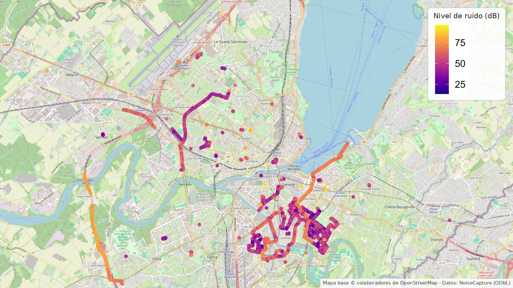

# Estructura espacial del ruido urbano

[English](README.md) | **Español**

¿Se pueden inferir las dinámicas del tránsito urbano a partir de la estructura
espacial de los niveles de ruido? Este proyecto analiza mediciones
colaborativas de NoiseCapture en Ginebra (Suiza) y Gandhinagar (India), de día
y de noche. Además de describir los patrones espaciales, evalúa cuánto
dependen de los recorridos con que se midió, qué se mantiene al modelar esa
estructura y qué se puede anticipar fuera de la muestra.

*Mediciones de NoiseCapture en Ginebra, coloreadas por nivel de ruido.*

## En resumen

- **Los patrones de los mapas dependen mucho de los recorridos.** Entre el 62%
  y el 77% de la variación del nivel está entre recorridos, y el R² local y la
  autocorrelación de los residuos reflejan en buena parte esa estructura. En
  Gandhinagar, el GWR asocia diferencias de 10 a 14 dB con el rumbo; en los
  modelos que separan los recorridos, esas diferencias son mucho menores (de
  1 a 6 dB) y su magnitud depende de cómo se represente esa estructura. En
  Gandhinagar de noche, la asociación del rumbo dentro de los recorridos con
  correlación temporal depende del tratamiento de dos pares de registros con
  tiempos coincidentes.
- **Al incorporar una superficie espacial, la varianza estimada entre
  recorridos baja mucho más en Ginebra que en Gandhinagar.** En Ginebra baja
  entre un 45% y un 72%, aunque esa reducción depende del modelo y de cuánto se
  superponen los recorridos, y no identifica por separado cuánto corresponde al
  lugar y cuánto a las condiciones de medición. En Gandhinagar, los
  corrimientos por recorrido siguen en 10 a 12 dB y se asocian con la ganancia
  de calibración, lo que es compatible con diferencias de los dispositivos o de
  las condiciones de medición; allí, el nivel local del GWR se aparta del nivel
  de la superficie espacial en una mediana de 5 a 13 dB, casi todo por arrastre
  de esos corrimientos.
- **La velocidad se asocia con más ruido dentro de los recorridos en
  Gandhinagar y en Ginebra de noche** (0.45 a 0.7 dB por m/s), también con
  correlación temporal y, en Gandhinagar, dentro del rango de velocidades
  vehiculares. En Ginebra de día, medida mayormente a pie, la asociación
  positiva de los efectos fijos (1.5 dB por m/s con las mismas covariables)
  desaparece al modelar la correlación temporal (−0.02 ± 0.30), y tampoco
  aparece al incorporar el lugar ni entre los puntos del rango compatible con
  caminar. El fin de semana se compara casi exclusivamente entre
  recorridos distintos, y su estimación cambia mucho según qué se tenga en
  cuenta.
- **Las etiquetas son sensibles a los corrimientos estimados, y algunas
  ubicaciones tienen muy pocos recorridos para contrastarlas.** Sin los
  corrimientos, el acuerdo con las etiquetas originales es bajo (kappa de 0.2
  a 0.5), y de noche entre el 25% y el 30% de las ubicaciones tiene menos de
  dos recorridos efectivos. En Gandhinagar, la base estacionaria desaparece
  donde domina un solo recorrido y se sostiene donde aportan cuatro o más; en
  Ginebra no puede verificarse, porque casi no hay otros recorridos cerca. Más
  recorridos permiten contrastar una etiqueta, pero no garantizan que sea
  estable.
- **Los modelos describen la muestra, pero anticipan poco recorridos nuevos.**
  Para un recorrido nuevo, el error absoluto medio del GWR fue de 8.6 a
  12.3 dB, cerca del de la media (9.7 a 12.0 dB). Conocer el comienzo del
  recorrido baja mucho el error, pero ningún modelo mejora de forma clara al
  nivel medio de ese comienzo.
- **Las ciudades se midieron de forma distinta:** según las velocidades,
  mayormente en vehículo en Gandhinagar y a pie en Ginebra de día, así que la comparación se limita a la
  estructura espacial y temporal. Los resultados describen asociaciones, no
  efectos causales.

## Mapas interactivos

- [Gandhinagar: día](https://ca90m.github.io/urban-noise-spatial-analysis/gandhinagar_dia.html)
- [Gandhinagar: noche](https://ca90m.github.io/urban-noise-spatial-analysis/gandhinagar_noche.html)
- [Ginebra: día](https://ca90m.github.io/urban-noise-spatial-analysis/ginebra_dia.html)
- [Ginebra: noche](https://ca90m.github.io/urban-noise-spatial-analysis/ginebra_noche.html)

Los mapas son exploratorios: muestran el GWR principal (coeficientes locales,
residuos, etiquetas y efectos del fin de semana), y sus coeficientes mezclan
diferencias dentro de cada recorrido y entre recorridos. El
[análisis detallado](analisis-detallado.md) muestra cuánto queda de cada
efecto al separarlas. Se construyeron con leaflet en R, se abren en cualquier
navegador y permiten alternar entre español e inglés.

## Datos

Mediciones móviles de NoiseCapture ([Noise-Planet](https://noise-planet.org/),
UMRAE y Lab-STICC, distribuidas bajo
[ODbL](https://opendatacommons.org/licenses/odbl/)), tomadas con una aplicación
de Android: nivel sonoro, velocidad, rumbo, precisión del GPS y ganancia de
calibración del dispositivo. Cada medición pertenece a un recorrido. Los
registros se filtraron por calidad espaciotemporal y precisión, y las marcas de
tiempo se pasaron a hora local.

## Cómo se analizó

1. **Regresión geográficamente ponderada (GWR)**, con el rumbo en versión
   direccional (0–360°) y axial (0° ≡ 180°), después de verificar la
   dependencia espacial con el I de Moran y LISA. Con sus coeficientes se
   asignó una etiqueta operativa a cada ubicación.
2. **Calibración de los dispositivos:** corrección del sesgo según la ganancia
   y umbrales de anomalía por nivel de ganancia.
3. **Validación fuera de muestra**, dejando afuera recorridos completos, y
   calibración con el comienzo de cada recorrido.
4. **Modelos con estructura de recorridos:** jerárquico con varianza según la
   ganancia, efectos fijos y un modelo dentro-entre (Mundlak) con y sin
   correlación temporal.
5. **Número efectivo de recorridos** detrás de cada estimación local.
6. **Modelo aditivo espacial con efecto de recorrido**, que separa una
   superficie espacial del corrimiento de cada recorrido, y el GWR sin esos
   corrimientos; con variantes de solo la superficie de nivel y sin
   correlación temporal.
7. **Modo de medición:** pendientes de la velocidad, dentro de los recorridos,
   en los rangos compatibles con caminar y con ir en vehículo.
8. **Sensibilidad a la codificación del rumbo** en Gandhinagar de noche, donde
   el criterio de selección y el AICc eligen versiones distintas.

Las ecuaciones, todas las tablas y las limitaciones están en el
[análisis detallado](analisis-detallado.md).

## Resultados principales

**Cuánto pesan los recorridos.**

| | Variación entre recorridos | Rumbo: mapas → sin corrimientos (amplitud mediana) | Velocidad dentro de los recorridos (dB por m/s) |
|---|---|---|---|
| Gandhinagar, día | 77% | 4.9 → 1.7 dB | 0.56 (0.04) |
| Gandhinagar, noche | 74% | 7.1 → 3.0 dB | 0.68 (0.06) |
| Ginebra, día | 62% | 1.6 → 1.8 dB | −0.02 (0.30) |
| Ginebra, noche | 64% | 2.6 → 2.6 dB | 0.70 (0.13) |

La amplitud es la mitad de la diferencia entre el rumbo más ruidoso y el más
silencioso: 4.9 y 7.1 dB equivalen a las diferencias de 10 a 14 dB de los
mapas. La velocidad corresponde al modelo dentro-entre con correlación
temporal; entre paréntesis, el error estándar. En Gandhinagar de noche, con una
separación de 2 s según el GPS para dos pares de registros con tiempos
coincidentes, es 0.59.

**Superficie espacial y corrimientos.**

| | Desvío de los corrimientos: sin → con lugar | Reducción de su varianza | Corrimiento y ganancia (Spearman) | $\kappa$ de las etiquetas sin corrimientos |
|---|---|---|---|---|
| Gandhinagar, día | 12.4 → 11.9 dB | 7% | 0.59 | 0.22 |
| Gandhinagar, noche | 10.2 → 10.4 dB | ninguna | 0.57 | 0.25 |
| Ginebra, día | 9.9 → 5.2 dB | 72% | 0.01 | 0.20 |
| Ginebra, noche | 10.0 → 7.4 dB | 45% | 0.15 | 0.47 |

El kappa compara las etiquetas originales con las recalculadas tras restar los
corrimientos estimados de cada recorrido; 1 sería acuerdo total y 0, el acuerdo
esperable por azar.

**Predicción.** Error absoluto medio, en dB, en dos escenarios distintos:

| | Recorrido nuevo: GWR | Recorrido nuevo: media | Con su comienzo: intercepto aleatorio | Con su comienzo: nivel medio del comienzo |
|---|---|---|---|---|
| Gandhinagar, día | 8.6 | 9.7 | 4.5 | 4.6 |
| Gandhinagar, noche | 11.7 | 12.0 | 5.6 | 5.9 |
| Ginebra, día | 10.9 | 11.0 | 7.4 | 7.3 |
| Ginebra, noche | 12.3 | 11.9 | 7.3 | 7.1 |

En el primer escenario se predicen recorridos que no participaron del ajuste.
En el segundo, el primer 20% de las observaciones de cada uno de esos
recorridos, en orden temporal, se usa para estimar su corrimiento, y el error
se mide en el resto. El intercepto aleatorio es un modelo con un nivel propio
por recorrido y varianza residual común. Ahí ningún modelo
mejora de forma significativa al nivel medio del comienzo (prueba de Wilcoxon
pareada, p ≥ 0.10), y el GWR calibrado queda peor (7.9 a 11.7 dB).

## Conclusión

Los patrones espaciales de los mapas fueron sensibles a la estructura de
recorridos y no se tradujeron en una ventaja predictiva consistente para
recorridos nuevos. La asociación con la velocidad y, en menor medida, la del
rumbo se mantuvieron al representar esa estructura, pero con magnitudes menores, que
dependen de cómo se la represente, y sin poder atribuirlas exclusivamente al
tránsito, al dispositivo o a la forma de medir. Donde un lugar fue medido por
uno o dos recorridos, no puede separarse la calle del recorrido.

## Limitaciones principales

- Las ciudades se midieron de forma distinta, así que no puede separarse cuánto
  de sus diferencias corresponde a la ciudad y cuánto al modo de medición.
- Los corrimientos estimados recogen todo lo propio de cada recorrido
  (dispositivo, forma de llevarlo, momento, modo y, sin superficie espacial,
  también el lugar); no son un error instrumental identificado por separado.
- La separación entre lugar y recorrido se apoya en los cruces entre
  recorridos: solo entre el 21% y el 44% de los puntos tiene otro recorrido a
  menos de 50 m.
- Los errores estándar locales del GWR tratan cada punto como independiente,
  así que $\lvert z \rvert \ge 2$ señala ubicaciones que merecen atención, no
  pruebas de significación.
- En Gandhinagar de noche, el efecto del rumbo dentro de los recorridos con
  correlación temporal no es robusto: con una separación de 2 s según el GPS
  para dos pares de registros con tiempos coincidentes, deja de distinguirse
  de cero (p = 0.63). Los modelos sin correlación temporal sí lo muestran.
- En Gandhinagar de noche, las etiquetas del mapa dependen de cómo se codifica
  el rumbo: con la versión direccional, que prefiere el AICc, coinciden en el
  55% de las ubicaciones. Las conclusiones agregadas no cambian.

La lista completa está en el
[análisis detallado](analisis-detallado.md#limitaciones).

## Contenido

- `README.md` y `README.es.md`: esta portada, en inglés y en español.
- `detailed-analysis.md` y `analisis-detallado.md`: metodología, tablas,
  interpretación, limitaciones y referencias.
- `*.html`: mapas interactivos autocontenidos.
- `figures/`: gráficos.

## Autores

Análisis y mapas de este repositorio: Cristian Antonio.
Parte de un trabajo final de la materia Estadística Espacial de la
Universidad de Buenos Aires (2025), realizado junto con Ezequiel Grenat.

## Licencia de los datos

Datos de ruido del proyecto NoiseCapture (Noise-Planet, UMRAE y Lab-STICC),
utilizados bajo la Open Database License (ODbL).
