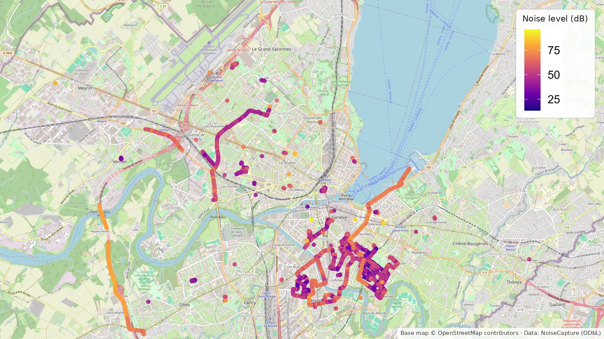

# Spatial structure of urban noise

**English** | [Español](README.es.md)

Can urban traffic dynamics be inferred from the spatial structure of noise
levels? To address this question, this project analyses crowdsourced
NoiseCapture measurements from Geneva (Switzerland) and Gandhinagar (India),
split into day and night. Beyond describing spatial patterns, it assesses how
much they depend on the tracks used for measuring, what holds once that
structure is modelled, and what can be anticipated out of sample.

*NoiseCapture measurements in Geneva, coloured by noise level.*

## Summary

The starting point was a geographically weighted regression (GWR) describing
how the association of sound level with speed and heading changes across
space. Models were then added that take into account that each measurement
belongs to a track, and therefore to a particular device, way of measuring and
moment.

The results show that a large part of the patterns on the maps depends on the
tracks. Between 62% and 77% of the variation in level lies between tracks, and
local R² and residual autocorrelation largely reflect that structure. In
Gandhinagar, GWR associates differences of 10 to 14 dB with heading, but in
models that separate tracks those differences fall to between 1 and 6 dB,
depending on how that structure is represented. In nighttime Gandhinagar, the
within-track heading association with temporal correlation also depends on how
two pairs of records with coincident times are handled, so it is not
considered robust.

Speed, by contrast, is associated with more noise within tracks in Gandhinagar
and in nighttime Geneva, with slopes of 0.45 to 0.7 dB per m/s. In Gandhinagar
the association also holds among points in the vehicular speed range. In
daytime Geneva, measured mostly on foot, the positive fixed-effects slope
(1.5 dB per m/s) vanishes once temporal correlation is included
(−0.02 ± 0.30), and it does not appear when place is added or among points in
the walking-compatible range either. The weekend, for its part, is compared
almost exclusively across different tracks, and its estimate changes a lot
depending on what is taken into account.

When a spatial surface is added, the estimated variance between tracks falls
by 45% to 72% in Geneva but barely changes in Gandhinagar. There, the level
offsets of each track remain at 10 to 12 dB and are associated with
calibration gain, which is consistent with differences between devices or
measurement conditions. In fact, in Gandhinagar the local GWR level departs
from the level of the spatial surface by a median of 5 to 13 dB, and almost
all of that difference is carry-over from the offsets. The reduction observed
in Geneva depends on the model and on how much tracks overlap, so it does not
separately indicate which part belongs to place and which to measurement.

Area labels are also sensitive to the estimated offsets. Once they are
removed, agreement with the original labels is low (kappa of 0.2 to 0.5), and
at night 25% to 30% of locations have fewer than two effective tracks to check
them against. In Gandhinagar, the stationary base disappears where a single
track dominates and holds where four or more contribute, whereas in Geneva it
cannot be checked because there are hardly any other tracks nearby. In other
words, more tracks make it possible to check a label, but do not guarantee
that it is stable.

Out of sample, GWR showed no consistent advantage. For a new track, its mean
absolute error was 8.6 to 12.3 dB, close to what the mean achieves (9.7 to
12.0 dB). Knowing the start of the track reduces the error substantially, but
no model showed a clear advantage over the mean level of that start. Finally,
since the two cities were measured differently (mostly from vehicles in
Gandhinagar and on foot in daytime Geneva), comparisons between them are
limited to spatial and temporal structure, and the results are read as
associations, not causal effects.

## Interactive maps

- [Gandhinagar: day](https://ca90m.github.io/urban-noise-spatial-analysis/gandhinagar_dia.html)
- [Gandhinagar: night](https://ca90m.github.io/urban-noise-spatial-analysis/gandhinagar_noche.html)
- [Geneva: day](https://ca90m.github.io/urban-noise-spatial-analysis/ginebra_dia.html)
- [Geneva: night](https://ca90m.github.io/urban-noise-spatial-analysis/ginebra_noche.html)

The maps are exploratory. They show the main GWR, that is, its local
coefficients, residuals, labels and weekend effects, and those coefficients mix
differences within each track and between tracks. The
[detailed analysis](detailed-analysis.md) shows how much of each effect
remains once they are separated. The maps were built with leaflet in R, open
in any browser and can switch between English and Spanish.

## Data

The data are mobile NoiseCapture measurements
([Noise-Planet](https://noise-planet.org/), UMRAE and Lab-STICC, distributed
under [ODbL](https://opendatacommons.org/licenses/odbl/)), taken with an
Android app. Each measurement includes sound level, speed, heading, GPS
accuracy and device calibration gain, and belongs to a track. Records were
filtered by spatiotemporal quality and accuracy, and timestamps were converted
to local time.

## How it was analysed

The analysis went through several stages:

1. A geographically weighted regression (GWR) was fitted with heading in two
   versions, directional (0–360°) and axial (0° ≡ 180°), after checking
   spatial dependence with Moran's I and LISA. Its coefficients were used to
   assign an operational label to each location.
2. The bias associated with device calibration gain was corrected, and anomaly
   thresholds were set by gain level.
3. The model was validated out of sample by leaving out whole tracks, and the
   gain from knowing the start of each track was assessed.
4. Models with track structure were estimated: a hierarchical model with
   gain-dependent variance, fixed effects, and a within-between (Mundlak) model
   with and without temporal correlation.
5. The effective number of tracks behind each local estimate was computed.
6. A spatial additive model with a track effect was fitted, which separates a
   spatial surface from each track's offset, together with GWR without those
   offsets and variants with only the level surface and without temporal
   correlation.
7. Within-track speed slopes were estimated in the ranges consistent with
   walking and with travelling in a vehicle.
8. In nighttime Gandhinagar, where the selection criterion and AICc choose
   different heading versions, the analysis was repeated with the directional
   version as a sensitivity check.

Equations, all tables and limitations can be found in the
[detailed analysis](detailed-analysis.md).

## Main results

The following table summarizes how much the tracks weigh in each case.

| | Variation between tracks | Heading: maps → without offsets (median amplitude) | Speed within tracks (dB per m/s) |
|---|---|---|---|
| Gandhinagar, day | 77% | 4.9 → 1.7 dB | 0.56 (0.04) |
| Gandhinagar, night | 74% | 7.1 → 3.0 dB | 0.68 (0.06) |
| Geneva, day | 62% | 1.6 → 1.8 dB | −0.02 (0.30) |
| Geneva, night | 64% | 2.6 → 2.6 dB | 0.70 (0.13) |

The amplitude is half the difference between the loudest and the quietest
heading, so 4.9 and 7.1 dB correspond to the 10 to 14 dB differences on the
maps. Speed comes from the within-between model with temporal correlation,
with the standard error in parentheses. In nighttime Gandhinagar, if the two
pairs of records with coincident times are separated by 2 s according to the
GPS, the slope is 0.59.

The second table shows what happens to the track offsets when a spatial
surface is added.

| | Offset standard deviation: without → with place | Reduction in its variance | Offset and gain (Spearman) | $\kappa$ of labels without offsets |
|---|---|---|---|---|
| Gandhinagar, day | 12.4 → 11.9 dB | 7% | 0.59 | 0.22 |
| Gandhinagar, night | 10.2 → 10.4 dB | none | 0.57 | 0.25 |
| Geneva, day | 9.9 → 5.2 dB | 72% | 0.01 | 0.20 |
| Geneva, night | 10.0 → 7.4 dB | 45% | 0.15 | 0.47 |

Kappa compares the original labels with those obtained after removing each
track's estimated offset. A value of 1 would indicate full agreement and 0 the
agreement expected by chance.

Finally, the validation evaluates the mean absolute error, in dB, in two
different scenarios.

| | New track: GWR | New track: mean | Given its start: random intercept | Given its start: mean level of the start |
|---|---|---|---|---|
| Gandhinagar, day | 8.6 | 9.7 | 4.5 | 4.6 |
| Gandhinagar, night | 11.7 | 12.0 | 5.6 | 5.9 |
| Geneva, day | 10.9 | 11.0 | 7.4 | 7.3 |
| Geneva, night | 12.3 | 11.9 | 7.3 | 7.1 |

The first scenario predicts tracks left out of the fit. In the second, the
first 20% of the observations of each of those tracks, in time order, is used
to estimate its offset, and the error is measured on the rest. The random
intercept is a model with its own level per track and a common residual
variance. In this second scenario no model improves significantly on the mean
level of the start (paired Wilcoxon test, p ≥ 0.10), and calibrated GWR does
worse than the rest (7.9 to 11.7 dB).

## Conclusion

Overall, the spatial patterns on the maps turned out to be sensitive to the
track structure and did not translate into a consistent predictive advantage
for new tracks. The association with speed and, to a lesser extent, with
heading held once that structure was represented, although with smaller
magnitudes that depend on how it is represented. Moreover, they cannot be
attributed exclusively to traffic, the device or the way of measuring. Where a
place was measured by one or two tracks, the street cannot be separated from
the track.

## Main limitations

- The cities were measured differently, so the share of their differences due
  to the city rather than the measurement mode cannot be separated.
- The estimated offsets capture everything specific to each track (device,
  how it was carried, timing, mode and, without a spatial surface, place too).
  They are not a separately identified instrumental error.
- Separating place from track relies on crossings between tracks, and only 21%
  to 44% of points have another track within 50 m.
- GWR local standard errors treat every point as independent. For this
  reason, $\lvert z \rvert \ge 2$ flags locations worth attention, but it is
  not a significance test.
- In nighttime Gandhinagar, the within-track heading effect with temporal
  correlation is not robust. If two pairs of records with coincident times are
  separated by 2 s according to the GPS, it is no longer distinguishable from
  zero (p = 0.63), although models without temporal correlation do show it.
- In nighttime Gandhinagar, the labels on the map depend on how heading is
  encoded. With the directional version, which is the one AICc prefers, they
  agree at 55% of locations, although the aggregate conclusions do not change.

The full list can be found in the
[detailed analysis](detailed-analysis.md#limitations).

## Contents

- `README.md` and `README.es.md`: this front page, in English and Spanish.
- `detailed-analysis.md` and `analisis-detallado.md`: methodology, tables,
  interpretation, limitations and references.
- `*.html`: self-contained interactive maps.
- `figures/`: charts.

## Authors

Analysis and maps in this repository: Cristian Antonio.
Part of a final project for the Spatial Statistics course at the
University of Buenos Aires (2025), carried out with Ezequiel Grenat.

## Data licence

Noise data from the NoiseCapture project (Noise-Planet, UMRAE and Lab-STICC),
used under the Open Database License (ODbL).
