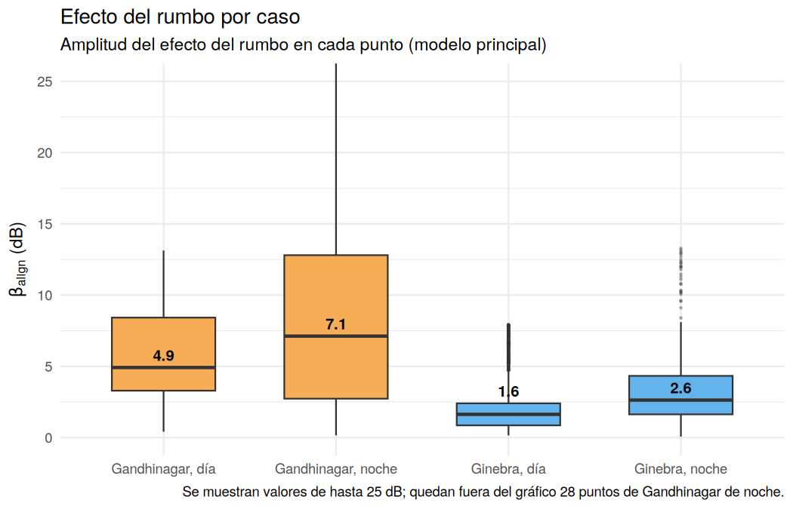
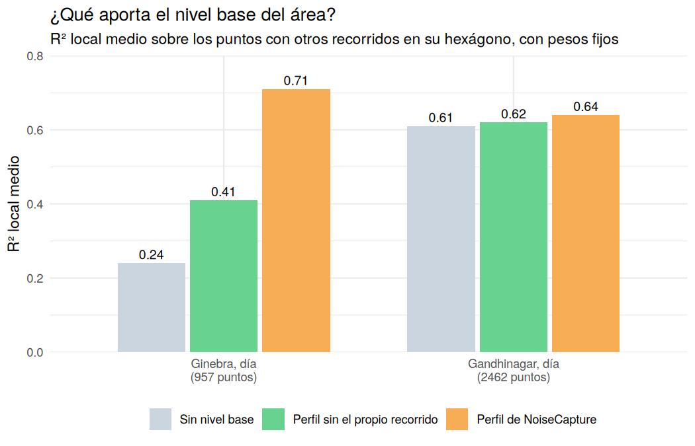
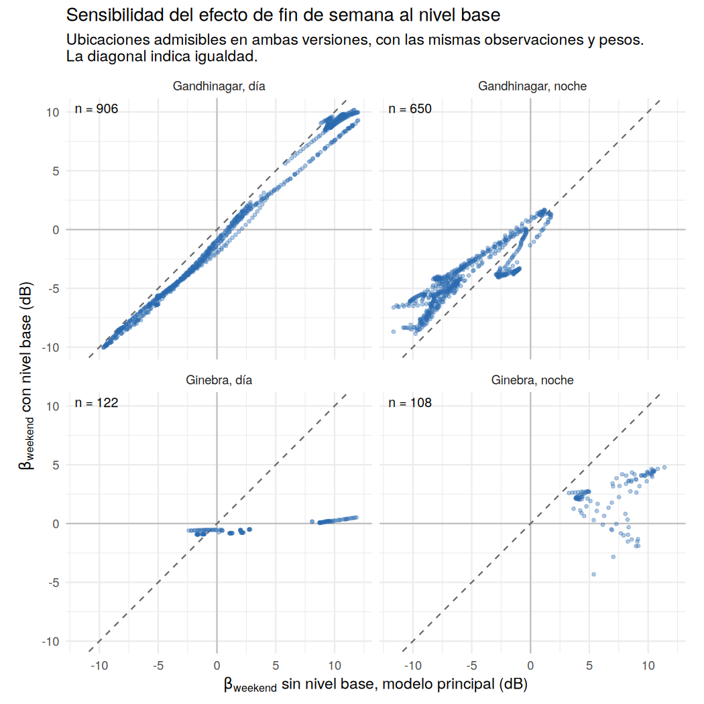
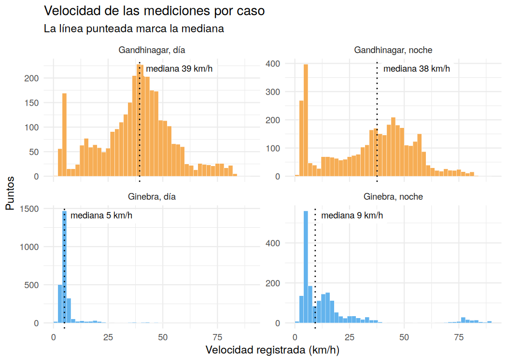

# Estructura espacial del ruido urbano: análisis detallado

[English](detailed-analysis.md) | **Español** · [Volver a la portada](README.es.md)

Este documento reúne la metodología, todas las tablas, la interpretación y las
limitaciones. El resumen, los mapas interactivos y las conclusiones están en la
[portada](README.es.md).

## Datos

Mediciones móviles de ruido con nivel sonoro, velocidad, rumbo, precisión del
GPS y ganancia de calibración del dispositivo, provenientes del conjunto de
datos colaborativo NoiseCapture ([Noise-Planet](https://noise-planet.org/),
UMRAE y Lab-STICC, distribuido bajo
[ODbL](https://opendatacommons.org/licenses/odbl/)). Las mediciones se obtienen
mediante una aplicación de Android, lo que explica la amplia dispersión en la
ganancia de calibración de los dispositivos. Los datos tienen una estructura
jerárquica: las muestras pertenecen a recorridos, y los recorridos a áreas
urbanas. Los registros se filtraron con criterios de calidad espaciotemporal y
umbrales de precisión, y las marcas de tiempo se convirtieron a la hora local.

## Metodología

**Dependencia espacial.** El índice I de Moran y los indicadores LISA mostraron
autocorrelación espacial global y agrupamientos locales en los niveles de
ruido. Se utilizó GWR para explorar cómo variaban las asociaciones con la
velocidad y la dirección del movimiento dentro de las áreas de estudio.

**Regresión local.** Se aplicó regresión geográficamente ponderada (GWR) con
dos representaciones del rumbo: direccional (0–360°), que distingue sentidos
opuestos, y axial (0° ≡ 180°), que los considera equivalentes. La comparación
buscó evaluar si el nivel de ruido se asociaba principalmente con el eje del
desplazamiento o si distinguir su sentido aportaba información.

La geometría de las calles y las reflexiones del sonido entre fachadas
motivaron considerar patrones asociados con el eje de circulación. A su vez,
las diferencias de exposición a las fuentes y la emisión desigual de sonido
según la dirección podrían generar diferencias entre sentidos. También se
consideró el posible papel del efecto Doppler, ligado al movimiento relativo
entre fuente y receptor y al cambio en la frecuencia recibida.

El rumbo registrado corresponde al desplazamiento de quien mide y no
identifica directamente la dirección de llegada del sonido. Por eso, la
comparación permite evaluar qué representación del rumbo resulta más útil,
aunque las diferencias de ajuste no permiten identificar por sí solas los
mecanismos físicos que originan los patrones observados.

**Especificación del modelo.** Para cada medición $i$, tomada en la ubicación
$u_i$, el nivel de ruido $L_i$ (dB) se modela como:

```math
\begin{aligned}
L_i ={}& \beta_0(u_i) + \beta_{\text{speed}}(u_i)\,v_i
       + \beta_{\cos}(u_i)\,\tilde c_i + \beta_{\sin}(u_i)\,\tilde s_i
       + v_i\big[\gamma_{\cos}(u_i)\,\tilde c_i + \gamma_{\sin}(u_i)\,\tilde s_i\big] \\
      &+ \beta_{\text{hs}}(u_i)\,h^s_i + \beta_{\text{hc}}(u_i)\,h^c_i
       + \beta_{\text{count}}(u_i)\,m_i
       + \beta_{\text{weekend}}(u_i)\,w_i + \varepsilon_i
\end{aligned}
```

Todos los coeficientes dependen de la ubicación: GWR los estima en cada punto,
con más peso para las observaciones cercanas. $v_i$ es la velocidad
estandarizada. $\tilde c_i$ y $\tilde s_i$ son el coseno y el seno del rumbo
$\theta_i$, centrados en su media. En el modelo direccional se usan
$\cos\theta_i$ y $\sin\theta_i$; en el axial, $\cos 2\theta_i$ y
$\sin 2\theta_i$, que valen lo mismo para $\theta$ y $\theta + 180^\circ$. Por
eso el modelo axial no distingue sentidos opuestos. El término entre corchetes
permite que el efecto del rumbo cambie con la velocidad.

Los demás términos son controles. $h^c_i$ y $h^s_i$ representan la hora como
coseno y seno de $2\pi \cdot \text{hora}_i / 24$, de modo que las 23 h y las
0 h quedan cerca. El seno entra residualizado: se reemplaza por el residuo de
su regresión lineal sobre el coseno (es decir, se ortogonaliza). Es solo una
reparametrización: el ajuste y los residuos no cambian. $m_i$ es el logaritmo
de uno más la cantidad de mediciones del área de NoiseCapture en la que cae el
punto, estandarizado. $w_i$ es el indicador de fin de semana, centrado.

Cada coeficiente se lee así:

| Coeficiente | Qué mide |
|---|---|
| $\beta_0$ | Nivel base del lugar: el nivel esperado a velocidad media, con las demás variables en su valor de referencia. En los mapas se muestra trasladado a velocidad nula. |
| $\beta_{\text{speed}}$ | Cuántos dB cambia el nivel por cada desvío estándar de velocidad, promediando sobre los rumbos. En los mapas se expresa en dB por m/s. |
| $\beta_{\cos}$, $\beta_{\sin}$ | Efecto del rumbo a velocidad media. En el modelo direccional, $\beta_{\cos}$ compara el desplazamiento hacia el norte con el desplazamiento hacia el sur, y $\beta_{\sin}$, hacia el este con hacia el oeste. En el axial, $\beta_{\cos}$ compara el eje norte-sur con el eje este-oeste, y $\beta_{\sin}$, el eje noreste-suroeste con el eje noroeste-sureste. En todos los casos, la diferencia entre ambos es el doble del coeficiente, y un valor positivo indica más ruido en el primero. Por separado dependen de cómo se orientan los ejes; por eso se resumen en $\beta_{\text{align}}$. |
| $\gamma_{\cos}$, $\gamma_{\sin}$ | Cuánto cambia el efecto del rumbo por cada desvío estándar de velocidad. Visto al revés, indican si el efecto de la velocidad depende del rumbo. |
| $\beta_{\text{hc}}$, $\beta_{\text{hs}}$ | Describen conjuntamente la variación horaria del nivel dentro de cada franja (día, de 7 a 19 h; noche, de 19 a 7 h) mediante términos coseno y seno. |
| $\beta_{\text{count}}$ | dB por cada desvío estándar del logaritmo de la cantidad de mediciones del área. Funciona sobre todo como control de la intensidad de muestreo, sin una lectura física directa. |
| $\beta_{\text{weekend}}$ | Diferencia local de nivel entre fines de semana y días hábiles, en dB, ajustada por velocidad, rumbo, hora y cantidad de mediciones. |
| $\beta_{\text{align}}$ | Amplitud del efecto del rumbo, en dB. Se detalla más abajo. |

Ambas variantes tienen los mismos términos y difieren solo en cómo codifican el
rumbo. El ancho de banda es adaptativo y se eligió por AICc, junto con el
kernel (gaussiano o bicuadrado). Entre las dos variantes se eligió la de mayor
R² local medio; ante un empate, la de menor AICc. En tres casos los dos
criterios eligen lo mismo. En Gandhinagar de noche, el R² local medio favorece
la versión axial por 0.003 y el AICc, la direccional por 32 puntos; la versión
direccional se analiza como sensibilidad (ver *Sensibilidad a la codificación
del rumbo*).

**Nivel base del área: evaluado y excluido del modelo principal.** NoiseCapture
publica, para cada hexágono de 15 m de radio, un perfil horario del nivel
sonoro (la mediana, LA50, de cada hora en días hábiles, sábados y domingos).
Ese perfil podría servir como control del contexto del lugar, pero se calcula
con las mismas mediciones colaborativas que se modelan. Para evaluar cuánto
dependía el ajuste de las mediciones del propio recorrido, se calculó un
perfil alternativo a partir de los puntos crudos: para cada punto, la mediana
de su hexágono, hora y tipo de día, excluyendo todas las mediciones de su mismo
recorrido. Cuando no había mediciones de otros recorridos en esa combinación de
hora y tipo de día, se utilizó la mediana general del hexágono, también
excluyendo el recorrido evaluado. Se compararon tres versiones del modelo
sobre las mismas observaciones y con los mismos pesos: sin nivel base, con el
perfil sin el propio recorrido y con el perfil de NoiseCapture. Los resultados
(ver Resultados) llevaron a excluirlo del modelo principal. La versión con el
perfil de NoiseCapture se conserva como análisis de sensibilidad, con las
mismas observaciones, la misma codificación del rumbo y los mismos pesos
espaciales que el modelo principal.

**Coeficiente de alineación.** El efecto del rumbo se resume en un solo valor
por ubicación:

```math
\beta_{\text{align}}(u) = \sqrt{\beta_{\cos}(u)^2 + \beta_{\sin}(u)^2}
```

A velocidad media, el término de rumbo es una onda de amplitud
$\beta_{\text{align}}$, con período de 360° en el modelo direccional y de 180°
en el axial. Según el rumbo, el nivel sube o baja hasta esa cantidad de dB, y
la diferencia entre el rumbo más ruidoso y el más silencioso es el doble. Por
construcción, el coeficiente nunca es negativo. Como resume coeficientes
estimados, puede presentar sesgo al alza por el error de estimación, sobre todo
donde sus componentes están poco determinados, y no es una cota superior del
efecto. Con $\hat{\mathbf b} = (\hat\beta_{\cos}, \hat\beta_{\sin})$, la
desigualdad de Jensen da $E\lVert\hat{\mathbf b}\rVert \ge \lVert E[\hat{\mathbf b}]\rVert$,
que es la amplitud verdadera solo si los componentes estimados son
insesgados.

**Tratamiento de la calibración de los dispositivos.** Los recorridos no son
una agrupación útil para representar el contexto del lugar, porque las
muestras de un mismo recorrido pueden estar alejadas en el espacio y en el
tiempo; sí lo son para representar las condiciones de medición, como se hace
en el modelo jerárquico descrito más abajo. La
ganancia de calibración, en cambio, es una propiedad del dispositivo, y la
magnitud de los residuos $r_i$ varió con ella. Para evaluarlo se modeló
$\log r_i^2$ en función de la ganancia: con un GAM en Gandhinagar y con un
ANOVA en Ginebra, donde la ganancia toma pocos valores. Como se mide respecto
de cero, esa magnitud refleja tanto la dispersión como el sesgo de los
residuos. En Gandhinagar de día la relación fue significativa (p < 2e-16): la
magnitud típica de los residuos en el percentil 95 de ganancia fue unas 1.36
veces la del percentil 5. En Ginebra de día también lo fue (p < 2e-16), pero en
sentido inverso (0.71).

Esto se trató en dos pasos. Primero, un LOESS robusto $\hat b(g)$ de los
residuos en función de la ganancia permitió estimar un sesgo, que se restó
antes de volver a centrar los residuos:

```math
r^{\text{db}}_i = r_i - \hat b(g_i) - \mathrm{mediana}\big(r - \hat b(g)\big)
```

Segundo, como la varianza seguía difiriendo según la ganancia, se calcularon
umbrales de anomalía para cada intervalo de ganancia $k$ (≤ −20, −20 a −15,
−15 a −12 y > −12 dB) a partir de la distribución local de los residuos:

```math
U_k = \max\big\{\,5\ \text{dB},\ \mathrm{P}_{95}\big(|r^{\text{db}}| \text{ en el intervalo } k\big)\big\}
```

Los intervalos con menos de 100 puntos usan el percentil 95 global. Un punto
se marca como anómalo si supera el umbral de su intervalo y, además, forma
parte de un agrupamiento alto-alto de LISA sobre $\lvert r^{\text{db}} \rvert$ (4 vecinos
más cercanos, α = 0.05, con el residuo y el promedio de los vecinos por encima
de 5 dB). Así, los errores aislados quedan fuera y se retienen las zonas donde
el modelo falla de forma sostenida.

**Modelo jerárquico con varianza según la calibración.** Las mediciones están
anidadas en recorridos: la medición $i$ pertenece al recorrido $j$. Cada
recorrido tiene condiciones propias que no cambian a lo largo del trayecto,
como el dispositivo, su calibración, la forma de llevar el teléfono o el día,
y la magnitud de los residuos varía con la ganancia. Para separar los efectos
que ocurren dentro de un mismo recorrido de las diferencias entre recorridos,
se ajustó un modelo global con un intercepto aleatorio por recorrido y una
varianza distinta por grupo de ganancia, con los mismos puntos y términos que
el modelo principal:

```math
\begin{aligned}
L_{ij} &= \beta_0 + \mathbf{x}_{ij}^\top \boldsymbol\beta + \beta_{\text{weekend}}\, w_{ij} + u_j + \varepsilon_{ij} \\
u_j &\sim N(0, \tau^2), \qquad \varepsilon_{ij} \sim N\big(0, \sigma^2_{g(j)}\big)
\end{aligned}
```

$\mathbf{x}_{ij}$ reúne la velocidad, el rumbo, sus interacciones, la hora y la
cantidad de mediciones del área. $u_j$ es el corrimiento de nivel del recorrido
$j$, es decir, cuánto mide por encima o por debajo de lo esperado, y
$g(j)$ es su grupo de ganancia: cada valor observado en Ginebra, donde hay
pocos, y los cuartiles en Gandhinagar. La varianza por grupo se evaluó con una
prueba de razón de verosimilitud contra el modelo con varianza común.

El modelo jerárquico supone que $u_j$ no está correlacionado con las
variables. Como verificación, se estimó también un modelo de efectos fijos por
recorrido, que no hace ese supuesto: a cada variable se le resta la media de su
recorrido, de modo que los coeficientes se estiman solo con la variación
dentro de cada recorrido:

```math
L_{ij} - \bar L_j = (\mathbf{x}_{ij} - \bar{\mathbf{x}}_j)^\top \boldsymbol\beta + (\varepsilon_{ij} - \bar\varepsilon_j)
```

Se ajusta por mínimos cuadrados ponderados, con pesos $1/\hat\sigma^2_{g(j)}$ y
errores estándar robustos por recorrido. Los términos constantes dentro de un
recorrido desaparecen: el fin de semana no se incluye, porque casi todos los
recorridos ocurren en un único tipo de día, y la hora casi no varía dentro de
un recorrido, por lo que tampoco se incluye. Ambos modelos se comparan con la
regresión global sin estructura de recorridos. Por último, se repitió el GWR
con las variables centradas por recorrido y los mismos pesos espaciales que el
modelo principal, para comparar los mapas de $\beta_{\text{align}}$. Es un
análisis de sensibilidad: quita el corrimiento constante de cada recorrido,
pero no equivale a incluir efectos fijos de recorrido en cada regresión local,
que requeriría centrar cada recorrido con los pesos locales.

**Modelo dentro-entre con correlación temporal.** Los modelos anteriores
estiman un solo coeficiente por variable y suponen que, dado el nivel de cada
recorrido, sus puntos son independientes. Para separar en una misma ecuación
el efecto dentro de los recorridos del efecto entre recorridos, se ajustó el
modelo dentro-entre (Mundlak, 1978; Bell y Jones, 2015). Cada variable se
divide en su desvío respecto de la media del recorrido y esa media:

```math
\begin{aligned}
L_{ij} &= \beta_0 + (\mathbf{x}_{ij} - \bar{\mathbf{x}}_j)^\top \boldsymbol\beta_W + \bar{\mathbf{x}}_j^\top \boldsymbol\beta_B + \beta_{\text{weekend}}\, w_{ij} + u_j + \varepsilon_{ij} \\
u_j &\sim N(0, \tau^2), \qquad \varepsilon_{ij} \sim N\big(0, \sigma^2_{g(j)}\big), \qquad \mathrm{Corr}(\varepsilon_{ij}, \varepsilon_{kj}) = \phi^{\,|t_{ij} - t_{kj}|}
\end{aligned}
```

$\boldsymbol\beta_W$ se estima con la variación dentro de cada recorrido, con
el mismo dispositivo y la misma calibración, como en el modelo de efectos
fijos. $\boldsymbol\beta_B$ se estima con las diferencias entre las medias de
los recorridos. $t_{ij}$ es el tiempo en segundos desde el comienzo del
recorrido: los errores siguen un proceso autorregresivo de orden 1 en tiempo
continuo (Pinheiro y Bates, 2000), de modo que dos mediciones separadas por
10 s tienen correlación $\phi^{10}$. La varianza por grupo de ganancia es la
misma que en el modelo jerárquico. Las interacciones se dividen después de
multiplicar. El fin de semana entra como un solo término y se estima
fundamentalmente entre recorridos, porque casi todos ocurren en un único tipo
de día. La excepción es el recorrido 567120 de Gandhinagar, que cruza la
medianoche del domingo 29 al lunes 30 de septiembre de 2024: de sus 15
observaciones retenidas, 10 son de fin de semana y 5 de día hábil. Un solo
recorrido no alcanza para estimar con precisión un efecto del fin de semana
dentro de los recorridos.

El mismo modelo se ajustó también sin la correlación temporal, con las mismas
observaciones, términos, grupos de ganancia e intercepto aleatorio, para
aislar el efecto de la correlación. Sin ella, y con la varianza constante
dentro de cada recorrido, la parte dentro coincide exactamente con efectos
fijos ponderados por las varianzas estimadas en ese ajuste, lo que sirve para
comprobar la implementación. La igualdad exige incluir en el control la parte
centrada de toda variable que varíe dentro de algún recorrido, también la del
fin de semana en el recorrido que cruza del domingo al lunes:

```math
\hat{\boldsymbol\beta}_W = \arg\min_{\boldsymbol\beta}\ \sum_j \frac{1}{\hat\sigma^2_{g(j)}} \sum_{i \in j} \Big[(L_{ij} - \bar L_j) - (\mathbf{x}_{ij} - \bar{\mathbf{x}}_j)^\top \boldsymbol\beta\Big]^2
```

Cada ajuste de nlme se registró con sus avisos, y un ajuste sin convergencia
no se habría usado; todos convergieron con el optimizador por defecto.

Con esta correlación, el estimador da más peso a los cambios entre mediciones
cercanas en el tiempo. Si la correlación entre mediciones consecutivas es
$\rho$, equivale aproximadamente a ajustar

```math
L_{ij} - \rho\, L_{i-1,j} = (\mathbf{x}_{ij} - \rho\, \mathbf{x}_{i-1,j})^\top \boldsymbol\beta + \eta_{ij}
```

que, con $\rho$ cercano a 1, compara cada medición con la anterior. En tiempo
continuo, $\rho$ depende del intervalo real entre mediciones, así que la
equivalencia es solo aproximada. Por eso $\boldsymbol\beta_W$ da más peso a
los cambios entre mediciones cercanas, mientras que el modelo de efectos fijos
pondera por igual toda la variación dentro del recorrido. En la muestra, los
intervalos entre puntos consecutivos de un recorrido tienen una mediana de 3 a
6 s y un percentil 90 de 8 a 21 s, y entre el 1% y el 2.6% supera los 60 s.
En Gandhinagar de noche, dos pares de observaciones tienen la misma marca de
tiempo acústica; el código los separa en 0.001 s, y su influencia se evalúa en
*Sensibilidad del modelo temporal a dos registros con tiempos coincidentes*.

Para la velocidad y el rumbo se contrasta

```math
H_0:\ \beta_W = \beta_B
```

con una prueba de Wald. Si se rechaza, la asociación entre recorridos difiere
de la que se observa dentro de ellos, por ejemplo porque los recorridos
difieren también en dispositivo o en modo de medición. Es la versión de
Mundlak de la prueba de Hausman (1978). Para el rumbo, la prueba es conjunta sobre
sus cuatro términos (los dos de rumbo y sus interacciones con la velocidad), y
el efecto se resume con la amplitud a velocidad media, como
$\beta_{\text{align}}$.

**Número efectivo de recorridos.** Los coeficientes de cada ubicación se
estiman con los puntos cercanos, que pueden venir de muchos recorridos o de
uno solo. Para medirlo, se sumaron los pesos del GWR de cada recorrido $j$ en
la ubicación $u$ y se calculó el número efectivo de recorridos, una adaptación
del tamaño efectivo de muestra de Kish (1965):

```math
\omega_j(u) = \frac{\sum_{i \in j} w_i(u)}{\sum_i w_i(u)}, \qquad N_{\text{ef}}(u) = \frac{1}{\sum_j \omega_j(u)^2}
```

Vale 1 si todo el peso viene de un solo recorrido y $K$ si $K$ recorridos
pesan lo mismo. Si el modelo local tuviera solo intercepto, este sería un
promedio ponderado de los niveles y arrastraría los corrimientos de los
recorridos. Suponiendo corrimientos independientes con varianza $\tau^2$:

```math
\hat\beta_0(u) \approx \mu(u) + \sum_j \omega_j(u)\, u_j, \qquad \mathrm{Var}\Big(\sum_j \omega_j(u)\, u_j\Big) = \tau^2 \sum_j \omega_j(u)^2 = \frac{\tau^2}{N_{\text{ef}}(u)}
```

donde $\mu(u)$ es el nivel del lugar. El desvío $\tau/\sqrt{N_{\text{ef}}}$
se usa como indicador aproximado de la escala de variación que los
corrimientos de los recorridos pueden transmitir a un promedio local, con
$\tau$ estimado por el modelo jerárquico de cada caso. No es una cota ni el
error de cada ubicación: con covariables, la influencia de cada recorrido
depende también del diseño local y puede amplificarse si está mal
condicionado. El arrastre exacto se calcula con el modelo siguiente.

**Modelo espacial con efecto de recorrido.** Para separar en una misma
ecuación el nivel del lugar del corrimiento de cada recorrido, se ajustó un
modelo aditivo generalizado (Wood, 2017) con superficies suaves en las
coordenadas y un efecto aleatorio por recorrido. Con $\mathbf{p}_{ij}$ la
posición de la medición:

```math
L_{ij} = a + f_0(\mathbf{p}_{ij}) + f_v(\mathbf{p}_{ij})\, v_{ij} + f_c(\mathbf{p}_{ij})\, \tilde c_{ij} + f_s(\mathbf{p}_{ij})\, \tilde s_{ij} + \mathbf{z}_{ij}^\top \boldsymbol\gamma + u_j + \varepsilon_{ij}, \qquad u_j \sim N(0, \tau^2)
```

$f_0$ es el componente espacial del nivel, ajustado por los corrimientos de
los recorridos, y $f_v$, $f_c$ y $f_s$
son los coeficientes de velocidad y rumbo que varían en el espacio, el
equivalente a los coeficientes locales del GWR. Cada superficie es una spline
de placa delgada cuya suavidad se elige por REML. $\mathbf{z}_{ij}$ reúne las
interacciones de velocidad y rumbo, la hora, la cantidad de mediciones del
área y el fin de semana, con efectos comunes a toda el área. Como en el modelo
dentro-entre, la varianza de $\varepsilon_{ij}$ depende del grupo de ganancia,
y hay una correlación AR(1) entre puntos consecutivos de cada recorrido.

Los corrimientos se identifican sobre todo donde los recorridos se cruzan: si
dos recorridos miden el mismo lugar, descontados los demás términos del modelo,
$L_1 - L_2 \approx u_1 - u_2$, siempre que el lugar suene parecido en ambas
mediciones. Donde un recorrido mide solo, su nivel puede atribuirse a la
superficie o al recorrido, y el reparto depende de las penalizaciones.
Comparar $\hat\tau$ con y sin las superficies indica cuánto se reduce la
varianza estimada de los corrimientos al incorporar el componente espacial:

```math
\text{reducción de la varianza de los corrimientos} = 1 - \frac{\hat\tau^2_{\text{con lugar}}}{\hat\tau^2_{\text{sin lugar}}}
```

Esa reducción depende de la especificación y de cuánto se superponen los
recorridos, así que no es una descomposición identificada entre lugar y
recorrido.

Con los mismos datos y pesos se ajustaron dos variantes: una con solo la
superficie de nivel $f_0$, con pendientes de velocidad y rumbo comunes, y otra
sin la correlación AR(1). Este AR(1) depende del orden de los puntos y no del
tiempo transcurrido: aplica la misma correlación a dos puntos separados por
3 s o por 2 min. Por eso se midió también la correlación entre residuos de
puntos consecutivos según el intervalo que los separa. Además se calculó la
concurvidad (Wood, 2017), que mide qué parte de una superficie podría
reproducirse con los demás términos del modelo.

**GWR sin corrimientos.** Como el GWR es lineal en las observaciones, cada
coeficiente local se separa exactamente en dos partes, dados los corrimientos
estimados:

```math
\hat{\boldsymbol\beta}_{\text{GWR}}(\mathbf{p}) = \underbrace{\big(X^\top W(\mathbf{p}) X\big)^{-1} X^\top W(\mathbf{p})\,(\mathbf{L} - \hat{\mathbf{u}})}_{\text{GWR sin corrimientos}} + \underbrace{\big(X^\top W(\mathbf{p}) X\big)^{-1} X^\top W(\mathbf{p})\,\hat{\mathbf{u}}}_{\text{arrastre de los recorridos}}
```

donde $\hat{\mathbf{u}}$ asigna a cada medición el corrimiento estimado de su
recorrido. El primer término equivale a repetir el mismo GWR, con los mismos
pesos y términos, sobre los niveles corregidos. La separación es exacta
respecto de esos corrimientos estimados, no de errores de medición conocidos. Con esa versión y con las
superficies del modelo espacial se recalcularon las etiquetas, con las mismas
reglas, y se las comparó con las originales mediante el kappa de Cohen.

**Modo de medición.** Si el nivel cambia con el modo de desplazamiento y el
modo está ligado a la velocidad, una pendiente común de la velocidad mezcla
los dos efectos. Con $V$ igual a 1 en vehículo y 0 a pie, si el modelo omite
$V$:

```math
L = a + \delta\,V + \beta\,v + \varepsilon \quad\Rightarrow\quad \hat\beta \to \beta + \delta\,\frac{\mathrm{Cov}(v, V)}{\mathrm{Var}(v)}
```

Cada punto se clasificó por su velocidad: a pie (8 km/h o menos), en vehículo
(15 km/h o más) o intermedio. Son categorías definidas por la velocidad, no
modos observados de forma independiente. Se consideró que un recorrido cambia
de modo si tiene al menos un 10% de sus puntos a pie y al menos un 10% en
vehículo. En el modelo espacial con efecto de recorrido se
reemplazó la pendiente común de la velocidad por una pendiente por modo y se
agregó un nivel por modo. Los dos se separan en su parte dentro y entre
recorridos, como en el modelo dentro-entre: el nivel, con la proporción de
puntos de cada modo en el recorrido, y la pendiente, con la media por
recorrido de $q_{ij} = v_{ij}\, I(\text{modo}_{ij} = m)$:

```math
\beta_m\, q_{ij} + \delta_m\, \bar q_j = \beta_m\, (q_{ij} - \bar q_j) + (\beta_m + \delta_m)\, \bar q_j
```

así que $\beta_m$ es la pendiente dentro de los recorridos. La pendiente común
se separa de la misma forma. Con los pesos del GWR se midió además cuánto se
mezclan los modos en cada vecindario:

```math
\text{mezcla}(\mathbf{p}) = 2 \min\big(p_{\text{pie}}(\mathbf{p}),\ p_{\text{veh}}(\mathbf{p})\big)
```

donde $p_{\text{pie}}$ y $p_{\text{veh}}$ son las proporciones ponderadas de
puntos a pie y en vehículo. Vale 0 si todo el vecindario se midió en un solo
modo y 1 si se midió mitad a pie y mitad en vehículo.

## Etiquetas operativas

A cada ubicación se le asigna un régimen según cuál de sus coeficientes
locales predomina. Cada coeficiente se compara con su propia distribución
dentro de la ciudad y el período. Por eso las etiquetas son relativas: indican
qué efecto sobresale en cada lugar, no valores comparables entre ciudades.

| Etiqueta | Interpretación |
|---|---|
| Predominio de la velocidad | El ruido varía con la velocidad de desplazamiento; la dirección tiene poca influencia. |
| Cañón urbano / direccional | Predomina la orientación: a la misma velocidad, el ruido cambia según el eje de circulación. Es un patrón compatible con calles encajonadas. |
| Base estacionaria | Intercepto local alto según las reglas operativas, con efectos débiles de la velocidad y la orientación. Puede reflejar el lugar o los recorridos que lo midieron (ver *Lugar y recorrido en un mismo modelo*). |
| Ruido uniforme | Velocidad y orientación empatadas o relativamente débiles, con el nivel predicho a no más de 3 dB del intercepto y este cercano a la mediana del caso. |
| Transición / mixto | Sin predominio claro de velocidad u orientación según las reglas utilizadas: sus magnitudes normalizadas son comparables o ambas son relativamente bajas. |
| Anómalo / a revisar | El residuo supera el umbral ajustado por calibración de su intervalo de ganancia y forma parte de un agrupamiento de residuos altos. Se marca para inspección, sin asignarle una interpretación. |

### Reglas de asignación

Los coeficientes de velocidad y alineación se normalizan por su percentil 75
dentro de cada caso:

```math
s_i = \frac{|\beta_{\text{speed},i}|}{\mathrm{P}_{75}\big(|\beta_{\text{speed}}|\big)},
\qquad
a_i = \frac{\beta_{\text{align},i}}{\mathrm{P}_{75}\big(\beta_{\text{align}}\big)}
```

Un efecto es fuerte si $\max(s_i, a_i) \ge 0.8$, y hay empate si $s_i / a_i$
está entre $1/1.2$ y $1.2$. Las etiquetas se asignan en este orden, y cada
punto recibe la primera que cumple:

1. **Anómalo / a revisar**: cumple el criterio de anomalías descrito en la
   sección de calibración.
2. **Predominio de la velocidad**: hay un efecto fuerte y $s_i / a_i \gt 1.2$.
3. **Cañón urbano / direccional**: hay un efecto fuerte y $s_i / a_i \lt 1/1.2$.
4. **Base estacionaria**: el intercepto supera su percentil 75, y ni la
   velocidad ni la alineación superan su percentil 75.
5. **Transición / mixto**: el resto, es decir, puntos con empate o con ambos
   efectos débiles.

Por último, un punto no anómalo con empate o efectos débiles pasa a **ruido
uniforme** si su nivel predicho está a no más de 3 dB del intercepto y el
intercepto está cerca de la mediana (a no más de 0.33 veces el rango
intercuartílico).

Las etiquetas se calculan con los coeficientes del GWR, que mezclan diferencias
dentro de cada recorrido y entre recorridos. Cuánto se sostienen al separarlas
se evalúa en *Efectos dentro de los recorridos*; cuántos recorridos
sostienen cada ubicación, en *Recorridos que sostienen cada ubicación*, y
cómo cambian sin los corrimientos de los recorridos, en *Lugar y recorrido en
un mismo modelo*. La relación de la velocidad dominante con el modo de
medición se analiza en *Velocidad y modo de medición*.

## Resultados

**El criterio de anomalías reduce la cantidad de puntos marcados en un orden de
magnitud.** Según el caso, un umbral fijo de 5 dB marca entre el 27% y el 52%
de los puntos. Exigir además que formen un agrupamiento de residuos altos
(LISA alto-alto) reduce esa proporción a entre el 4% y el 8%, y el umbral por
intervalo de ganancia, a entre el 1.8% y el 2.6%. La tasa final por intervalo
de ganancia va de 0% a 3%; que sea pareja es esperable en parte por
construcción, ya que el umbral es un percentil dentro de cada intervalo. Como
diagnóstico adicional, se calculó la correlación de Spearman entre la ganancia
mediana de cada recorrido y su proporción de puntos anómalos. Fue débil en
tres casos (de −0.11 a +0.01; p ≥ 0.38). En Gandhinagar de noche fue de +0.26
(p = 0.015): allí, los recorridos con más ganancia tienden a tener más
anómalos. Con una corrección de Bonferroni para las cuatro pruebas (umbral de
0.0125), esa correlación no resulta significativa. Los mapas conservan las distintas capas para poder
compararlas directamente.

**En los mapas, el término direccional pesa mucho más en Gandhinagar que en
Ginebra.** La
mediana del coeficiente de alineación es 4.9 dB durante el día y 7.1 dB por la
noche en Gandhinagar, frente a 1.6 y 2.6 dB en Ginebra. A la velocidad media de
cada caso, eso implica diferencias típicas de 10 a 14 dB entre el rumbo más
ruidoso y el más silencioso en Gandhinagar, y de 3 a 5 dB en Ginebra. Un
diagnóstico de colinealidad local, con los mismos pesos del ajuste, marca el
efecto del rumbo como mal determinado en pocas ubicaciones: entre el 0% y el
10% según el caso. Se usó el criterio de Belsley: un índice de condición mayor
a 30 con dos o más términos, alguno de rumbo, con proporción de varianza mayor
a 0.5. Excluir esas ubicaciones casi no cambia las medianas. El modelo
axial fue seleccionado únicamente en Gandhinagar durante la noche, donde
también dejó los residuos con menor autocorrelación espacial de los cuatro
casos (I de Moran de los residuos de 0.20, frente a valores de 0.30 a 0.54 en
los demás). Ambas especificaciones utilizan la misma cantidad de predictores y
términos de interacción; difieren en cómo representan la dirección del
movimiento. Esa amplitud mezcla diferencias dentro de cada recorrido y entre
recorridos; dentro de un mismo recorrido es bastante menor (ver *Efectos
dentro de los recorridos*).



**Los efectos del fin de semana difirieron entre ciudades y fueron mayores
durante la noche.**

| | Ubicaciones | Mediana de $\beta_{\text{weekend}}$ | Patrón predominante |
|---|---|---|---|
| Gandhinagar, día | 906 | −0.2 dB | Mixto: 38% con menos ruido, 38% con más ruido |
| Gandhinagar, noche | 650 | −6.4 dB | 67% con menos ruido, ninguna con más ruido |
| Ginebra, día | 122 | +2.0 dB | 53% con más ruido, 7% con menos ruido |
| Ginebra, noche | 108 | +7.0 dB | Ninguna ubicación con $\lvert z \rvert \ge 2$ |

Los porcentajes de ubicaciones con más o menos ruido corresponden a estimaciones
que alcanzan $\lvert z \rvert \ge 2$ entre las ubicaciones informadas, no solo
al signo del coeficiente.

**Cómo se estima y filtra $\beta_{\text{weekend}}$.** Es el coeficiente del
indicador de fin de semana: la diferencia local de nivel entre fines de semana
y días hábiles, en dB, ajustada por los demás términos del modelo. Solo se
informa donde puede estimarse de forma razonable. Entre los $k$ vecinos más
cercanos (10% de los puntos, entre 30 y 150) debe haber entre un 10% y un 90%
de mediciones de fin de semana, el R² local debe ser de al menos 0.5 y el
efecto no debe superar los 12 dB en valor absoluto. Un efecto se considera
distinguible cuando el cociente entre el coeficiente y su error estándar es de
al menos 2 en valor absoluto.

En Gandhinagar durante el día, la mediana es cercana a cero, pero el 76% de las
ubicaciones presenta un efecto distinguible, repartido en partes iguales entre
fines de semana con menos y con más ruido en distintos corredores. Durante la
noche, en cambio, predomina claramente la disminución. En Ginebra de noche la
mediana es alta, pero ninguna ubicación alcanza $\lvert z \rvert \ge 2$: el
efecto estimado es grande e impreciso.

Estos porcentajes deben leerse con cautela. Casi todos los recorridos ocurren
en un único tipo de día, así que el efecto del fin de semana se estima
fundamentalmente comparando recorridos distintos, y los errores estándar locales del GWR tratan cada punto
como independiente. En la regresión global, el error estándar robusto por
recorrido es entre 1.6 y 8 veces el que supone independencia. Los porcentajes
de la tabla pueden ser demasiado optimistas: ese diagnóstico muestra la
importancia de la dependencia por recorrido, pero no da errores estándar
locales corregidos. El modelo jerárquico da una
estimación para cada caso (ver *Efectos dentro de los recorridos*).

**El ajuste fue sensible a cómo se construyó el nivel base.** Al excluir el
propio recorrido, muchos puntos se quedan sin ninguna otra medición en su
hexágono:

| Situación al excluir el propio recorrido | Ginebra, día | Ginebra, noche | Gandhinagar, día |
|---|---|---|---|
| Otros recorridos en su hexágono, en la misma hora y tipo de día | 3% | 5% | 28% |
| Otros recorridos en su hexágono, fuera de esa combinación de hora y tipo de día | 36% | 35% | 47% |
| Ningún otro recorrido en su hexágono | 61% | 60% | 25% |

En Gandhinagar, los porcentajes se calculan sobre los puntos que caen dentro de
algún hexágono. En los puntos crudos disponibles de Ginebra, la mayoría de las
observaciones no comparte su hexágono con otros recorridos. Sobre los puntos
que sí lo comparten (957 en Ginebra de día y 2462 en Gandhinagar de día), las
tres versiones del modelo dieron:



En Ginebra de día, sobre la muestra común, el R² local medio fue 0.24 sin
nivel base, 0.41 con la referencia que excluye el propio recorrido y 0.71 con
el perfil de NoiseCapture; el I de Moran de los residuos fue 0.67, 0.55 y 0.20.
La diferencia es compatible con una dependencia importante respecto de las
mediciones del propio recorrido, pero también refleja cambios en la
disponibilidad y la resolución temporal del predictor: para la mayoría de
estos puntos, la referencia alternativa es la mediana general del hexágono, no
la de esa hora. La comparación no permite cuantificar por separado esos
componentes. En Gandhinagar de día, las tres versiones ajustan casi igual (0.61
a 0.64, con un I de Moran de 0.32 a 0.33): allí el nivel base aporta poco. La
comparación se hizo solo en estos dos casos; en Gandhinagar de noche no se
evaluó.

**La sensibilidad con el nivel base muestra el mismo contraste.** La tabla compara
el modelo principal con la versión con nivel base, con las mismas
observaciones y los mismos pesos espaciales.

| | R² local medio (sin / con) | I de Moran de los residuos (sin / con) | Ubicaciones comunes | Mediana de $\beta_{\text{weekend}}$ (sin / con) | Mismo signo |
|---|---|---|---|---|---|
| Gandhinagar, día | 0.68 / 0.72 | 0.30 / 0.28 | 906 | −0.2 / −1.5 dB | 96% |
| Gandhinagar, noche | 0.76 / 0.81 | 0.20 / 0.13 | 650 | −6.4 / −4.1 dB | 98% |
| Ginebra, día | 0.54 / 0.83 | 0.54 / 0.06 | 122 | +2.0 / −0.5 dB | 73% |
| Ginebra, noche | 0.60 / 0.85 | 0.30 / −0.01 | 108 | +7.0 / +2.5 dB | 85% |

El R² local medio y el I de Moran corresponden a la muestra de ajuste de cada
caso. Las medianas del coeficiente de fin de semana y los porcentajes de
conservación del signo se calculan únicamente sobre las ubicaciones que cumplen
los filtros de presentación en ambas versiones, incluido el límite de ±12 dB.
No representan todas las estimaciones ni toda la ciudad.

En Gandhinagar, agregar el nivel base mejora poco el ajuste y el efecto de fin
de semana conserva su signo en casi todas las ubicaciones; la disminución
nocturna se mantiene en ambas versiones. En Ginebra, el nivel base sube mucho
el R² y casi elimina la autocorrelación de los residuos, coherente con que
reutiliza la propia medición. Con él, ninguna de las ubicaciones comparadas en
Ginebra muestra un efecto de fin de semana distinguible; sin él, el 53% de las ubicaciones de
Ginebra de día muestra más ruido el fin de semana.



**El ajuste del modelo varió entre las etiquetas asignadas.** Las ubicaciones
de base estacionaria tuvieron el mayor R² local medio en los cuatro casos (de
0.73 a 0.84) y el menor |residuo| medio en tres (de 2.4 a 5.4 dB). En
Gandhinagar de día, el menor residuo correspondió a cañón urbano (2.4 dB).
Ruido uniforme tuvo el peor ajuste entre los regímenes regulares en los cuatro
casos (R² local medio de 0.41 a 0.62). En la clase anómala, el |residuo| medio
va de 16 a 21 dB; esta clase reúne como máximo el 2.6% de los puntos. El R²
local medio del modelo varía entre 0.54 y 0.76.

**Fuera de la muestra, el modelo anticipa poco el nivel de recorridos nuevos.**
Para evaluar cuánto se generalizan estas asociaciones, se dejaron afuera
recorridos completos. Los recorridos de cada caso se repartieron en cinco
grupos, y cada grupo se predijo con un modelo ajustado solo con los demás.
Dentro de cada partición se recalculó con los recorridos de entrenamiento todo
lo que se aprende de los datos: centrados, estandarizaciones, la hora
residualizada y la elección de orientación, kernel y ancho de banda. La
cantidad de mediciones del área se reconstruyó contando solo las mediciones
crudas (de todos los años y horas) de los recorridos que no son de prueba, con
una asignación única de cada medición a un hexágono, como si los recorridos de
prueba todavía no estuvieran en la base. Se compararon el GWR, una regresión
global con los mismos términos y la media del entrenamiento. Los puntos de
prueba salen de la muestra ya filtrada del modelo principal: los filtros de
redundancia espaciotemporal se aplicaron con todos los recorridos presentes y
no se repitieron dentro de cada partición. Eso no usa los niveles de prueba
para ajustar, pero la evaluación se hace sobre una muestra seleccionada con
todos los recorridos.

| | Error absoluto medio: GWR | Regresión global | Media de entrenamiento | Recorridos en los que el GWR supera a la global |
|---|---|---|---|---|
| Gandhinagar, día | 8.6 dB | 10.4 dB | 9.7 dB | 59% de 74 |
| Gandhinagar, noche | 11.7 dB | 10.7 dB | 12.0 dB | 36% de 90 |
| Ginebra, día | 10.9 dB | 12.4 dB | 11.0 dB | 64% de 66 |
| Ginebra, noche | 12.3 dB | 9.9 dB | 11.9 dB | 53% de 45 |

Los errores se calculan sobre todas las observaciones de prueba. La última
columna compara el error medio de cada recorrido (prueba de Wilcoxon pareada:
p = 0.19, 0.002, 0.027 y 0.24, en el orden de la tabla). Ningún modelo mejora
en más de unos 2 dB a la media de entrenamiento, con errores típicos de 9 a
12 dB.

La razón principal es que la mayor parte de la variación está entre
recorridos: entre el 62% y el 77% de la varianza del nivel corresponde a
diferencias de nivel medio entre recorridos, que pueden deberse al
dispositivo, a su calibración o al contexto de cada medición. El GWR anticipa
en parte el nivel general de un recorrido según dónde se mide (correlación de
0.24 a 0.49 entre el nivel medio predicho y el observado de cada recorrido), y
de día lo hace mejor que la regresión global. Pero ninguno de los dos modelos
anticipa cómo varía el nivel a lo largo de un recorrido nuevo: dentro de cada
recorrido, la correlación entre el nivel medido y el predicho va de −0.05 a
+0.10 con el GWR y de +0.01 a +0.23 con la regresión global. De noche, además,
los coeficientes locales del GWR producen algunas predicciones extremas: el 3%
de los errores en Gandhinagar y el 8% en Ginebra superan los 30 dB. En un
pliegue de Gandhinagar de día, 7 predicciones usaron la pseudoinversa porque
el diseño local era singular. Excluir cualquier conjunto de 7 observaciones de
ese pliegue deja el error absoluto medio entre 8.550 y 8.614 dB, frente a
8.596 dB con todas; esa cota corresponde a excluirlas, no a reemplazar la
pseudoinversa por otro procedimiento.

El R² local medio de 0.54 a 0.76 refleja, entonces, sobre todo diferencias de
nivel entre recorridos, que el modelo reproduce en buena parte porque cada
recorrido integra su propio vecindario. Lo mismo ocurre con la autocorrelación
de los residuos: el I de Moran se calcula con los 4 vecinos más cercanos, y
entre el 70% y el 93% de ellos pertenece al mismo recorrido según el caso. Por
eso su valor (de 0.20 a 0.54) refleja en buena parte cuánto persiste el desvío
de nivel dentro de cada recorrido. Los coeficientes y los mapas describen la
muestra medida; no son relaciones que se trasladen directamente a mediciones
nuevas.

**Conocer el comienzo de un recorrido reduce mucho el error, pero el modelo no
muestra una ventaja clara sobre eso.** Como la mayor parte del error es el corrimiento de nivel de
cada recorrido, se probó estimarlo con el comienzo del recorrido de prueba
(calibración cruzada). Con los primeros puntos $C_j$ del recorrido $j$, en
orden temporal, el corrimiento se estima comparando lo medido con lo que el
modelo predice a partir de los demás recorridos, y se suma a la predicción del
resto:

```math
\hat u_j = \frac{1}{n_c}\sum_{i \in C_j}\big(y_{ij} - \hat y_{ij}\big), \qquad \hat y^{\,\text{cal}}_{ij} = \hat y_{ij} + \hat u_j \quad (i \notin C_j)
```

$C_j$ son las primeras observaciones del recorrido que quedaron en la
muestra, no el primer tramo de su duración. En el modelo jerárquico, ajustado
en cada partición, el corrimiento además se encoge según cuánta información
aportan los puntos de calibración, con el factor
$\hat\tau^2/(\hat\tau^2 + \hat\sigma^2/n_c)$. Para esta evaluación se usó un
modelo de intercepto aleatorio por recorrido con varianza residual común,
distinto del modelo con varianza por ganancia empleado en el análisis de
asociaciones. Error absoluto medio en el resto de cada recorrido, sin y con
calibración, usando el primer 20% de sus observaciones:

| | GWR | Regresión global | Intercepto aleatorio por recorrido | Media de entrenamiento |
|---|---|---|---|---|
| Gandhinagar, día | 8.9 → 8.3 | 10.7 → 5.9 | 11.2 → 4.5 | 10.0 → 4.6 |
| Gandhinagar, noche | 11.2 → 11.7 | 10.6 → 6.8 | 10.1 → 5.6 | 12.3 → 5.9 |
| Ginebra, día | 11.1 → 7.9 | 12.6 → 7.3 | 11.3 → 7.4 | 11.2 → 7.3 |
| Ginebra, noche | 11.4 → 11.0 | 9.8 → 7.6 | 9.7 → 7.3 | 11.9 → 7.1 |

Calibrar reduce el error de la regresión global, del modelo jerárquico y de la
media de 10 a 13 dB a entre 4.5 y 7.6 dB, con resultados casi iguales usando el
10% o el 30% inicial. Pero, ya calibrado, el modelo
jerárquico no muestra una ventaja clara frente a la media de entrenamiento
calibrada, que es
simplemente el nivel medio del comienzo del recorrido
($\bar y_{\text{entr}} + \hat u_j = \bar y_{C_j}$): la diferencia por recorrido
no es significativa en ningún caso (prueba de Wilcoxon pareada con el 20%
inicial, p ≥ 0.10). Eso no demuestra que sean equivalentes. El
GWR calibrado es el peor. Es decir, lo que aportan la velocidad, el rumbo y
la hora es chico frente a la variación de cada segundo. Parte de la
mejora puede deberse a que los minutos siguientes se parecen a los primeros
(misma zona, mismo tránsito), y no solo a la calibración del dispositivo.

### Efectos dentro de los recorridos

Las tablas comparan tres estimaciones globales con los mismos puntos y
términos que el modelo principal: la regresión global sin estructura de
recorridos, el modelo jerárquico con varianza según la ganancia y el modelo de
efectos fijos por recorrido, ponderado por esa misma varianza. Entre paréntesis
figura el error estándar: robusto por recorrido en la regresión global y en
efectos fijos, y del propio modelo en el jerárquico. El de la amplitud del
rumbo se obtiene por el método delta, con la covarianza entre los términos de
coseno y seno. Los errores del modelo
jerárquico suponen que, dado el nivel de cada recorrido, sus puntos son
independientes. Como puntos consecutivos se parecen, son optimistas para los
efectos que varían dentro de los recorridos; para ellos, la significación se
juzga con los errores robustos del modelo de efectos fijos y con el modelo
dentro-entre, que incorpora esa correlación. Para el fin de semana, que se
compara fundamentalmente entre recorridos, se usan el modelo jerárquico y el
dentro-entre.

**La mayor parte del efecto del rumbo de los mapas es diferencia entre
recorridos.** Amplitud del efecto del rumbo a velocidad media, en dB:

| | Regresión global | Modelo jerárquico | Efectos fijos por recorrido | Mediana de $\beta_{\text{align}}$: mapas → GWR sobre datos centrados |
|---|---|---|---|---|
| Gandhinagar, día | 3.2 (1.5) | 1.0 (0.2) | 1.1 (0.5) | 4.9 → 2.1 |
| Gandhinagar, noche | 7.2 (1.8) | 1.5 (0.2) | 1.5 (0.6) | 7.1 → 2.8 |
| Ginebra, día | 1.5 (1.8) | 0.5 (0.3) | 0.4 (0.7) | 1.6 → 1.6 |
| Ginebra, noche | 1.8 (1.0) | 1.8 (0.3) | 1.8 (1.1) | 2.6 → 2.8 |

En Gandhinagar, el modelo jerárquico y el de efectos fijos coinciden: dentro de
un mismo recorrido, el nivel cambia entre 2 y 3 dB entre el rumbo más ruidoso y
el más silencioso, frente a 10 a 14 dB en los mapas. Ese efecto es distinguible
de cero (prueba de Wald conjunta de los cuatro términos de rumbo, incluidas
sus interacciones con la velocidad, con errores robustos y sin ponderar:
p = 0.0005 de día y 0.009 de noche). La última columna repite el GWR
con las variables centradas por recorrido y los mismos pesos espaciales: las
amplitudes locales bajan a menos de la mitad, y su distribución espacial casi
no se parece a la de los mapas (correlación de Spearman de −0.10 de día y 0.22
de noche). Como la amplitud puede presentar sesgo al alza por el error de
estimación, sobre todo donde sus componentes están mal determinados, esas
medianas se leen con cautela. En Ginebra, con errores robustos,
el efecto principal del rumbo no se distingue de cero dentro de los
recorridos; de día aparece solo en interacción con la velocidad.

**La velocidad sí tiene un efecto dentro de los recorridos.** En dB por m/s:

| | Regresión global | Modelo jerárquico | Efectos fijos por recorrido |
|---|---|---|---|
| Gandhinagar, día | 0.91 (0.15) | 0.50 (0.03) | 0.48 (0.07) |
| Gandhinagar, noche | 0.73 (0.34) | 0.45 (0.04) | 0.45 (0.08) |
| Ginebra, día | 1.10 (0.76) | 1.66 (0.28) | 1.60 (0.48) |
| Ginebra, noche | 1.06 (0.24) | 0.64 (0.09) | 0.64 (0.07) |

Dentro de un mismo recorrido, moverse más rápido se asocia con más ruido en
los cuatro casos. En Gandhinagar, cerca del 40% al 50% de la asociación de la
regresión global venía de diferencias entre recorridos, por ejemplo entre
mediciones a pie y en vehículo, o entre dispositivos.

**Al separar ambos efectos en una misma ecuación, la información precisa está
dentro de los recorridos.** Resultados del modelo dentro-entre, con
correlación temporal y varianza según la ganancia. La velocidad está en dB por
m/s y el rumbo, como amplitud en dB; entre paréntesis figura el error
estándar, y la columna p corresponde a la prueba de $\beta_W = \beta_B$:

| | Correlación a 10 s | Velocidad: dentro | Velocidad: entre | p | Rumbo: dentro | Rumbo: entre | p |
|---|---|---|---|---|---|---|---|
| Gandhinagar, día | 0.25 | 0.56 (0.04) | 1.33 (0.34) | 0.02 | 0.8 (0.3) | 1.4 (2.3) | 0.07 |
| Gandhinagar, noche | 0.50 | 0.68 (0.06)ᵃ | 0.94 (0.33) | 0.43 | 2.1 (0.5)ᵃ | 6.8 (5.1) | 0.85 |
| Ginebra, día | 0.40 | −0.02 (0.30) | 0.77 (1.86) | 0.67 | 0.4 (0.4) | 2.7 (2.4) | 0.87 |
| Ginebra, noche | 0.39 | 0.70 (0.13) | 0.00 (1.08) | 0.52 | 0.4 (0.5) | 9.4 (6.7) | 0.30 |

ᵃ Con un desempate de 0.001 s entre dos pares de registros con la misma marca
de tiempo. Con una separación de 2 s según el GPS, 0.59 dB por m/s y 0.52 dB
(p = 0.63); ver *Sensibilidad del modelo temporal a dos registros con tiempos
coincidentes*.

Los errores de un mismo recorrido están muy correlacionados a pocos segundos
($\hat\phi$ de 0.87 a 0.93 por segundo) y la correlación desaparece al minuto
(menos de 0.02 a 60 s). Los efectos entre recorridos tienen errores estándar
entre 5 y 13 veces mayores que los efectos dentro: con 45 a 90 recorridos y
corrimientos de nivel de unos 9 a 11 dB, la comparación entre recorridos
aporta poca información. Por eso la igualdad casi nunca puede rechazarse. La
excepción es la velocidad en Gandhinagar de día (p = 0.02): los recorridos más
rápidos son más ruidosos de lo que anticipa el efecto dentro (1.33 frente a
0.56 dB por m/s), como ya sugería la regresión global.

**En Ginebra de día, la asociación con la velocidad desaparece al modelar la
correlación temporal.** Dentro de los recorridos, el efecto de la velocidad se
mantiene con la correlación temporal en Gandhinagar y en Ginebra de noche
(0.56 a 0.70 dB por m/s); en Ginebra de día desaparece (−0.02 ± 0.30). Para ver
qué produce ese cambio, se repitió el modelo dentro-entre sin la correlación,
con todo lo demás igual. Partes dentro de los recorridos; la velocidad, en dB
por m/s, y el rumbo, como amplitud en dB, con el valor p de la prueba conjunta
de sus cuatro términos:

| | Velocidad: sin correlación | Velocidad: con correlación | Rumbo: sin correlación | Rumbo: con correlación |
|---|---|---|---|---|
| Gandhinagar, día | 0.50 (0.03) | 0.56 (0.04) | 1.0 (0.2), p < 0.001 | 0.8 (0.3), p = 0.03 |
| Gandhinagar, noche | 0.45 (0.04) | 0.68 (0.06)ᵃ | 1.5 (0.2), p < 0.001 | 2.1 (0.5), p < 0.001ᵃ |
| Ginebra, día | 1.46 (0.31) | −0.02 (0.30) | 0.1 (0.3), p = 0.006 | 0.4 (0.4), p = 0.24 |
| Ginebra, noche | 0.65 (0.09) | 0.70 (0.13) | 1.7 (0.3), p < 0.001 | 0.4 (0.5), p = 0.98 |

ᵃ Con el desempate original de 0.001 s; ver la nota de la tabla anterior.

Sin la correlación, la pendiente de Ginebra de día (1.46) queda cerca de la de
efectos fijos (1.60): el cambio a −0.02 aparece al incorporar la correlación
temporal, no al cambiar la hora ni la varianza por ganancia. Con la correlación, el estimador
pondera sobre todo los cambios entre mediciones cercanas en el tiempo. En
Ginebra de día, entonces, la asociación positiva estimada sin correlación no se
mantiene al incorporarla. Es compatible con que provenga de variaciones lentas
a lo largo del recorrido (tramos más rápidos y más ruidosos) y con que la
velocidad marque cambios de contexto más que un efecto del propio movimiento,
aunque el modelo no separa exactamente cambios lentos y rápidos ni identifica
el mecanismo. La asociación tampoco aparece en el modelo espacial
ni entre los puntos del rango compatible con caminar (ver más abajo). Con el
rumbo de Ginebra ocurre algo parecido: sin la correlación se distingue de
cero; con ella, no. En Gandhinagar, las dos versiones coinciden en lo
cualitativo en la velocidad, aunque no en su magnitud (de noche, la pendiente
pasa de 0.45 a 0.68). El rumbo se distingue de cero en ambas de día, con una
amplitud de 0.8 dB con la correlación, es decir, 1.5 dB entre el rumbo más
ruidoso y el más silencioso; de noche, con la correlación, depende del
tratamiento de dos pares de registros con tiempos coincidentes (ver la
subsección siguiente). Como comprobación de la implementación, sin correlación
la parte dentro coincide con efectos fijos ponderados por las mismas
varianzas: la diferencia máxima es menor a $4 \times 10^{-13}$ en Gandhinagar
de día y en Ginebra, y de $8.6 \times 10^{-14}$ en Gandhinagar de noche, una vez
incluida la parte centrada del fin de semana del recorrido que cruza del
domingo al lunes. También se verificaron las matrices, los pesos y los
coeficientes de nlme.

**El fin de semana, estimado entre recorridos, es más incierto.** Diferencia
entre fines de semana y días hábiles, en dB:

| | GWR: mediana local | Regresión global: error estándar común / robusto | Modelo jerárquico | Modelo dentro-entre |
|---|---|---|---|---|
| Gandhinagar, día | −0.2 | +4.1 (0.5 / 3.2) | −0.9 (4.5) | +3.0 (4.1) |
| Gandhinagar, noche | −6.4 | −11.8 (0.8 / 2.8) | −3.5 (2.5) | −4.8 (2.9) |
| Ginebra, día | +2.0 | +2.9 (0.9 / 7.3) | +9.2 (3.6) | +5.3 (4.4) |
| Ginebra, noche | +7.0 | +11.5 (1.0 / 1.5) | +13.1 (4.8) | +20.7 (5.2) |

Como casi todos los recorridos ocurren en un único tipo de día, este efecto
prácticamente no puede estimarse dentro de los recorridos. El modelo jerárquico y el dentro-entre lo estiman
comparando recorridos, con la incertidumbre que corresponde a esa comparación.
En Gandhinagar de noche mantiene el signo negativo, pero no se distingue de
cero en ninguno de los dos. En Ginebra, el modelo dentro-entre, que además
tiene en cuenta la velocidad, el rumbo y la hora medias de cada recorrido, lo
lleva a +5.3 dB de día, que ya no se distingue de cero, y a +20.7 dB de noche.
Que la estimación cambie tanto al agregar características de los recorridos,
con solo 45 recorridos de noche, indica que el fin de semana se confunde con
otras diferencias entre ellos; en ese modelo, la hora media del recorrido
también tiene coeficientes grandes (−12 y −21 dB en sus dos términos). Además,
se comparan recorridos distintos, y la diferencia puede reflejar dispositivos
o personas distintas además del día.

**La varianza depende de la calibración.** La prueba de razón de verosimilitud
rechaza la varianza común en los cuatro casos (p < 1e−69). El desvío estándar
residual entre grupos de ganancia va de 2.8 a 8.2 dB en Gandhinagar de día, de
3.6 a 8.0 dB de noche, de 4.9 a 10.2 dB en Ginebra de día y de 2.0 a 9.2 dB de
noche. Sin ponderar, las estimaciones cambian algo (por ejemplo, la amplitud
del rumbo dentro de los recorridos en Gandhinagar de día pasa de 1.1 a 1.9 dB),
pero las conclusiones no cambian.

**Las etiquetas de velocidad y rumbo se sostienen solo en parte.** Se
recalculó la clasificación por velocidad y rumbo de las etiquetas, con las
mismas reglas de normalización por el percentil 75, usando los coeficientes del
GWR sobre datos centrados por recorrido. Se la comparó con la original mediante
el kappa de Cohen:

```math
\kappa = \frac{p_o - p_e}{1 - p_e}
```

donde $p_o$ es la proporción de ubicaciones con la misma clase en ambas
versiones y $p_e$ la que se esperaría por azar. La base estacionaria no puede
evaluarse así, porque al centrar por recorrido se pierde el nivel del lugar.

| | Acuerdo | $\kappa$ | Conservan la clase de velocidad | Conservan la clase de rumbo |
|---|---|---|---|---|
| Gandhinagar, día | 53% | 0.24 | 58% | 39% |
| Gandhinagar, noche | 52% | 0.26 | 60% | 38% |
| Ginebra, día | 36% | −0.04 | 57% | 4% |
| Ginebra, noche | 60% | 0.37 | 55% | 55% |

Como los coeficientes locales tienen mucho error de estimación, $\kappa$ no
llega a 1 aun cuando el efecto existe. En una simulación ilustrativa con la
misma estructura (45 recorridos, una realización por escenario), el mismo
procedimiento dio alrededor de 0.3 cuando el rumbo actúa dentro de los
recorridos y alrededor de 0 cuando solo se asocia a través de ellos; no es una
escala general para leer el kappa. La clasificación por
velocidad se conserva en más de la mitad de las ubicaciones en los cuatro
casos. La de rumbo se conserva en menos del 40% en Gandhinagar y prácticamente
desaparece en Ginebra de día (4%): allí, la etiqueta de cañón urbano refleja
sobre todo diferencias entre recorridos.

### Sensibilidad del modelo temporal a dos registros con tiempos coincidentes

En Gandhinagar de noche, dos pares de observaciones, de los recorridos 570023 y
570359, tienen la misma marca de tiempo acústica. Para poder ajustar el CAR(1),
el código original los separó en 0.001 s, lo que impone a sus errores una
correlación casi perfecta:

```math
\rho(0.001) = \hat\phi^{\,0.001} = 0.934^{\,0.001} \approx 0.99993, \qquad \mathrm{Var}(\varepsilon_i - \varepsilon_k) = 2\,\sigma^2_g\,\big(1 - \rho\big) \approx 0.00014\,\sigma^2_g
```

Para dos puntos consecutivos típicos, separados por 3 s, esa varianza es de
$2\sigma^2_g(1 - 0.934^3) \approx 0.37\,\sigma^2_g$, unas 2700 veces mayor: la
diferencia de nivel entre los puntos empatados pesa en el ajuste como miles de
pares comunes. En ambos pares, las marcas del GPS están separadas por 2 s, de
forma compatible con las distancias recorridas y las velocidades registradas.
Eso no demuestra que el reloj del GPS represente el instante acústico, pero
ofrece una separación razonable para una prueba de sensibilidad. Se
compararon tres tratamientos del modelo dentro-entre con CAR(1):

| Tratamiento | Observaciones | Amplitud del rumbo dentro | p conjunto del rumbo | Velocidad dentro (dB por m/s) |
|---|---|---|---|---|
| Desempate de 0.001 s (original) | 3797 | 2.13 dB | 0.00009 | 0.68 |
| Sin el segundo registro de cada par | 3795 | 0.52 dB | 0.63 | 0.59 |
| Separación de 2 s según el GPS | 3797 | 0.52 dB | 0.63 | 0.59 |

La prueba conjunta incluye el coseno, el seno y sus dos interacciones con la
velocidad. Los tres ajustes convergieron. La versión de 2 s conserva las
observaciones, la fórmula y los predictores, y solo cambia los dos tiempos que
usa el CAR(1); no afecta los mapas del GWR.

La asociación nocturna con el rumbo en el modelo dentro-entre con CAR(1) no es
robusta al tratamiento de los tiempos empatados: la evidencia del ajuste
original depende del desempate de 0.001 s. Con una separación compatible con
el GPS, la amplitud baja de 2.13 a 0.52 dB y la prueba conjunta deja de
rechazar la hipótesis nula; el cambio se concentra en el término del seno y su
interacción con la velocidad. Esto no demuestra que no haya asociación con el
rumbo: los modelos sin correlación temporal, donde esos registros no reciben un
peso especial, la siguen mostrando (amplitud de 1.5 dB, p < 0.001), igual que
los efectos fijos (p = 0.009). Tampoco convierte los 2 s en una corrección
validada del reloj acústico: es una sensibilidad basada en el GPS de esos dos
pares. La asociación positiva con la velocidad se mantiene en las tres
versiones, aunque baja de 0.68 a 0.59 dB por m/s.

### Recorridos que sostienen cada ubicación

El número efectivo de recorridos indica de cuántos recorridos distintos sale,
en la práctica, cada estimación local. $\hat\tau$ es el desvío de los
corrimientos de nivel en el modelo jerárquico, y $\hat\tau/\sqrt{N_{\text{ef}}}$,
la escala de variación que esos corrimientos pueden transmitir a un promedio
local:

| | $\hat\tau$ | Mediana de $N_{\text{ef}}$ | Ubicaciones con $N_{\text{ef}} \lt 2$ | Ubicaciones con $N_{\text{ef}} \ge 4$ | Mediana de $\hat\tau/\sqrt{N_{\text{ef}}}$ |
|---|---|---|---|---|---|
| Gandhinagar, día | 12.3 dB | 5.1 | 2% | 76% | 5.5 dB |
| Gandhinagar, noche | 10.3 dB | 3.2 | 25% | 42% | 5.8 dB |
| Ginebra, día | 9.0 dB | 6.9 | 6% | 75% | 3.4 dB |
| Ginebra, noche | 8.5 dB | 4.9 | 30% | 54% | 3.8 dB |

De noche, entre el 25% y el 30% de las ubicaciones tiene menos de dos
recorridos efectivos: allí, esa escala es de 6 a 10 dB. El R² local es mayor donde aportan menos recorridos: la
correlación de Spearman entre el R² local y $N_{\text{ef}}$ es de −0.74 en
Gandhinagar de noche, de −0.45 y −0.27 en Ginebra de día y de noche, y de
−0.18 en Gandhinagar de día. Es lo esperable si un recorrido que forma su
propio vecindario se ajusta a sí mismo.

**La base estacionaria de Ginebra se apoya en pocos recorridos.** Mediana de
$N_{\text{ef}}$ por etiqueta y, entre paréntesis, porcentaje de sus
ubicaciones con $N_{\text{ef}} \lt 2$:

| | Predominio de la velocidad | Cañón urbano / direccional | Base estacionaria | Ruido uniforme | Transición / mixto | Anómalo / a revisar |
|---|---|---|---|---|---|---|
| Gandhinagar, día | 11.5 (1%) | 5.1 (0%) | 4.7 (3%) | 4.8 (0%) | 5.1 (2%) | 4.3 (0%) |
| Gandhinagar, noche | 4.2 (17%) | 2.4 (41%) | 2.7 (21%) | 3.2 (13%) | 3.3 (24%) | 3.0 (18%) |
| Ginebra, día | 6.2 (21%) | 6.1 (0%) | 2.4 (17%) | 8.8 (0%) | 7.9 (0%) | 7.4 (0%) |
| Ginebra, noche | 2.4 (40%) | 4.5 (19%) | 1.0 (73%) | 8.1 (0%) | 7.6 (21%) | 2.5 (39%) |

En Ginebra, la base estacionaria es la etiqueta con menos recorridos detrás.
De noche, el 73% de sus ubicaciones tiene menos de dos recorridos efectivos, y
la escala de variación por los corrimientos es de 8.4 dB en la mediana, frente
a 3.0 a 4.0 dB en cañón urbano, ruido uniforme y transición. Como esa etiqueta
se asigna por un intercepto alto, en Ginebra puede reflejar el nivel de un
recorrido más que el del lugar; eso también puede explicar en parte su R²
local alto.
En Gandhinagar de noche, la etiqueta con menos recorridos es cañón urbano
(mediana de 2.4; 41% con menos de dos). En Gandhinagar de día, todas las
etiquetas tienen una mediana de al menos 4. En Ginebra, el ruido uniforme
aparece donde más recorridos se promedian (mediana de 8 a 9).

**El acuerdo de las etiquetas de velocidad y rumbo no mejora de forma
sistemática con más recorridos.** Kappa de Cohen entre la clasificación
original y la del GWR centrado por recorrido, según $N_{\text{ef}}$, con la
cantidad de ubicaciones entre paréntesis:

| | $N_{\text{ef}} \lt 2$ | 2 a 4 | 4 o más |
|---|---|---|---|
| Gandhinagar, día | 0.09 (51) | −0.03 (740) | 0.30 (2473) |
| Gandhinagar, noche | 0.33 (956) | 0.27 (1252) | 0.19 (1589) |
| Ginebra, día | 0.00 (156) | 0.00 (488) | −0.12 (1904) |
| Ginebra, noche | 0.38 (569) | 0.30 (306) | 0.35 (1008) |

El kappa sube con $N_{\text{ef}}$ en Gandhinagar de día, baja en Gandhinagar
de noche y casi no cambia en Ginebra de noche. En Ginebra de día vale 0 con
pocos recorridos porque la versión centrada asigna todas esas ubicaciones a
velocidad. Es decir, el bajo acuerdo no se explica solo por los vecindarios de
un recorrido: donde aportan varios, las pendientes del GWR incorporan también
diferencias entre recorridos, que el modelo dentro-entre estima con mucho
error.

### Lugar y recorrido en un mismo modelo

**En Gandhinagar, los corrimientos no se reducen al incorporar el lugar; en
Ginebra, sí.** Desvío de los corrimientos de nivel sin y con la superficie
espacial en el modelo:

| | $\hat\tau$ sin el lugar | $\hat\tau$ con el lugar | Reducción de la varianza de los corrimientos | Corrimiento y ganancia: Spearman / R² del grupo | Fin de semana, comparando en los mismos lugares |
|---|---|---|---|---|---|
| Gandhinagar, día | 12.4 dB | 11.9 dB | 7% | 0.59 / 0.31 | −3.0 (4.4) |
| Gandhinagar, noche | 10.2 dB | 10.4 dB | ninguna (+4%) | 0.57 / 0.18 | −4.8 (2.6) |
| Ginebra, día | 9.9 dB | 5.2 dB | 72% | 0.01 / 0.00 | +8.3 (3.7) |
| Ginebra, noche | 10.0 dB | 7.4 dB | 45% | 0.15 / 0.34 | +12.3 (4.2) |

En Gandhinagar, tener en cuenta dónde midió cada recorrido no reduce sus
corrimientos: siguen siendo de 10 a 12 dB y se asocian con la ganancia de
calibración. Se mantienen también en los recorridos que se cruzan con otros,
donde el modelo puede compararlos directamente (el corrimiento con el lugar es
0.95 a 1.01 veces el estimado sin él). Es compatible con diferencias de los
dispositivos o de otras condiciones de cada recorrido, sin que el modelo pueda
separar esas contribuciones. En Ginebra, en cambio, la varianza estimada de
los corrimientos baja entre un 45% y un 72% al incorporar el lugar, y quedan
en 5 a 7 dB, sin relación con la ganancia de día. Esa reducción se apoya en
pocos cruces: solo entre el 21% y el 27% de los puntos tiene otro
recorrido a menos de 50 m (en Gandhinagar, entre el 29% y el 44%), y donde un
recorrido mide solo, su nivel no puede atribuirse con certeza al lugar ni al
recorrido. El fin de semana, comparando recorridos en los mismos lugares, no se
distingue de cero en Gandhinagar (p = 0.49 y 0.07) y es más ruidoso en Ginebra
(p = 0.02 y 0.003), dentro del rango de los demás modelos.

**La reducción viene de la superficie de nivel y cambia poco sin el AR(1).**
Reducción de la varianza de los corrimientos según la especificación, y
concurvidad entre la superficie de nivel y el efecto de recorrido:

| | Modelo completo | Solo superficie de nivel | Sin AR(1) | Concurvidad del nivel con el recorrido |
|---|---|---|---|---|
| Gandhinagar, día | 7% | 7% | 8% | 0.60 |
| Gandhinagar, noche | ninguna | ninguna | ninguna | 0.54 |
| Ginebra, día | 72% | 73% | 65% | 0.65 |
| Ginebra, noche | 45% | 44% | 54% | 0.70 |

Con solo la superficie de nivel, la reducción es prácticamente la misma: las
pendientes que varían en el espacio no cambian cuánto se atribuye al lugar.
Sin el AR(1), los corrimientos estimados casi no cambian (correlación de 0.96 a
1.00 con los del modelo completo y diferencia mediana de 0.3 a 0.7 dB), ni su
asociación con la ganancia (Spearman de 0.60, 0.56, 0.03 y 0.24), ni los
errores estándar de los términos lineales (entre 0.93 y 1.13 veces los del
modelo con AR(1)). Lo que más cambia es el reparto en Ginebra, de 72% a 65% de
día y de 45% a 54% de noche, y la amplitud mediana del rumbo en la superficie
espacial de Ginebra (de 1.9 a 2.8 dB de día y de 1.4 a 2.0 dB de noche). La
concurvidad es la medida *estimate* de mgcv: 0 sería que la superficie no puede
reproducirse con corrimientos de los recorridos y 1, que son indistinguibles.
Es mayor en Ginebra, donde los recorridos se cruzan menos, lo que es coherente
con que allí el reparto entre lugar y recorrido sea el menos identificado.

Las superficies de pendiente son menos estables que la de nivel. Su
concurvidad con el resto del modelo va de 0.83 a 0.99 y es máxima en la
superficie de velocidad de Ginebra (0.96 de día y 0.99 de noche). Sin el
AR(1), en Ginebra esa superficie conserva una mediana parecida (de 0.80 a
0.70 dB por m/s de noche), pero no el orden entre ubicaciones (correlación de
Spearman entre ambas versiones de 0.44 de día y −0.12 de noche). El resultado
agregado sobre la varianza de los corrimientos está mejor respaldado que la
lectura punto a punto de esas superficies.

**El AR(1) por orden capta la mayor parte de la correlación temporal, pero no
toda.** Correlación entre residuos de puntos consecutivos de un mismo
recorrido, según el intervalo que los separa: con los residuos estandarizados
del modelo con AR(1) y, entre paréntesis, con los del modelo sin AR(1):

| | Hasta 5 s | 5 a 15 s | 15 a 60 s | Más de 60 s |
|---|---|---|---|---|
| Gandhinagar, día | 0.08 (0.26) | −0.06 (0.13) | −0.09 (0.10) | −0.13 (−0.03) |
| Gandhinagar, noche | 0.09 (0.28) | 0.09 (0.25) | 0.02 (0.22) | −0.36 (−0.28) |
| Ginebra, día | 0.12 (0.42) | −0.02 (0.30) | −0.04 (0.26) | — |
| Ginebra, noche | 0.18 (0.39) | −0.03 (0.21) | −0.04 (0.18) | −0.03 (0.23) |

Sin el AR(1), la correlación baja a medida que aumenta el intervalo, como se
espera de una dependencia en el tiempo. Con el AR(1), que aplica la misma
corrección a cualquier par consecutivo, queda algo de correlación en los
intervalos cortos (0.08 a 0.18), que son la mayoría de los pares, y se
sobrecorrige en los más largos, que son entre el 1% y el 2.6% (en Ginebra de
día hay menos de 30 pares de más de 60 s). Una correlación que dependa del
tiempo transcurrido, como el CAR(1) del modelo dentro-entre, sería más
adecuada. Las cantidades analizadas fueron poco sensibles a omitir el AR(1),
pero sus errores estándar deben leerse como aproximados.

**El nivel local del GWR en Gandhinagar arrastra varios dB de los
corrimientos de los recorridos.** Ambos niveles se evalúan a la velocidad
media, con las demás variables en su valor de referencia, como el intercepto
del GWR; el del modelo espacial es $a + f_0$:

| | Mediana de $\lvert$nivel GWR − nivel del lugar$\rvert$ | Ídem, con el GWR sin corrimientos | Mediana del $\lvert$arrastre$\rvert$ de los recorridos | Mediana de $\hat\tau/\sqrt{N_{\text{ef}}}$ |
|---|---|---|---|---|
| Gandhinagar, día | 5.4 dB | 1.0 dB | 5.8 dB | 5.5 dB |
| Gandhinagar, noche | 12.6 dB | 2.7 dB | 10.0 dB | 5.8 dB |
| Ginebra, día | 3.7 dB | 4.2 dB | 2.6 dB | 3.4 dB |
| Ginebra, noche | 4.6 dB | 3.3 dB | 3.7 dB | 3.8 dB |

En Gandhinagar, casi toda la diferencia entre el nivel local del GWR y el del
lugar es el arrastre de los recorridos: al restarlo, la diferencia mediana baja
de 5.4 a 1.0 dB de día y de 12.6 a 2.7 dB de noche. La aproximación
$\hat\tau/\sqrt{N_{\text{ef}}}$ acierta el orden de magnitud, salvo en
Gandhinagar de noche, donde los diseños locales casi colineales amplifican el
arrastre. Punto a punto, en cambio, explica poco: el R² entre el arrastre
exacto y $\sum_j \omega_j u_j$ va de 0.02 a 0.74. Los términos que casi no
varían dentro de un recorrido, como el fin de semana y la hora, absorben y
redistribuyen parte de los corrimientos. En Ginebra, el modelo espacial
atribuye al lugar buena parte de lo que el GWR atribuye a los recorridos, así
que la comparación es menos directa.

**Sin los corrimientos, el rumbo de los mapas de Gandhinagar baja a menos de
la mitad.** Medianas locales; el rumbo, como amplitud en dB, y la velocidad, en
dB por m/s:

| | Rumbo: GWR | Rumbo: GWR sin corrimientos | Rumbo: modelo espacial | Velocidad: GWR | Velocidad: GWR sin corrimientos | Velocidad: modelo espacial |
|---|---|---|---|---|---|---|
| Gandhinagar, día | 4.9 | 1.7 | 2.1 | 0.65 | 0.50 | 0.60 |
| Gandhinagar, noche | 7.1 | 3.0 | 1.9 | 0.55 | 0.65 | 0.60 |
| Ginebra, día | 1.6 | 1.8 | 1.9 | 1.58 | 1.97 | 0.51 |
| Ginebra, noche | 2.6 | 2.6 | 1.4 | 1.39 | 0.95 | 0.80 |

En Gandhinagar, restar los corrimientos reduce la amplitud mediana del rumbo de
4.9 a 1.7 dB de día y de 7.1 a 3.0 dB de noche, y el modelo espacial da
alrededor de 2 dB, del orden de lo estimado dentro de los recorridos. Estas
estimaciones no son comprobaciones independientes: usan los mismos datos, y el
GWR sin corrimientos resta los corrimientos estimados por el modelo espacial.
Su concordancia indica que la amplitud del rumbo es sensible a la estructura
de recorridos, no una amplitud verdadera de unos 2 dB. La
reducción se concentra donde aportan varios recorridos (de día, de 5.5 a
1.6 dB con $N_{\text{ef}} \ge 4$): allí, recorridos con distinto corrimiento
que circulan en distintas direcciones generan un efecto aparente del rumbo. En
Ginebra el rumbo del GWR no cambia. La velocidad casi no cambia en Gandhinagar;
en Ginebra de día, el modelo espacial no distingue un efecto de la velocidad
(p = 0.51), en línea con el modelo dentro-entre.

**Las etiquetas cambian bastante, y en Gandhinagar la base estacionaria solo se
sostiene donde aportan varios recorridos.** Kappa entre las etiquetas
originales y las recalculadas, sin contar las anómalas, y porcentaje de la base
estacionaria del GWR que se conserva al restar los corrimientos, con la
cantidad de ubicaciones entre paréntesis:

| | $\kappa$: GWR sin corrimientos | $\kappa$: modelo espacial | Base que se conserva: total | Con $N_{\text{ef}} \lt 2$ | Con $N_{\text{ef}} \ge 4$ |
|---|---|---|---|---|---|
| Gandhinagar, día | 0.22 | 0.12 | 41% (683) | 0% (22) | 44% (489) |
| Gandhinagar, noche | 0.25 | 0.14 | 27% (427) | 0% (91) | 96% (97) |
| Ginebra, día | 0.20 | 0.11 | 39% (437) | 3% (74) | 32% (113) |
| Ginebra, noche | 0.47 | 0.23 | 55% (210) | 73% (153) | 0% (14) |

La clasificación por velocidad es la más estable: se conserva entre el 52% y
el 68% sin corrimientos. En Gandhinagar, la base estacionaria desaparece donde
un solo recorrido domina el vecindario y se sostiene donde aportan cuatro o
más, sobre todo de noche (96%). En Ginebra, el 95% o más de las ubicaciones de
base estacionaria no tiene otro recorrido a menos de 50 m, así que el modelo no
puede separar allí el lugar del recorrido: que de noche se conserve el 73% con
$N_{\text{ef}} \lt 2$ indica que no se corrigió, no que se haya confirmado.
Como las etiquetas se definen con percentiles dentro de cada versión, parte del
cambio se debe a que también cambian los umbrales.

### Velocidad y modo de medición

**En Gandhinagar, la asociación positiva con la velocidad se mantiene dentro
del rango de velocidades clasificadas como vehiculares.**
Porcentaje de puntos por modo y pendiente de la velocidad dentro de los
recorridos, en dB por m/s, con una pendiente común y con una por modo; entre
paréntesis, el error estándar:

| | A pie / intermedio / vehículo | Recorridos que cambian de modo | Pendiente común | A pie | Intermedio | En vehículo | p (pendientes iguales) |
|---|---|---|---|---|---|---|---|
| Gandhinagar, día | 7% / 4% / 88% | 5 (9% de los puntos) | 0.59 (0.03) | −2.76 (1.02) | 1.66 (0.64) | 0.56 (0.04) | 0.001 |
| Gandhinagar, noche | 19% / 5% / 77% | 5 (2%) | 0.48 (0.05) | 1.24 (0.83) | 0.91 (0.77) | 0.48 (0.05) | 0.56 |
| Ginebra, día | 91% / 5% / 5% | 1 (2%) | 0.23 (0.31) | −0.41 (0.50) | −0.39 (1.22) | 1.43 (0.79) | 0.14 |
| Ginebra, noche | 47% / 22% / 30% | 3 (21%) | 0.77 (0.16) | 2.22 (0.73) | 2.30 (0.65) | 0.54 (0.23) | 0.007 |

En Gandhinagar, la pendiente entre los puntos del rango vehicular (0.56 y
0.48 dB por m/s) es prácticamente la común, así que la asociación no se
explica solo por mezclar puntos de rangos de velocidad distintos. De día, entre
los puntos lentos, ir más rápido se asocia con menos ruido (−2.8 ± 1.0 dB por
m/s); el 38% de esos puntos pertenece a recorridos mayormente en vehículo, lo
que es compatible con frenadas o tránsito detenido. En Ginebra de día, entre los
puntos del rango compatible con caminar, no se detectó una asociación clara con
el nivel (−0.4 ± 0.5). En Ginebra de noche, donde los
modos se mezclan, la pendiente difiere según el modo (p = 0.007): es de unos
2.2 dB por m/s a velocidades de peatón e intermedias y de 0.5 en vehículo, y
la pendiente común (0.8) mezcla ambas. El nivel propio de cada modo no puede
estimarse bien: el modo se define por la velocidad, así que compararlos a igual
velocidad exige extrapolar, y pocos recorridos cambian de modo según la
definición anterior.

**En Gandhinagar de día, la velocidad dominante marca zonas donde se mezclan
velocidades.** La mezcla local mediana es 0.47 en las ubicaciones de velocidad
dominante, frente a 0.02 a 0.10 en las demás etiquetas regulares: el 22% de
sus puntos va a 8 km/h o menos, y el 72% de sus ubicaciones tiene una mezcla
de al menos 0.2. Allí la etiqueta señala tramos con velocidades muy variadas,
como frenadas o cambios entre caminar y circular, más que un efecto mayor de la
velocidad. En los demás casos, la velocidad dominante no está más mezclada que
el resto (0.15 frente a 0.14 en Gandhinagar de noche y 0.15 frente a 0.23 en
Ginebra de noche), y en Ginebra de día casi no hay mezcla.

### Sensibilidad a la codificación del rumbo

**En Gandhinagar de noche, las conclusiones agregadas no dependen de la
codificación del rumbo, pero las etiquetas por ubicación sí.** El R² local
medio eligió la versión axial (0.765 frente a 0.762) y el AICc prefiere la
direccional (25 382 frente a 25 414). Se repitieron todos los análisis con la
versión direccional, con el kernel y el ancho de banda elegidos de nuevo
(resultaron los mismos: gaussiano, 69 vecinos) y, en la validación, elegidos
en cada entrenamiento con las mismas particiones:

| | Regla original (axial en los mapas) | Direccional forzado |
|---|---|---|
| Amplitud mediana del rumbo: GWR → sin corrimientos | 7.1 → 3.0 dB | 7.6 → 3.2 dB |
| Ubicaciones con el rumbo mal determinado | 5% | 17% |
| Rumbo dentro de los recorridos (dentro-entre, con el desempate) | 2.1 (0.5) dB | 2.2 (0.6) dB |
| Velocidad dentro de los recorridos (dentro-entre) | 0.68 (0.06) dB por m/s | 0.65 (0.06) dB por m/s |
| Reducción de la varianza de los corrimientos | ninguna | ninguna |
| Base estacionaria que se conserva con $N_{\text{ef}} \ge 4$ | 96% | 100% |
| Recorrido nuevo: GWR / media | 11.7 / 12.0 dB | 12.2 / 12.0 dB |
| Con su comienzo: intercepto aleatorio / nivel del comienzo | 5.6 / 5.9 dB | 5.8 / 5.9 dB |

Con la regla original, la validación elige la orientación en cada
entrenamiento: axial en 3 de los 5 pliegues y direccional en 2. Forzar la
versión direccional no mejoró el error por punto (12.2 frente a 11.7 dB),
aunque el error medio por recorrido baja levemente (de 11.3 a 11.1 dB). Las
conclusiones agregadas no cambian. Las etiquetas por ubicación sí: sin contar
las anómalas en ninguna de las dos versiones, coinciden en el 55% de 3710
ubicaciones ($\kappa$ = 0.38), y la correlación de Spearman entre las
amplitudes locales del rumbo de ambas versiones es de 0.73 (0.64 para la
velocidad). Es una sensibilidad exploratoria: forzar la orientación en la
validación no equivale a elegirla por AICc en cada entrenamiento.

## Interpretación

En Gandhinagar, donde la mayoría de las mediciones se tomó a velocidad de
vehículo, el GWR asocia fuertemente el ruido con el rumbo: unos 10 a 14 dB a
velocidad media. Pero la mayor parte de esa asociación proviene de diferencias
entre recorridos: en las especificaciones que incorporan la estructura de
recorridos, la diferencia entre rumbos es considerablemente menor (de 1 a
6 dB, el doble de amplitudes de 0.5 a 3.0 dB), su magnitud depende de cómo se
representa esa estructura, y el patrón espacial de los mapas no se reproduce.
Los corredores que muestran los mapas reflejan sobre todo qué recorridos, con qué dispositivo y de qué forma de
medir, pasaron por cada calle y en qué dirección. Un modelo que estima a la
vez una superficie espacial y un corrimiento por recorrido es coherente con
esa lectura: los corrimientos no se reducen al incorporar el lugar, se asocian
con la calibración, y al restarlos la amplitud del rumbo en los mapas baja a
menos de la mitad. Donde el efecto que queda dentro de los recorridos se
distingue de cero, es compatible con el ruido del propio vehículo, con una exposición distinta al tránsito según el sentido o
con la geometría de las calles. La asociación con la velocidad se mantiene dentro
del rango de velocidades vehiculares, así que tampoco se explica solo por
mezclar rangos de velocidad. La
disminución nocturna de fin de semana aparece en la mayoría de las
ubicaciones del GWR, pero estimada entre recorridos (−3.5 a −4.8 dB) no se
distingue de cero.

En Ginebra, las velocidades fueron predominantemente compatibles con
desplazamientos a pie durante el día, mientras que la franja nocturna presentó
una mezcla mayor. Allí, con la correlación temporal, no se distingue un efecto
del rumbo dentro de los recorridos, y el modelo explica una parte menor de la
variación. Las
diferencias entre recorridos se reducen bastante al incorporar el lugar (la
varianza estimada de los corrimientos baja entre un 45% y un 72%), aunque con
pocos cruces entre recorridos para comprobarlo. De día, la asociación de la
velocidad estimada con efectos fijos desaparece al modelar la correlación
temporal, con las mismas covariables y pesos, y tampoco aparece al incorporar
el lugar ni entre los puntos del rango compatible con caminar. Es compatible
con que marque cambios de contexto a lo largo del recorrido más que el
desplazamiento, sin que los modelos identifiquen el mecanismo. De noche, cuando se mezclan
modos, la velocidad se asocia más con el nivel a velocidades de peatón (unos
2 dB por m/s) que en vehículo (0.5). Los fines de semana parecen más
ruidosos, pero la estimación cambia mucho según qué características de los
recorridos se tengan en cuenta (de +5 a +21 dB) y compara recorridos
distintos, así que no puede descartarse que refleje diferencias de
dispositivo, de horario o de quién midió. Además, la base estacionaria de
Ginebra depende en buena parte de uno o dos recorridos por ubicación, sin
otros recorridos cerca con los que contrastarla.

Como las dos ciudades se midieron de forma distinta, no puede separarse cuánto
de las diferencias entre ellas corresponde a las ciudades y cuánto al modo de
medición. Los resultados describen asociaciones, no efectos causales.

## Limitaciones

- Las velocidades registradas difieren mucho entre ciudades, lo que indica
  que las mediciones se tomaron mayormente de formas distintas. En
  Gandhinagar, entre el 76% y el 88% de los puntos supera los 15 km/h
  (mediana de ≈39 km/h de día), compatible con mediciones desde vehículos. En
  Ginebra de día, el 91% está a 8 km/h o menos (mediana de ≈5 km/h),
  compatible con mediciones a pie; de noche, la mezcla es mayor (47% a 8 km/h
  o menos y 30% por encima de 15 km/h). Los niveles base no son directamente
  comparables (mediana del intercepto de 74.4 frente a 51.8 dB durante el
  día). La comparación se limita a la estructura espacial y temporal.

  

- La calibración también presenta diferencias estructurales. En Ginebra, la
  ganancia toma pocos valores (cuatro de día y cinco de noche), y la mayoría
  de los recorridos está en −22.5 o 0 dB. En Gandhinagar está ampliamente
  dispersa: de −35 a +25 dB durante el día y hasta +64 dB por la noche. La
  varianza de los residuos también depende de la ganancia; el modelo
  jerárquico la incorpora, pero el GWR supone una varianza común.

- En Gandhinagar, el 31% de los puntos de día (1436 de 4700) y el 20% de los
  de noche (970 de 4767) quedan fuera del modelo porque no caen en ningún
  hexágono de NoiseCapture, así que no tienen cantidad de mediciones del área.
  Están lejos de toda área (de día, a una mediana de 2.9 km del hexágono más
  cercano), por lo que se excluyeron en lugar de imputarse. En Ginebra no se
  excluye ningún punto por este motivo.

- El subconjunto con datos de fin de semana no es representativo en
  velocidad. Las ubicaciones con suficiente combinación de días de semana
  y fines de semana para estimar $\beta$ tienen una mediana de velocidad de
  21.4 km/h en Gandhinagar durante la noche, frente a 38 km/h en el conjunto
  completo.

- En Gandhinagar, los recorridos con una o dos observaciones retenidas tras
  los filtros tienen residuos mucho mayores (mediana de
  |residuo| de 9.1 a 14.6 dB, frente a unos 3 dB en el resto), aunque reúnen
  menos del 1% de los puntos. En Ginebra la diferencia es menor. Queda pendiente
  evaluar la calidad y la influencia de los recorridos con pocas observaciones
  retenidas.

- La cantidad de mediciones del área sigue siendo un agregado de NoiseCapture
  que incluye las propias mediciones; funciona como control de la intensidad
  de muestreo, no del nivel sonoro. Parte de su asociación con el nivel
  proviene del propio recorrido: de noche, la correlación entre ambos fue de
  −0.31 en Gandhinagar y −0.36 en Ginebra, y bajó a −0.08 y −0.19 al quitar
  las mediciones de los recorridos de prueba de cada partición de la
  validación. La evaluación del nivel base se hizo solo en
  Ginebra de día y Gandhinagar de día, sobre los puntos con otros recorridos
  en su hexágono. Los resultados se interpretan como asociaciones
  exploratorias, no como efectos causales.

- En Gandhinagar de noche, el 3% de las ubicaciones (109) tiene una amplitud
  del efecto del rumbo mayor a 20 dB (máximo 34 dB). Casi todas (97%) tienen
  un VIF local mayor a 10 en algún término de rumbo, frente al 28% del resto:
  allí las velocidades cercanas se concentran lejos de la velocidad media, que
  es donde se evalúa $\beta_{\text{align}}$, y los términos de rumbo quedan
  casi colineales con sus interacciones con la velocidad. Su error estándar
  aproximado es unas tres veces mayor (mediana de 4.6 frente a 1.6 dB). Por eso
  esas amplitudes no se interpretan como diferencias físicas de ruido. La
  figura limita el rango visual a 25 dB, pero los resúmenes se calculan con
  todas las estimaciones.

- Las estimaciones locales de GWR están correlacionadas espacialmente, y sus
  errores estándar tratan cada punto como independiente, sin tener en cuenta
  que los puntos de un mismo recorrido se parecen. Por eso,
  $\lvert z \rvert \ge 2$ señala ubicaciones que merecen atención, sin
  constituir pruebas de significación.

- El número efectivo de recorridos resume cuánto se concentran los pesos y
  no necesita supuestos para calcularse. Leer $\hat\tau/\sqrt{N_{\text{ef}}}$
  como el desvío del arrastre sí supone corrimientos independientes, y esa
  aproximación acierta el orden de magnitud del arrastre, pero no su valor en
  cada ubicación. La parte
  entre recorridos del modelo dentro-entre se estima con 45 a 90 recorridos y
  unos diez términos por recorrido, así que es imprecisa y sensible a qué
  variables se incluyen, como muestra el fin de semana.

- El modelo espacial separa la superficie espacial de los corrimientos sobre
  todo donde los recorridos se cruzan: entre el 21% y el 44% de los puntos tiene otro recorrido a menos de
  50 m. Donde un recorrido mide solo, el reparto depende de las
  penalizaciones, así que en Ginebra la reducción atribuida al lugar puede
  estar sobrestimada. Los corrimientos estimados recogen todo lo propio de cada
  recorrido (dispositivo, forma de llevarlo, momento, modo y, en los modelos
  sin superficie espacial, también el lugar), no un error instrumental
  identificado por separado. En Ginebra, la concurvidad entre la
  superficie de nivel y el efecto de recorrido es de 0.65 a 0.70. Su
  correlación AR(1) depende del orden de los puntos y no del tiempo
  transcurrido: deja algo de correlación entre puntos separados por pocos
  segundos (0.08 a 0.18) y sobrecorrige los pocos pares separados por más de
  un minuto. Las cantidades analizadas cambian poco sin ella, pero sus errores
  estándar son aproximados. Las superficies de pendiente tienen concurvidad
  alta (hasta 0.99 en la de velocidad de Ginebra de noche) y su orden espacial
  cambia con la especificación, así que no se interpretan punto a punto.

- El modo de medición se infiere de la velocidad (a pie hasta 8 km/h, en
  vehículo desde 15 km/h), así que un vehículo detenido cuenta como a pie, y
  pocos recorridos tienen al menos un 10% de sus puntos en cada rango extremo
  (de 1 a 5 por caso). Por eso el nivel propio
  de cada modo no puede separarse bien de la velocidad.

- En Gandhinagar de noche, dos pares de registros tienen la misma marca de
  tiempo acústica. Con el desempate original de 0.001 s reciben un peso
  desproporcionado en el CAR(1); con una separación de 2 s según el GPS, o sin
  esos registros, la amplitud del rumbo dentro de los recorridos baja de 2.13 a
  0.52 dB (p = 0.63) y la velocidad, de 0.68 a 0.59 dB por m/s. La
  sensibilidad con el rumbo direccional usa el desempate original.

- En Gandhinagar de noche, la regla de selección (R² local medio) y el AICc
  eligen codificaciones distintas del rumbo. Las conclusiones agregadas no
  cambian, pero las etiquetas por ubicación coinciden solo en el 55%
  ($\kappa$ = 0.38), así que las de ese mapa dependen de la codificación.

- Los errores robustos por recorrido de la regresión global y de efectos fijos
  usan la corrección CR1, con referencias normales y chi-cuadrado. Con
  recorridos de tamaños e influencia muy distintos pueden ser optimistas; no se
  contrastaron con correcciones para pocos grupos, como CR2.

## Referencias

- Bell, A. y Jones, K. (2015). Explaining fixed effects: random effects
  modeling of time-series cross-sectional and panel data. *Political Science
  Research and Methods*, 3(1), 133–153.
- Hausman, J. A. (1978). Specification tests in econometrics.
  *Econometrica*, 46(6), 1251–1271.
- Kish, L. (1965). *Survey Sampling*. Wiley.
- Mundlak, Y. (1978). On the pooling of time series and cross section data.
  *Econometrica*, 46(1), 69–85.
- Pinheiro, J. C. y Bates, D. M. (2000). *Mixed-Effects Models in S and
  S-PLUS*. Springer.
- Wood, S. N. (2017). *Generalized Additive Models: An Introduction with R*
  (2.ª ed.). CRC Press.
