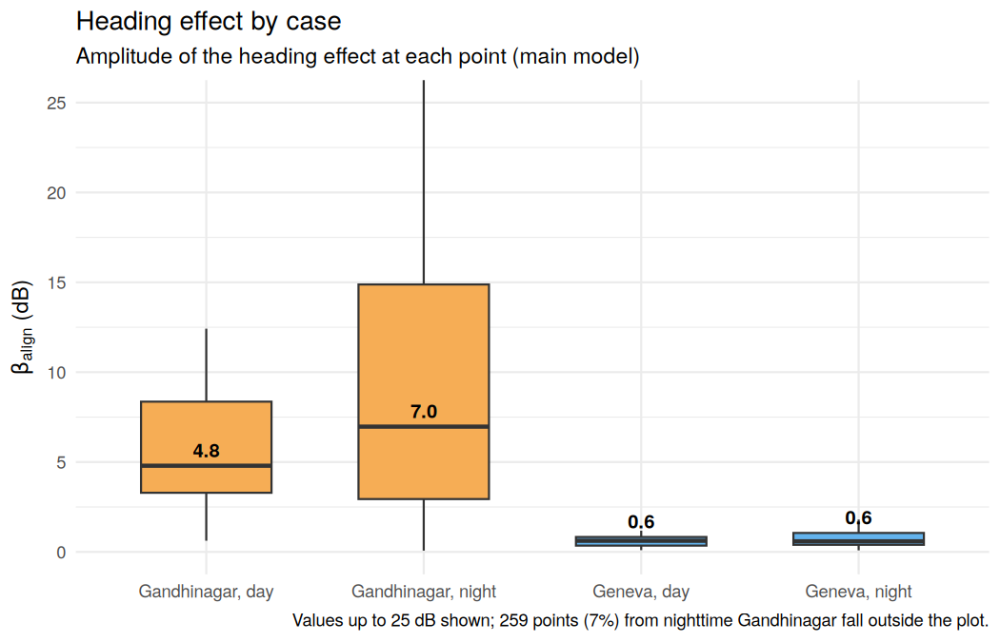
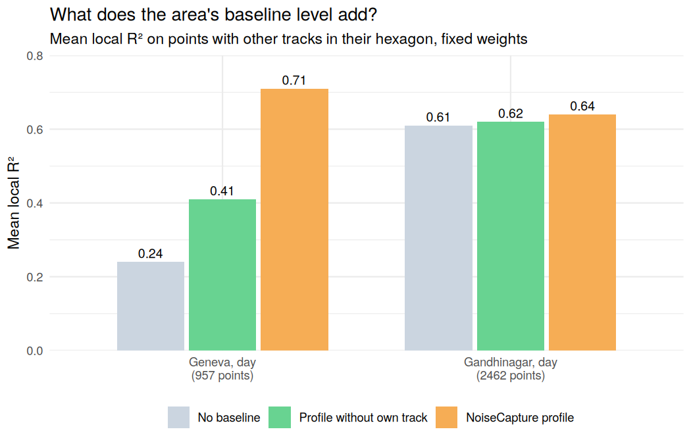
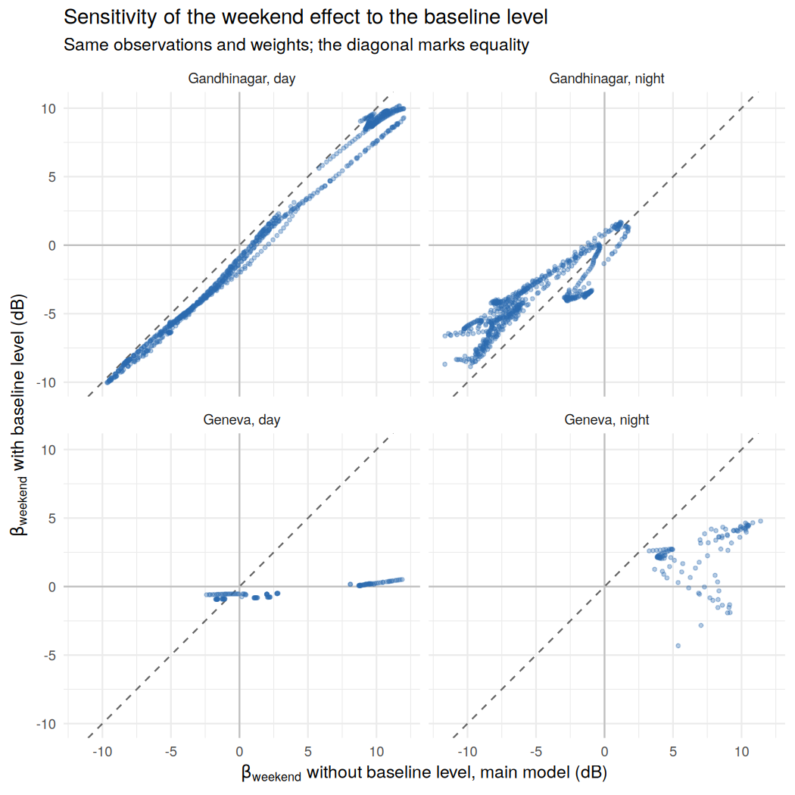
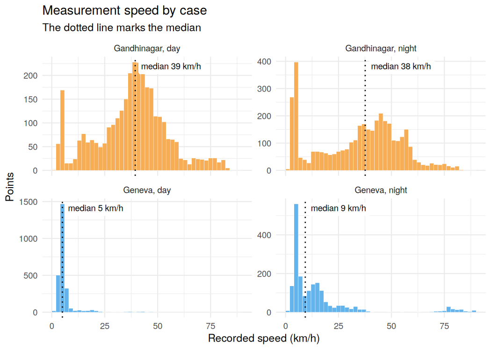

# Spatial structure of urban noise: detailed analysis

**English** | [Español](analisis-detallado.md) · [Back to the front page](README.md)

This document gathers the methodology, all tables, the interpretation and the
limitations of the analysis. The summary, the interactive maps and the
conclusions can be found on the [front page](README.md).

## Data

The data are mobile noise measurements from the NoiseCapture crowdsourced
dataset ([Noise-Planet](https://noise-planet.org/), UMRAE and Lab-STICC,
distributed under [ODbL](https://opendatacommons.org/licenses/odbl/)), which
include sound level, speed, heading, GPS accuracy and device calibration gain.
Measurements come from an Android app, which explains the wide spread in
device calibration gain. The data are hierarchical, since samples belong to
tracks and tracks to urban areas. Records were filtered by spatio-temporal
quality criteria and accuracy thresholds, and timestamps were converted to
local time.

## Methodology

### Spatial dependence

As a first step, the spatial dependence of noise levels was assessed. Moran's
I and LISA showed global spatial autocorrelation and local clusters. Based on
this result, GWR was used to explore how the associations with speed and
movement direction varied across the study areas.

### Local regression

Geographically weighted regression (GWR) was fitted with two representations
of heading. The first is directional (0–360°) and distinguishes opposite
directions of travel, whereas the second is axial (0° ≡ 180°) and treats them
as equivalent. The comparison aimed to assess whether noise levels were mainly
associated with the axis of movement or whether distinguishing the direction
of travel added information.

Street geometry and sound reflections between façades motivated examining
patterns associated with the axis of travel. Differences in exposure to sound
sources and variation in sound emission across directions could also produce
differences between opposite directions of travel. The possible role of the
Doppler effect was also considered, linked to relative motion between source
and receiver and the change in the received frequency.

It should be noted that the recorded heading describes the movement of the
person taking the measurements and does not directly identify the direction
from which sound arrives. Therefore, the comparison helps assess which
representation of heading is more useful, but differences in model fit alone
are not enough to identify the physical mechanisms behind the observed
patterns.

### Model specification

For each measurement $i$ at location $u_i$, the noise level $L_i$ (dB) is
modelled as

```math
\begin{aligned}
L_i ={}& \beta_0(u_i) + \beta_{\text{speed}}(u_i)\,v_i
       + \beta_{\cos}(u_i)\,\tilde c_i + \beta_{\sin}(u_i)\,\tilde s_i
       + v_i\big[\gamma_{\cos}(u_i)\,\tilde c_i + \gamma_{\sin}(u_i)\,\tilde s_i\big] \\
      &+ \beta_{\text{hs}}(u_i)\,h^s_i + \beta_{\text{hc}}(u_i)\,h^c_i
       + \beta_{\text{count}}(u_i)\,m_i
       + \beta_{\text{weekend}}(u_i)\,w_i + \varepsilon_i
\end{aligned}
```

All coefficients vary with location, since GWR estimates them at each point
while giving more weight to nearby observations. The variable $v_i$ is
standardized speed, and $\tilde c_i$ and $\tilde s_i$ are the cosine and sine
of heading $\theta_i$, centred on their mean. The directional model uses
$\cos\theta_i$ and $\sin\theta_i$, whereas the axial one uses
$\cos 2\theta_i$ and $\sin 2\theta_i$, which take the same value at $\theta$
and $\theta + 180^\circ$. This is why the axial model does not tell opposite
directions apart. Finally, the bracketed term lets the heading effect change
with speed.

The remaining terms act as controls. On the one hand, $h^c_i$ and $h^s_i$
encode hour as the cosine and sine of $2\pi \cdot \text{hour}_i / 24$, so
23:00 and 00:00 stay close. The sine enters residualized, that is, it is
replaced by its residual from a linear regression on the cosine, which amounts
to orthogonalizing it. This is only a reparametrization, so the fit and the
residuals do not change. On the other hand, $m_i$ is the log of one plus the
measurement count of the NoiseCapture area containing the point,
standardized, and $w_i$ is a centred weekend indicator.

The following table summarizes how to read each coefficient.

| Coefficient | What it measures |
|---|---|
| $\beta_0$ | Local baseline, that is, the expected level at mean speed, with the other variables at their reference values. Shown on the maps shifted to zero speed. |
| $\beta_{\text{speed}}$ | dB change per standard deviation of speed, averaged over headings. Shown on the maps in dB per m/s. |
| $\beta_{\cos}$, $\beta_{\sin}$ | Heading effect at mean speed. In the directional model, $\beta_{\cos}$ contrasts travelling north with travelling south, and $\beta_{\sin}$ east with west. In the axial model, $\beta_{\cos}$ contrasts the north–south axis with the east–west axis, and $\beta_{\sin}$ the northeast–southwest axis with the northwest–southeast one. In every case the gap between the two is twice the coefficient, and a positive value means the first is louder. On their own they depend on how the axes are oriented, so they are summarized as $\beta_{\text{align}}$. |
| $\gamma_{\cos}$, $\gamma_{\sin}$ | How much the heading effect changes per standard deviation of speed. Read the other way, whether the speed effect depends on heading. |
| $\beta_{\text{hc}}$, $\beta_{\text{hs}}$ | Jointly describe hourly variation in level within each period (day 07–19, night 19–07) through cosine and sine terms. |
| $\beta_{\text{count}}$ | dB per standard deviation of the log measurement count. Mainly a control for sampling intensity, with no direct physical reading. |
| $\beta_{\text{weekend}}$ | Local weekend-minus-weekday difference in level, in dB, adjusted for speed, heading, hour and measurement count. |
| $\beta_{\text{align}}$ | Amplitude of the heading effect, in dB. See below. |

Both variants share the same terms and differ only in heading encoding.
Bandwidth is adaptive and was selected by AICc together with the kernel
(Gaussian or bisquare). The variant with the higher mean local R² was kept,
with AICc as tie-breaker. In three cases both criteria choose the same
version. In nighttime Gandhinagar, by contrast, mean local R² favours the
axial version by 0.003 and AICc the directional one by 32 points, so the
directional version is analysed as a sensitivity check (see *Sensitivity to
heading encoding*).

### Area baseline level

NoiseCapture publishes, for each hexagon of 15 m radius, an hourly sound-level
profile, which corresponds to the median (LA50) of each hour on weekdays,
Saturdays and Sundays. That profile could serve as a control for local
context, but it is computed from the same crowdsourced measurements being
modelled. To assess how much the fit depended on measurements from the
point's own track, an alternative profile was built from the raw points. For
each point, the median of its hexagon, hour and type of day was taken,
excluding every measurement from its own track. When no other track had
measurements in that combination of hour and type of day, the overall median
of the hexagon was used, also excluding the evaluated track.

Three versions of the model were compared on the same observations and with
the same weights, one with no baseline, one with the profile without the own
track and one with the NoiseCapture profile. Based on the results (see
*Results*), it was decided to exclude it from the main model. The version with
the NoiseCapture profile is kept as a sensitivity analysis, with the same
observations, heading encoding and spatial weights as the main model.

### Alignment coefficient

The heading effect is summarized as one value per location, defined as

```math
\beta_{\text{align}}(u) = \sqrt{\beta_{\cos}(u)^2 + \beta_{\sin}(u)^2}
```

At mean speed, the heading term is a wave of amplitude $\beta_{\text{align}}$,
with a period of 360° in the directional model and 180° in the axial one.
Depending on heading, the level rises or falls by up to that many dB, so the
loudest and quietest headings differ by twice that. By construction, the
coefficient is never negative. Moreover, since it summarises estimated
coefficients, it may be biased upwards by estimation error, especially where
its components are poorly determined, and it should not be read as an upper
bound on the effect. With
$\hat{\mathbf b} = (\hat\beta_{\cos}, \hat\beta_{\sin})$, Jensen's
inequality gives $E\lVert\hat{\mathbf b}\rVert \ge \lVert E[\hat{\mathbf b}]\rVert$,
which equals the true amplitude only if the estimated components are
unbiased.

### Handling device calibration

Tracks are not a useful grouping for the context of a place, since samples
from one track can be far apart in space and time. They are useful, however,
for representing measurement conditions, as in the hierarchical model
described below. Calibration gain, for its part, is a device property, and the
magnitude of the residuals $r_i$ changed with it. This was tested by modelling
$\log r_i^2$ against gain, with a GAM in Gandhinagar and an ANOVA in Geneva,
where gain takes few distinct values. Since it is measured around zero, this
magnitude reflects both the spread and the bias of the residuals. In daytime
Gandhinagar the relationship was significant (p < 2e-16), and the typical
residual magnitude at the 95th gain percentile was about 1.36 times that at
the 5th. In daytime Geneva it was also significant (p < 2e-16), although
reversed (0.71).

This was handled in two steps. First, a bias was estimated with a robust LOESS
$\hat b(g)$ of the residuals on gain, and it was subtracted before re-centring
the residuals:

```math
r^{\text{db}}_i = r_i - \hat b(g_i) - \mathrm{median}\big(r - \hat b(g)\big)
```

Second, since the variance still differed by gain, anomaly thresholds were
computed for each gain bin $k$ (≤ −20, −20 to −15, −15 to −12 and > −12 dB)
from the local distribution of the residuals:

```math
U_k = \max\big\{\,5\ \text{dB},\ \mathrm{P}_{95}\big(|r^{\text{db}}| \text{ within bin } k\big)\big\}
```

Bins with under 100 points use the global 95th percentile. A point is flagged
as anomalous if it exceeds the threshold of its bin and also belongs to a LISA
high-high cluster of $\lvert r^{\text{db}} \rvert$ (4 nearest neighbours,
α = 0.05, with the residual and the neighbour average both above 5 dB). In
this way, isolated errors are left out and the areas where the model fails
consistently are kept.

### Hierarchical model with calibration-dependent variance

Measurements are nested in tracks, that is, measurement $i$ belongs to track
$j$. Each track has its own conditions that do not change along the way, such
as the device, its calibration, how the phone is carried or the day, and the
magnitude of the residuals varies with gain. To separate effects that occur
within a single track from differences between tracks, a global model was
fitted with a random intercept per track and a separate variance per gain
group, on the same points and terms as the main model:

```math
\begin{aligned}
L_{ij} &= \beta_0 + \mathbf{x}_{ij}^\top \boldsymbol\beta + \beta_{\text{weekend}}\, w_{ij} + u_j + \varepsilon_{ij} \\
u_j &\sim N(0, \tau^2), \qquad \varepsilon_{ij} \sim N\big(0, \sigma^2_{g(j)}\big)
\end{aligned}
```

In this expression, $\mathbf{x}_{ij}$ holds speed, heading, their
interactions, hour and the area measurement count. The term $u_j$ is track
$j$'s level offset, that is, how far above or below expectation it measures,
and $g(j)$ is its gain group. The groups correspond to each observed value in
Geneva, where there are few, and to quartiles in Gandhinagar. The per-group
variance was tested with a likelihood-ratio test against the common-variance
model.

The hierarchical model assumes that $u_j$ is uncorrelated with the
predictors. As a check, a track fixed-effects model was also estimated, which
makes no such assumption. In this model, each variable has its track mean
subtracted, so the coefficients are estimated only from variation within each
track:

```math
L_{ij} - \bar L_j = (\mathbf{x}_{ij} - \bar{\mathbf{x}}_j)^\top \boldsymbol\beta + (\varepsilon_{ij} - \bar\varepsilon_j)
```

This model is fitted by weighted least squares, with weights
$1/\hat\sigma^2_{g(j)}$ and track-clustered standard errors. Terms that are
constant within a track drop out. The weekend is not included, because almost
every track takes place on a single type of day, and neither is hour, since it
barely varies within a track. Both models are compared with the global
regression without track structure.

Finally, GWR was refitted on track-centred variables with the same spatial
weights as the main model, to compare the $\beta_{\text{align}}$ maps. This is
a sensitivity analysis, since it removes each track's constant offset, but it
is not equivalent to including track fixed effects in each local regression,
which would require centring each track with the local weights.

### Within-between model with temporal correlation

The models above estimate a single coefficient per variable and assume that,
given each track's level, its points are independent. To separate the
within-track effect from the between-track effect in a single equation, the
within-between model was fitted (Mundlak, 1978; Bell and Jones, 2015), in
which each variable is split into its deviation from the track mean and that
mean:

```math
\begin{aligned}
L_{ij} &= \beta_0 + (\mathbf{x}_{ij} - \bar{\mathbf{x}}_j)^\top \boldsymbol\beta_W + \bar{\mathbf{x}}_j^\top \boldsymbol\beta_B + \beta_{\text{weekend}}\, w_{ij} + u_j + \varepsilon_{ij} \\
u_j &\sim N(0, \tau^2), \qquad \varepsilon_{ij} \sim N\big(0, \sigma^2_{g(j)}\big), \qquad \mathrm{Corr}(\varepsilon_{ij}, \varepsilon_{kj}) = \phi^{\,|t_{ij} - t_{kj}|}
\end{aligned}
```

The coefficient $\boldsymbol\beta_W$ is estimated from variation within each
track, with the same device and the same calibration, as in the fixed-effects
model. By contrast, $\boldsymbol\beta_B$ is estimated from differences between
track means. Time $t_{ij}$ is measured in seconds since the start of the
track, and errors follow a continuous-time first-order autoregressive process
(Pinheiro and Bates, 2000). For example, two measurements 10 s apart have
correlation $\phi^{10}$. The per-gain-group variance is the same as in the
hierarchical model, and interactions are split after multiplying.

The weekend enters as a single term and is estimated essentially between
tracks, since almost all of them take place on a single type of day. The
exception is track 567120 in Gandhinagar, which crosses midnight from Sunday 29
to Monday 30 September 2024. Of its 15 retained observations, 10 are on the
weekend and 5 on a weekday, but a single track is not enough to estimate a
within-track weekend effect precisely.

To isolate the effect of the correlation, the same model was also fitted
without it, with the same observations, terms, gain groups and random
intercept. Without the correlation, and with constant variance within each
track, the within part matches fixed effects weighted by the variances
estimated in that fit exactly, which serves as a check on the implementation.
For the equality to hold, the check must include the centred part of every
variable that varies within any track, including the weekend in the track
that crosses from Sunday to Monday:

```math
\hat{\boldsymbol\beta}_W = \arg\min_{\boldsymbol\beta}\ \sum_j \frac{1}{\hat\sigma^2_{g(j)}} \sum_{i \in j} \Big[(L_{ij} - \bar L_j) - (\mathbf{x}_{ij} - \bar{\mathbf{x}}_j)^\top \boldsymbol\beta\Big]^2
```

Every nlme fit was logged with its warnings, and a fit without convergence
would not have been used. All of them converged with the default optimizer.

With this correlation, the estimator gives more weight to changes between
measurements close in time. If the correlation between consecutive
measurements is $\rho$, it is roughly equivalent to fitting

```math
L_{ij} - \rho\, L_{i-1,j} = (\mathbf{x}_{ij} - \rho\, \mathbf{x}_{i-1,j})^\top \boldsymbol\beta + \eta_{ij}
```

which, with $\rho$ close to 1, compares each measurement with the previous
one. In continuous time, $\rho$ depends on the actual interval between
measurements, so the equivalence is only approximate. This is why
$\boldsymbol\beta_W$ gives more weight to changes between nearby
measurements, whereas the fixed-effects model weights all within-track
variation equally. In the sample, the interval between consecutive points of a
track has a median of 3 to 6 s and a 90th percentile of 8 to 21 s, and 1% to
2.6% exceed 60 s. In nighttime Gandhinagar, moreover, two pairs of
observations share the same acoustic timestamp. The code separates them by
0.001 s, and their influence is assessed in *Sensitivity of the temporal model
to two records with coincident times*.

For speed and heading, the hypothesis

```math
H_0:\ \beta_W = \beta_B
```

is tested with a Wald test. If it is rejected, the association between tracks
differs from the one observed within them, for example because tracks also
differ in device or measurement mode. This is Mundlak's version of the Hausman
(1978) test. For heading, the test is joint over its four terms (the two
heading terms and their speed interactions), and the effect is summarized by
its amplitude at mean speed, like $\beta_{\text{align}}$.

### Effective number of tracks

Each location's coefficients are estimated from nearby points, which may come
from many tracks or from just one. To measure this, the GWR weights of each
track $j$ at location $u$ were summed and the effective number of tracks was
computed, an adaptation of Kish's (1965) effective sample size:

```math
\omega_j(u) = \frac{\sum_{i \in j} w_i(u)}{\sum_i w_i(u)}, \qquad N_{\text{eff}}(u) = \frac{1}{\sum_j \omega_j(u)^2}
```

This number equals 1 if all the weight comes from a single track and $K$ if
$K$ tracks weigh the same. If the local model had only an intercept, it would
be a weighted average of levels and would carry over the tracks' offsets.
Assuming independent offsets with variance $\tau^2$, it follows that

```math
\hat\beta_0(u) \approx \mu(u) + \sum_j \omega_j(u)\, u_j, \qquad \mathrm{Var}\Big(\sum_j \omega_j(u)\, u_j\Big) = \tau^2 \sum_j \omega_j(u)^2 = \frac{\tau^2}{N_{\text{eff}}(u)}
```

where $\mu(u)$ is the level of the place. The deviation
$\tau/\sqrt{N_{\text{eff}}}$ is used as an approximate indicator of the scale
of variation that track offsets can pass on to a local average, with $\tau$
estimated by each case's hierarchical model. It is neither a bound nor the
error at each location, since with covariates each track's influence also
depends on the local design and can be amplified if it is ill-conditioned.
The exact carry-over is computed with the next model.

### Spatial model with a track effect

To separate the level of the place from each track's offset in a single
equation, a generalized additive model (Wood, 2017) was fitted with smooth
surfaces over the coordinates and a random effect per track. With
$\mathbf{p}_{ij}$ the position of the measurement, the model is

```math
L_{ij} = a + f_0(\mathbf{p}_{ij}) + f_v(\mathbf{p}_{ij})\, v_{ij} + f_c(\mathbf{p}_{ij})\, \tilde c_{ij} + f_s(\mathbf{p}_{ij})\, \tilde s_{ij} + \mathbf{z}_{ij}^\top \boldsymbol\gamma + u_j + \varepsilon_{ij}, \qquad u_j \sim N(0, \tau^2)
```

In this model, $f_0$ is the spatial component of the level, adjusted for track
offsets, and $f_v$, $f_c$ and $f_s$ are the spatially varying speed and
heading coefficients, the counterpart of the local GWR coefficients. Each
surface is a thin-plate spline whose smoothness is chosen by REML. The vector
$\mathbf{z}_{ij}$ holds the speed-heading interactions, hour, the area
measurement count and the weekend, with effects common to the whole area. As
in the within-between model, the variance of $\varepsilon_{ij}$ depends on the
gain group, and there is an AR(1) correlation between consecutive points of
each track.

Offsets are identified mainly where tracks cross. If two tracks measure the
same place, after accounting for the other model terms,
$L_1 - L_2 \approx u_1 - u_2$, provided the place sounds similar in both
measurements. Where a track measures alone, however, its level can be
attributed to the surface or to the track, and the split depends on the
penalties. Comparing $\hat\tau$ with and without the surfaces shows how much
the estimated variance of the offsets falls when the spatial component is
added:

```math
\text{reduction in offset variance} = 1 - \frac{\hat\tau^2_{\text{with place}}}{\hat\tau^2_{\text{without place}}}
```

This reduction depends on the specification and on how much tracks overlap,
so it is not an identified decomposition between place and track.

Two variants were fitted with the same data and weights, one with only the
level surface $f_0$ and common speed and heading slopes, and one without the
AR(1) correlation. This AR(1) depends on the order of the points and not on
the elapsed time, so it applies the same correlation to two points 3 s or
2 min apart. For this reason, the correlation between residuals of
consecutive points was also measured by the interval between them. In
addition, concurvity was computed (Wood, 2017), which measures how much of a
surface could be reproduced by the other terms of the model.

### GWR without offsets

Since GWR is linear in the observations, each local coefficient splits
exactly into two parts, given the estimated offsets:

```math
\hat{\boldsymbol\beta}_{\text{GWR}}(\mathbf{p}) = \underbrace{\big(X^\top W(\mathbf{p}) X\big)^{-1} X^\top W(\mathbf{p})\,(\mathbf{L} - \hat{\mathbf{u}})}_{\text{GWR without offsets}} + \underbrace{\big(X^\top W(\mathbf{p}) X\big)^{-1} X^\top W(\mathbf{p})\,\hat{\mathbf{u}}}_{\text{carry-over from tracks}}
```

where $\hat{\mathbf{u}}$ assigns each measurement the estimated offset of its
track. The first term is equivalent to rerunning the same GWR, with the same
weights and terms, on the corrected levels. It should be noted that the split
is exact with respect to those estimated offsets, not to known measurement
errors. With this version and with the surfaces of the spatial model, the
labels were recomputed with the same rules and compared with the originals
using Cohen's kappa.

### Measurement mode

If level changes with the travel mode and the mode is tied to speed, a common
speed slope mixes both effects. With $V$ equal to 1 in a vehicle and 0 on
foot, if the model omits $V$, it follows that

```math
L = a + \delta\,V + \beta\,v + \varepsilon \quad\Rightarrow\quad \hat\beta \to \beta + \delta\,\frac{\mathrm{Cov}(v, V)}{\mathrm{Var}(v)}
```

To account for this, each point was classified by its speed as on foot
(8 km/h or less), in a vehicle (15 km/h or more) or intermediate. These
categories are defined by speed and are not independently observed modes. A
track was considered to change mode if at least 10% of its points are on foot
and at least 10% in a vehicle.

In the spatial model with a track effect, the common speed slope was replaced
by one slope per mode, and a level per mode was added. Both are split into a
within- and a between-track part, as in the within-between model. The level
is split through each track's share of points in each mode, and the slope
through the track mean of $q_{ij} = v_{ij}\, I(\text{mode}_{ij} = m)$:

```math
\beta_m\, q_{ij} + \delta_m\, \bar q_j = \beta_m\, (q_{ij} - \bar q_j) + (\beta_m + \delta_m)\, \bar q_j
```

so $\beta_m$ is the within-track slope. The common slope is split the same
way. Finally, the GWR weights were used to measure how much modes mix in each
neighbourhood:

```math
\text{mixing}(\mathbf{p}) = 2 \min\big(p_{\text{foot}}(\mathbf{p}),\ p_{\text{veh}}(\mathbf{p})\big)
```

where $p_{\text{foot}}$ and $p_{\text{veh}}$ are the weighted shares of points
on foot and in a vehicle. This index equals 0 if the whole neighbourhood was
measured in a single mode and 1 if it was measured half on foot and half in a
vehicle.

## Operational labels

Each location is assigned a regime based on which of its local coefficients
dominates. Each coefficient is compared against its own distribution within
each city and period, so the labels are relative. In other words, they show
which effect stands out at each place, but they are not values comparable
across cities. The following table describes each label.

| Label | Interpretation |
|---|---|
| Speed-dominant | Noise tracks travel speed, and direction matters little. |
| Urban canyon / directional | Orientation dominates, that is, at the same speed noise changes with the axis of travel. Consistent with enclosed streets. |
| Stationary base | High local intercept under the operational rules, with weak speed and orientation effects. It may reflect the place or the tracks that measured it (see *Place and track in one model*). |
| Uniform noise | Speed and orientation effects tied or relatively weak, with the predicted level within 3 dB of the intercept and the intercept close to the case median. |
| Transitional / mixed | No clear dominance of speed or orientation under the rules used, since their normalized magnitudes are comparable or both relatively low. |
| Anomalous / review | Residual exceeds the calibration-adjusted threshold for its gain bin and sits in a cluster of high residuals. Flagged for inspection rather than interpreted. |

### Assignment rules

Speed and alignment coefficients are normalized by their 75th percentile
within each case:

```math
s_i = \frac{|\beta_{\text{speed},i}|}{\mathrm{P}_{75}\big(|\beta_{\text{speed}}|\big)},
\qquad
a_i = \frac{\beta_{\text{align},i}}{\mathrm{P}_{75}\big(\beta_{\text{align}}\big)}
```

An effect is considered strong if $\max(s_i, a_i) \ge 0.8$, and the two are
considered tied if $s_i / a_i$ lies between $1/1.2$ and $1.2$. Labels are
assigned in the following order, and each point gets the first one it meets:

1. *Anomalous / review*, if it meets the anomaly criterion described under
   device calibration.
2. *Speed-dominant*, if there is a strong effect and $s_i / a_i \gt 1.2$.
3. *Urban canyon / directional*, if there is a strong effect and
   $s_i / a_i \lt 1/1.2$.
4. *Stationary base*, if the intercept exceeds its 75th percentile, and
   neither speed nor alignment exceeds its 75th percentile.
5. *Transitional / mixed*, in all other cases, that is, ties or both effects
   weak.

Finally, a non-anomalous point with a tie or weak effects becomes uniform
noise if its predicted level is within 3 dB of its intercept and the
intercept is near the median (within 0.33 times the interquartile range).

It should be noted that the labels are computed from GWR coefficients, which
mix differences within each track and between tracks. *Effects within tracks*
assesses how far they hold once these are separated, *Tracks behind each
location* analyses how many tracks lie behind each location and *Place and
track in one model*, how labels change without the track offsets. Finally,
the relationship between the speed-dominant label and the measurement mode is
analysed in *Speed and measurement mode*.

## Results

### Anomalous points

Depending on the case, a fixed 5 dB cutoff flags 27% to 52% of points.
Requiring them to form a cluster of high residuals (LISA high-high) brings
that share down to 4% to 8%, and the per-gain-bin threshold to 1.8% to 2.6%.
In other words, the anomaly criterion cuts the number of flagged points by an
order of magnitude. The final rate per gain bin ranges from 0% to 3%, which is
partly expected by construction, since each threshold is a within-bin
percentile.

As an additional diagnostic, the Spearman correlation between each track's
median gain and its share of anomalous points was computed. This correlation
was weak in three cases (−0.11 to +0.01; p ≥ 0.38). In nighttime Gandhinagar,
by contrast, it was +0.26 (p = 0.015), which indicates that there higher-gain
tracks tend to have more anomalies. Even so, with a Bonferroni correction for
the four tests (threshold 0.0125), that correlation is not significant. The
maps keep the separate layers so that they can be compared directly.

### Heading effect on the maps

In Gandhinagar, the median alignment coefficient is 4.9 dB by day and 7.1 dB
at night, against 1.6 and 2.6 dB in Geneva. At each case's mean speed, this
means typical gaps of 10 to 14 dB between the loudest and quietest heading in
Gandhinagar, and of 3 to 5 dB in Geneva. Therefore, on the maps the
directional term weighs much more in Gandhinagar than in Geneva.

A local collinearity diagnostic, using the same weights as the fit, flags the
heading effect as poorly determined at few locations, 0% to 10% depending on
the case. It uses Belsley's criterion, which treats as poorly determined a
condition index above 30 with two or more terms, at least one of them a
heading term, having a variance proportion above 0.5. Excluding those
locations barely changes the medians.

The axial model won selection only in Gandhinagar at night, where it also left
the residuals with the lowest spatial autocorrelation of the four cases
(Moran's I on residuals of 0.20, against 0.30 to 0.54 elsewhere). Both
specifications use the same number of predictors and interaction terms, and
differ only in how movement direction is represented. It should be noted that
this amplitude mixes differences within each track and between tracks, and
that within a single track it is considerably smaller (see *Effects within
tracks*).



### Weekend effect

The coefficient $\beta_{\text{weekend}}$ is the one on the weekend indicator,
that is, the local weekend-minus-weekday difference in level, in dB, adjusted
for the other model terms. It is reported only where it can be estimated
reasonably. For this, among the $k$ nearest neighbours (10% of points, bounded
to 30–150), 10% to 90% of measurements must be from weekends, local R² must be
at least 0.5 and the effect must be within ±12 dB. An effect counts as
distinguishable when the coefficient is at least twice its standard error in
absolute value. The following table summarizes the results for each case.

| | Locations | Median $\beta_{\text{weekend}}$ | Dominant pattern |
|---|---|---|---|
| Gandhinagar, day | 906 | −0.2 dB | Mixed: 38% quieter, 38% louder |
| Gandhinagar, night | 650 | −6.4 dB | 67% quieter, none louder |
| Geneva, day | 122 | +2.0 dB | 53% louder, 7% quieter |
| Geneva, night | 108 | +7.0 dB | No location with $\lvert z \rvert \ge 2$ |

Percentages of quieter and louder locations refer to estimates reaching
$\lvert z \rvert \ge 2$ among the reported locations, and not just to the sign
of the coefficient.

As the table shows, weekend effects differed between cities and were larger
at night. In daytime Gandhinagar the median is close to zero, yet 76% of
locations show a distinguishable effect, split evenly between quieter and
louder weekends along different corridors. At night, by contrast, the
decrease clearly dominates. In nighttime Geneva the median is high, but no
location reaches $\lvert z \rvert \ge 2$, which indicates a large and
imprecise estimated effect.

However, these percentages should be read with caution. Almost every track
takes place on a single type of day, so the weekend effect is estimated
essentially by comparing different tracks. Moreover, GWR's local standard
errors treat every point as independent. In the global regression, the
track-clustered standard error is 1.6 to 8 times the one that assumes
independence, so the percentages in the table may be too optimistic. This
diagnostic shows the importance of track dependence, although it does not
provide corrected local standard errors. The hierarchical model gives one
estimate per case (see *Effects within tracks*).

### Evaluation of the baseline level

When the own track is excluded, many points are left with no other measurement
in their hexagon. The situation of each point is summarized below.

| Situation when the own track is excluded | Geneva, day | Geneva, night | Gandhinagar, day |
|---|---|---|---|
| Other tracks in the hexagon, at the same hour and type of day | 3% | 5% | 28% |
| Other tracks in the hexagon, outside that combination of hour and type of day | 36% | 35% | 47% |
| No other track in the hexagon | 61% | 60% | 25% |

In Gandhinagar, percentages refer to points falling inside some hexagon. It can
be seen that, in the raw points available for Geneva, most observations do not
share their hexagon with other tracks. The following figure compares the three
versions of the model on the points that do (957 in daytime Geneva and 2462 in
daytime Gandhinagar).



In daytime Geneva, on the common sample, mean local R² was 0.24 with no
baseline, 0.41 with the reference excluding the own track and 0.71 with the
NoiseCapture profile. Residual Moran's I, for its part, was 0.67, 0.55 and
0.20. The difference is consistent with a substantial dependence on the
measurements of the point's own track, but it also reflects changes in the
availability and temporal resolution of the predictor, given that for most of
these points the alternative reference is the overall median of the hexagon
and not that of the hour. Therefore, the comparison cannot quantify these
components separately.

In daytime Gandhinagar, by contrast, the three versions fit almost equally
well (0.61 to 0.64, with Moran's I of 0.32 to 0.33), which indicates that
there the baseline adds little. This comparison was run only for these two
cases, and it was not evaluated for nighttime Gandhinagar. Overall, model fit
was sensitive to how the baseline level was built.

#### Sensitivity with the baseline level

The following table compares the main model with the version including the
baseline, on the same observations and with the same spatial weights.

| | Mean local R² (without / with) | Residual Moran's I (without / with) | Common locations | Median $\beta_{\text{weekend}}$ (without / with) | Same sign |
|---|---|---|---|---|---|
| Gandhinagar, day | 0.68 / 0.72 | 0.30 / 0.28 | 906 | −0.2 / −1.5 dB | 96% |
| Gandhinagar, night | 0.76 / 0.81 | 0.20 / 0.13 | 650 | −6.4 / −4.1 dB | 98% |
| Geneva, day | 0.54 / 0.83 | 0.54 / 0.06 | 122 | +2.0 / −0.5 dB | 73% |
| Geneva, night | 0.60 / 0.85 | 0.30 / −0.01 | 108 | +7.0 / +2.5 dB | 85% |

Mean local R² and Moran's I refer to each case's fitting sample. Weekend
medians and sign-agreement percentages are computed only on locations meeting
the reporting filters in both versions, including the ±12 dB limit, so they do
not represent all estimates or the whole city.

This sensitivity analysis shows the same contrast between cities. In
Gandhinagar, adding the baseline improves fit only slightly, the weekend effect
keeps its sign at almost every location and the nighttime decrease holds in
both versions. In Geneva, by contrast, the baseline raises R² sharply and
nearly removes residual autocorrelation, which is consistent with it reusing
the measurement itself. With it, none of the compared Geneva locations shows a
distinguishable weekend effect, whereas without it 53% of daytime Geneva
locations are louder at weekends.



### Fit by label

Model fit varied across the assigned labels. Stationary-base locations had
the highest mean local R² in all four cases (0.73 to 0.84) and the lowest mean
|residual| in three (2.4 to 5.4 dB). In daytime Gandhinagar, the lowest
residual belonged to urban canyon (2.4 dB). Uniform noise, for its part, fit
worst among the regular regimes in all four cases (mean local R² of 0.41 to
0.62). In the anomalous class, the mean |residual| ranges from 16 to 21 dB,
although this class holds at most 2.6% of points. Overall, the model's mean
local R² ranges from 0.54 to 0.76.

### Out-of-sample validation

#### New tracks

To assess how far these associations generalize, whole tracks were held out.
Each case's tracks were split into five groups, and each group was predicted
with a model fitted only on the others. Within each split, everything learned
from the data was recomputed on the training tracks, that is, centring,
standardization, the residualized hour term and the choice of heading
encoding, kernel and bandwidth. The area measurement count was rebuilt by
counting only the raw measurements (from all years and hours) of tracks
outside the test group, with each measurement assigned to a single hexagon,
as if the test tracks were not yet in the database. GWR was compared with a
global regression with the same terms and with the training mean.

It should be noted that test points come from the already filtered sample of
the main model, since the spatiotemporal redundancy filters were applied with
all tracks present and were not repeated within each split. This does not use
test levels for fitting, but the evaluation is on a sample selected with all
tracks. The following table shows the results.

| | Mean absolute error: GWR | Global regression | Training mean | Tracks where GWR beats the global model |
|---|---|---|---|---|
| Gandhinagar, day | 8.6 dB | 10.4 dB | 9.7 dB | 59% of 74 |
| Gandhinagar, night | 11.7 dB | 10.7 dB | 12.0 dB | 36% of 90 |
| Geneva, day | 10.9 dB | 12.4 dB | 11.0 dB | 64% of 66 |
| Geneva, night | 12.3 dB | 9.9 dB | 11.9 dB | 53% of 45 |

Errors are computed over all test observations. The last column compares each
track's mean error with a paired Wilcoxon test (p = 0.19, 0.002, 0.027 and
0.24, in table order).

As can be seen, the model says little about the level of new tracks. No model
improves on the training mean by more than about 2 dB, with typical errors of
9 to 12 dB. The main reason is that most of the variation lies between tracks.
Between 62% and 77% of the variance in level comes from differences in mean
level between tracks, which may reflect the device, its calibration or the
context of each measurement.

GWR partly anticipates a track's overall level from where it was measured
(correlation of 0.24 to 0.49 between each track's predicted and observed mean
level), and does so better than the global regression by day. However,
neither model anticipates how the level varies along a new track. Within
tracks, the correlation between measured and predicted level ranges from
−0.05 to +0.10 for GWR and from +0.01 to +0.23 for the global regression. At
night, moreover, GWR's local coefficients produce some extreme predictions,
and 3% of errors in Gandhinagar and 8% in Geneva exceed 30 dB.

In one split of daytime Gandhinagar, 7 predictions used the pseudo-inverse
because the local design was singular. Excluding any set of 7 observations
from that split leaves the mean absolute error between 8.550 and 8.614 dB,
against 8.596 dB with all of them. This bound refers to excluding them, and
not to replacing the pseudo-inverse with another procedure.

Consequently, the mean local R² of 0.54 to 0.76 mostly reflects level
differences between tracks, which the model reproduces largely because each
track is part of its own neighbourhood. The same applies to residual
autocorrelation. Moran's I is computed with the 4 nearest neighbours, and 70%
to 93% of them belong to the same track depending on the case, so its value
(0.20 to 0.54) largely reflects how persistent each track's level offset is.
In other words, the coefficients and maps describe the measured sample, but
they are not relationships that carry over directly to new measurements.

#### Calibration with the start of the track

Since most of the error is each track's level offset, it was estimated from
the start of each test track (cross-calibration). Using the first points
$C_j$ of track $j$, in time order, the offset is estimated by comparing what
was measured with what the model predicts from the other tracks, and it is
added to the prediction for the rest:

```math
\hat u_j = \frac{1}{n_c}\sum_{i \in C_j}\big(y_{ij} - \hat y_{ij}\big), \qquad \hat y^{\,\text{cal}}_{ij} = \hat y_{ij} + \hat u_j \quad (i \notin C_j)
```

The points $C_j$ are the first observations of the track that remained in the
sample, not the first part of its duration. In the hierarchical model, fitted
within each split, the offset is also shrunk according to how much information
the calibration points carry, by the factor
$\hat\tau^2/(\hat\tau^2 + \hat\sigma^2/n_c)$. This evaluation used a random
intercept per track with a common residual variance, unlike the gain-dependent
variance model used for the associations. The table presents the mean absolute
error on the rest of each track, without and with calibration, using the first
20% of its observations.

| | GWR | Global regression | Random intercept per track | Training mean |
|---|---|---|---|---|
| Gandhinagar, day | 8.9 → 8.3 | 10.7 → 5.9 | 11.2 → 4.5 | 10.0 → 4.6 |
| Gandhinagar, night | 11.2 → 11.7 | 10.6 → 6.8 | 10.1 → 5.6 | 12.3 → 5.9 |
| Geneva, day | 11.1 → 7.9 | 12.6 → 7.3 | 11.3 → 7.4 | 11.2 → 7.3 |
| Geneva, night | 11.4 → 11.0 | 9.8 → 7.6 | 9.7 → 7.3 | 11.9 → 7.1 |

The results show that calibration reduces the error of the global regression,
the hierarchical model and the mean from 10 to 13 dB to between 4.5 and 7.6 dB,
with almost the same results using the first 10% or 30%. In other words,
knowing the start of a track cuts the error sharply. However, once calibrated,
the hierarchical model shows no clear advantage over the calibrated training
mean, which is simply the mean level of the start of the track
($\bar y_{\text{train}} + \hat u_j = \bar y_{C_j}$). The per-track difference
is not significant in any case (paired Wilcoxon test with the first 20%, p ≥
0.10), although this does not show that they are equivalent. Calibrated GWR,
for its part, does worst.

This suggests that what speed, heading and hour add is small next to
second-to-second variation. Moreover, part of the improvement may come from
later minutes resembling the first ones (same area, same traffic), and not
only from device calibration.

### Effects within tracks

The tables in this section compare three global estimates on the same points
and terms as the main model. These are the global regression without track
structure, the hierarchical model with gain-dependent variance and the track
fixed-effects model, weighted by that same variance. Standard errors are in
parentheses, track-clustered for the global regression and fixed effects and
model-based for the hierarchical model. The standard error of the heading
amplitude comes from the delta method, using the covariance between the cosine
and sine terms.

The hierarchical model's errors assume that, given each track's level, its
points are independent. Since consecutive points resemble each other, these
errors are optimistic for effects that vary within tracks. For this reason,
significance for those effects is judged with the fixed-effects model's
clustered errors and with the within-between model, which accounts for that
correlation. For the weekend, which is compared essentially across tracks,
the hierarchical and within-between models are used.

#### Heading

The first table shows the amplitude of the heading effect at mean speed, in dB.

| | Global regression | Hierarchical model | Track fixed effects | Median $\beta_{\text{align}}$: maps → GWR on track-centred data |
|---|---|---|---|---|
| Gandhinagar, day | 3.2 (1.5) | 1.0 (0.2) | 1.1 (0.5) | 4.9 → 2.1 |
| Gandhinagar, night | 7.2 (1.8) | 1.5 (0.2) | 1.5 (0.6) | 7.1 → 2.8 |
| Geneva, day | 1.5 (1.8) | 0.5 (0.3) | 0.4 (0.7) | 1.6 → 1.6 |
| Geneva, night | 1.8 (1.0) | 1.8 (0.3) | 1.8 (1.1) | 2.6 → 2.8 |

As can be seen, in Gandhinagar the hierarchical and fixed-effects models
agree. Within a single track, the level differs by 2 to 3 dB between the
loudest and quietest heading, against 10 to 14 dB on the maps. This effect is
distinguishable from zero according to the joint Wald test of the four heading
terms, including their speed interactions, with clustered errors and
unweighted (p = 0.0005 by day and 0.009 at night).

The last column refits GWR on track-centred variables with the same spatial
weights. With these data, local amplitudes fall to less than half, and their
spatial pattern barely resembles the maps' (Spearman correlation of −0.10 by
day and 0.22 at night). Even so, since the amplitude may be biased upwards by
estimation error, especially where its components are poorly determined,
those medians are read with caution. In Geneva, with clustered errors, the
main heading effect cannot be distinguished from zero within tracks, and by
day it appears only in interaction with speed. This indicates that most of the
heading effect on the maps is a difference between tracks.

#### Speed

For speed, in dB per m/s, the results were as follows.

| | Global regression | Hierarchical model | Track fixed effects |
|---|---|---|---|
| Gandhinagar, day | 0.91 (0.15) | 0.50 (0.03) | 0.48 (0.07) |
| Gandhinagar, night | 0.73 (0.34) | 0.45 (0.04) | 0.45 (0.08) |
| Geneva, day | 1.10 (0.76) | 1.66 (0.28) | 1.60 (0.48) |
| Geneva, night | 1.06 (0.24) | 0.64 (0.09) | 0.64 (0.07) |

The results indicate that, within a single track, moving faster is associated
with more noise in all four cases. In Gandhinagar, roughly 40% to 50% of the
global regression's association came from differences between tracks, for
example between walking and vehicle measurements, or between devices.

#### Within-between model

The following table presents the results of the within-between model, with
temporal correlation and gain-dependent variance. Speed is in dB per m/s and
heading is an amplitude in dB. Standard errors are in parentheses, and the p
column is the test of $\beta_W = \beta_B$.

| | Correlation at 10 s | Speed: within | Speed: between | p | Heading: within | Heading: between | p |
|---|---|---|---|---|---|---|---|
| Gandhinagar, day | 0.25 | 0.56 (0.04) | 1.33 (0.34) | 0.02 | 0.8 (0.3) | 1.4 (2.3) | 0.07 |
| Gandhinagar, night | 0.50 | 0.68 (0.06)ᵃ | 0.94 (0.33) | 0.43 | 2.1 (0.5)ᵃ | 6.8 (5.1) | 0.85 |
| Geneva, day | 0.40 | −0.02 (0.30) | 0.77 (1.86) | 0.67 | 0.4 (0.4) | 2.7 (2.4) | 0.87 |
| Geneva, night | 0.39 | 0.70 (0.13) | 0.00 (1.08) | 0.52 | 0.4 (0.5) | 9.4 (6.7) | 0.30 |

ᵃ With a 0.001 s tie-break between two pairs of records with the same
timestamp. With a 2 s separation from the GPS, the values are 0.59 dB per m/s
and 0.52 dB (p = 0.63) (see *Sensitivity of the temporal model to two records
with coincident times*).

Errors within a track are strongly correlated over a few seconds
($\hat\phi$ of 0.87 to 0.93 per second), and the correlation vanishes within
a minute (under 0.02 at 60 s). Between-track effects have standard errors 5 to
13 times larger than within-track effects. This is because, with 45 to 90
tracks and level offsets of about 9 to 11 dB, comparing tracks carries little
information, and so equality can almost never be rejected. In other words,
when both effects are separated in one equation, the precise information lies
within tracks. The exception is speed in daytime Gandhinagar (p = 0.02), where
faster tracks are louder than the within-track effect predicts (1.33 vs
0.56 dB per m/s), as the global regression already suggested.

#### Effect of temporal correlation

Within tracks, the speed effect holds with temporal correlation in Gandhinagar
and in nighttime Geneva (0.56 to 0.70 dB per m/s), but in daytime Geneva it
vanishes (−0.02 ± 0.30). To see what drives that change, the within-between
model was refitted without the correlation, with everything else unchanged. The
table compares the within-track parts of both versions. Speed is in dB per m/s
and heading is an amplitude in dB, with the p-value of the joint test of its
four terms.

| | Speed: without correlation | Speed: with correlation | Heading: without correlation | Heading: with correlation |
|---|---|---|---|---|
| Gandhinagar, day | 0.50 (0.03) | 0.56 (0.04) | 1.0 (0.2), p < 0.001 | 0.8 (0.3), p = 0.03 |
| Gandhinagar, night | 0.45 (0.04) | 0.68 (0.06)ᵃ | 1.5 (0.2), p < 0.001 | 2.1 (0.5), p < 0.001ᵃ |
| Geneva, day | 1.46 (0.31) | −0.02 (0.30) | 0.1 (0.3), p = 0.006 | 0.4 (0.4), p = 0.24 |
| Geneva, night | 0.65 (0.09) | 0.70 (0.13) | 1.7 (0.3), p < 0.001 | 0.4 (0.5), p = 0.98 |

ᵃ With the original 0.001 s tie-break (see the note to the previous table).

Without the correlation, the daytime Geneva slope (1.46) stays close to the
fixed-effects one (1.60). Therefore, the drop to −0.02 appears when temporal
correlation is added, and not when the hour terms or the gain-dependent
variance change. With the correlation, the estimator weights mainly changes
between measurements close in time. In daytime Geneva, then, the positive
association estimated without correlation does not hold once it is included.
This is consistent with the association coming from slow variation along the
track (faster and louder stretches) and with speed marking changes of context
rather than an effect of the movement itself. However, the model does not
exactly separate slow and fast changes or identify the mechanism. Moreover, the
association does not appear in the spatial model or among points in the
walking-compatible range either (see below).

Heading in Geneva behaves similarly, since without the correlation it is
distinguishable from zero and with it, it is not. In Gandhinagar, both
versions agree qualitatively on speed, though not in magnitude (at night, the
slope goes from 0.45 to 0.68). Heading is distinguishable from zero in both by
day, with an amplitude of 0.8 dB with the correlation, that is, 1.5 dB between
the loudest and quietest heading. At night, by contrast, the result with the
correlation depends on how two pairs of records with coincident times are
handled (see *Sensitivity of the temporal model to two records with
coincident times*).

As a check on the implementation, without correlation the within part
matches fixed effects weighted by the same variances. The maximum difference
is below $4 \times 10^{-13}$ in daytime Gandhinagar and in Geneva, and
$8.6 \times 10^{-14}$ in nighttime Gandhinagar, once the centred weekend part
of the track that crosses from Sunday to Monday is included. The matrices,
weights and nlme coefficients were also verified.

#### Weekend

The weekend-minus-weekday difference, in dB, is presented below for each model.

| | GWR: local median | Global regression: common / clustered standard error | Hierarchical model | Within-between model |
|---|---|---|---|---|
| Gandhinagar, day | −0.2 | +4.1 (0.5 / 3.2) | −0.9 (4.5) | +3.0 (4.1) |
| Gandhinagar, night | −6.4 | −11.8 (0.8 / 2.8) | −3.5 (2.5) | −4.8 (2.9) |
| Geneva, day | +2.0 | +2.9 (0.9 / 7.3) | +9.2 (3.6) | +5.3 (4.4) |
| Geneva, night | +7.0 | +11.5 (1.0 / 1.5) | +13.1 (4.8) | +20.7 (5.2) |

Since almost every track takes place on a single type of day, this effect can
hardly be estimated within tracks. The hierarchical and within-between models
estimate it by comparing tracks, with the uncertainty that comparison
carries, so it is more uncertain. In nighttime Gandhinagar it keeps the
negative sign but cannot be distinguished from zero in either. In Geneva, the
within-between model, which also accounts for each track's mean speed,
heading and hour, moves it to +5.3 dB by day, no longer distinguishable from
zero, and to +20.7 dB at night.

Such a large change when track characteristics are added, with only 45 tracks
at night, indicates that the weekend is confounded with other differences
between tracks. In fact, in that model the track's mean hour also has large
coefficients (−12 and −21 dB on its two terms). Moreover, since different
tracks are being compared, the difference may reflect different devices or
people as well as the day.

#### Variance by calibration

The likelihood-ratio test rejects a common variance in all four cases
(p < 1e−69), that is, the variance depends on calibration. The residual
standard deviation across gain groups ranges from 2.8 to 8.2 dB in daytime
Gandhinagar, from 3.6 to 8.0 dB at night, from 4.9 to 10.2 dB in daytime
Geneva and from 2.0 to 9.2 dB at night. Without weighting, estimates shift
somewhat (for example, the within-track heading amplitude in daytime
Gandhinagar goes from 1.1 to 1.9 dB), but the conclusions hold.

#### Speed and heading labels

The speed-versus-heading classification behind the labels was recomputed,
with the same 75th-percentile normalization rules, from the coefficients of
GWR fitted on track-centred data. It was then compared with the original
using Cohen's kappa,

```math
\kappa = \frac{p_o - p_e}{1 - p_e}
```

where $p_o$ is the share of locations with the same class in both versions and
$p_e$, the share expected by chance. The stationary base cannot be assessed
this way, since centring by track removes the level of the place. The results
are summarized below.

| | Agreement | $\kappa$ | Keep the speed class | Keep the heading class |
|---|---|---|---|---|
| Gandhinagar, day | 53% | 0.24 | 58% | 39% |
| Gandhinagar, night | 52% | 0.26 | 60% | 38% |
| Geneva, day | 36% | −0.04 | 57% | 4% |
| Geneva, night | 60% | 0.37 | 55% | 55% |

Since local coefficients carry a lot of estimation error, $\kappa$ falls short
of 1 even when the effect exists. In an illustrative simulation with the same
structure (45 tracks, one realization per scenario), the same procedure gave
about 0.3 when heading acts within tracks and about 0 when it is associated
only through them. Even so, this result is not a general scale for reading
kappa.

As the table shows, the speed and heading labels hold only in part. The speed
classification is kept at more than half of the locations in all four cases.
The heading classification, by contrast, is kept at under 40% in Gandhinagar
and practically vanishes in daytime Geneva (4%), which indicates that there
the urban-canyon label mostly reflects differences between tracks.

### Sensitivity of the temporal model to two records with coincident times

In nighttime Gandhinagar, two pairs of observations, from tracks 570023 and
570359, share the same acoustic timestamp. To fit the CAR(1), the original
code separated them by 0.001 s, which imposes an almost perfect correlation on
their errors:

```math
\rho(0.001) = \hat\phi^{\,0.001} = 0.934^{\,0.001} \approx 0.99993, \qquad \mathrm{Var}(\varepsilon_i - \varepsilon_k) = 2\,\sigma^2_g\,\big(1 - \rho\big) \approx 0.00014\,\sigma^2_g
```

For two typical consecutive points 3 s apart, that variance is
$2\sigma^2_g(1 - 0.934^3) \approx 0.37\,\sigma^2_g$, about 2,700 times larger.
In other words, the level difference between the tied points weighs in the
fit like thousands of ordinary pairs. In both pairs, the GPS timestamps are
2 s apart, consistent with the distances travelled and the recorded speeds.
This does not show that the GPS clock represents the acoustic instant, but it
gives a reasonable separation for a sensitivity check. Three treatments of
the within-between model with CAR(1) were therefore compared, and their
results are shown in the following table.

| Treatment | Observations | Within-track heading amplitude | Joint heading p | Within-track speed (dB per m/s) |
|---|---|---|---|---|
| 0.001 s tie-break (original) | 3,797 | 2.13 dB | 0.00009 | 0.68 |
| Without the second record of each pair | 3,795 | 0.52 dB | 0.63 | 0.59 |
| 2 s separation from the GPS | 3,797 | 0.52 dB | 0.63 | 0.59 |

The joint test includes the cosine, the sine and their two interactions with
speed. All three fits converged. The 2 s version keeps the observations,
formula and predictors, and only changes the two times used by the CAR(1), so
it does not affect the GWR maps.

These results indicate that the nighttime heading association in the
within-between model with CAR(1) is not robust to how the tied times are
handled, since the evidence in the original fit depends on the 0.001 s
tie-break. With a separation consistent with the GPS, the amplitude falls from
2.13 to 0.52 dB and the joint test no longer rejects the null hypothesis. The
change is concentrated in the sine term and its interaction with speed.

This does not show that there is no heading association. The models without
temporal correlation, where these records get no special weight, still show
it (amplitude of 1.5 dB, p < 0.001), as do fixed effects (p = 0.009). Nor does
it make the 2 s a validated correction of the acoustic clock, since it is a
sensitivity check based on the GPS of those two pairs. Finally, the positive
association with speed holds in all three versions, although it falls from
0.68 to 0.59 dB per m/s.

### Tracks behind each location

The effective number of tracks shows how many distinct tracks each local
estimate comes from in practice. In the following table, $\hat\tau$ is the
standard deviation of level offsets in the hierarchical model, and
$\hat\tau/\sqrt{N_{\text{eff}}}$ is the scale of variation those offsets can
pass on to a local average.

| | $\hat\tau$ | Median $N_{\text{eff}}$ | Locations with $N_{\text{eff}} \lt 2$ | Locations with $N_{\text{eff}} \ge 4$ | Median $\hat\tau/\sqrt{N_{\text{eff}}}$ |
|---|---|---|---|---|---|
| Gandhinagar, day | 12.3 dB | 5.1 | 2% | 76% | 5.5 dB |
| Gandhinagar, night | 10.3 dB | 3.2 | 25% | 42% | 5.8 dB |
| Geneva, day | 9.0 dB | 6.9 | 6% | 75% | 3.4 dB |
| Geneva, night | 8.5 dB | 4.9 | 30% | 54% | 3.8 dB |

As can be seen, at night 25% to 30% of locations have fewer than two
effective tracks, and there that scale is 6 to 10 dB. Moreover, local R² is
higher where fewer tracks contribute. The Spearman correlation between local
R² and $N_{\text{eff}}$ is −0.74 in nighttime Gandhinagar, −0.45 and −0.27 in
daytime and nighttime Geneva, and −0.18 in daytime Gandhinagar. This is what
one would expect if a track that forms its own neighbourhood fits itself.

#### Tracks behind each label

The median $N_{\text{eff}}$ by label is shown below, together with the share of
its locations with $N_{\text{eff}} \lt 2$ in parentheses.

| | Speed-dominant | Urban canyon / directional | Stationary base | Uniform noise | Transitional / mixed | Anomalous / review |
|---|---|---|---|---|---|---|
| Gandhinagar, day | 11.5 (1%) | 5.1 (0%) | 4.7 (3%) | 4.8 (0%) | 5.1 (2%) | 4.3 (0%) |
| Gandhinagar, night | 4.2 (17%) | 2.4 (41%) | 2.7 (21%) | 3.2 (13%) | 3.3 (24%) | 3.0 (18%) |
| Geneva, day | 6.2 (21%) | 6.1 (0%) | 2.4 (17%) | 8.8 (0%) | 7.9 (0%) | 7.4 (0%) |
| Geneva, night | 2.4 (40%) | 4.5 (19%) | 1.0 (73%) | 8.1 (0%) | 7.6 (21%) | 2.5 (39%) |

In Geneva, the stationary base is the label with the fewest tracks behind it.
At night, 73% of its locations have fewer than two effective tracks, and the
scale of variation from offsets is 8.4 dB at the median, against 3.0 to 4.0 dB
for urban canyon, uniform noise and transitional. Since that label is assigned
for a high intercept, in Geneva it may reflect a track's level more than the
place's, which may also partly explain its high local R². In other words,
Geneva's stationary base rests on few tracks.

In nighttime Gandhinagar, the label with the fewest tracks is urban canyon
(median 2.4; 41% with fewer than two). In daytime Gandhinagar, every label has
a median of at least 4. In Geneva, for its part, uniform noise appears where
the most tracks are averaged (median of 8 to 9).

#### Label agreement by number of tracks

Cohen's kappa was also computed between the original classification and the one
from track-centred GWR by $N_{\text{eff}}$. The table shows the results, with
the number of locations in parentheses.

| | $N_{\text{eff}} \lt 2$ | 2 to 4 | 4 or more |
|---|---|---|---|
| Gandhinagar, day | 0.09 (51) | −0.03 (740) | 0.30 (2473) |
| Gandhinagar, night | 0.33 (956) | 0.27 (1252) | 0.19 (1589) |
| Geneva, day | 0.00 (156) | 0.00 (488) | −0.12 (1904) |
| Geneva, night | 0.38 (569) | 0.30 (306) | 0.35 (1008) |

According to these results, agreement of the speed and heading labels does not
improve systematically with more tracks. Kappa rises with $N_{\text{eff}}$ in
daytime Gandhinagar, falls in nighttime Gandhinagar and barely changes in
nighttime Geneva. In daytime Geneva it is 0 with few tracks because the centred
version assigns all those locations to speed. Therefore, the low agreement is
not explained only by single-track neighbourhoods. Where several contribute,
GWR slopes also absorb differences between tracks, which the within-between
model estimates with large error.

### Place and track in one model

#### Offsets with and without place

The following table shows the standard deviation of level offsets without and
with the spatial surface in the model.

| | $\hat\tau$ without place | $\hat\tau$ with place | Reduction in offset variance | Offset and gain: Spearman / group R² | Weekend, compared at the same places |
|---|---|---|---|---|---|
| Gandhinagar, day | 12.4 dB | 11.9 dB | 7% | 0.59 / 0.31 | −3.0 (4.4) |
| Gandhinagar, night | 10.2 dB | 10.4 dB | none (+4%) | 0.57 / 0.18 | −4.8 (2.6) |
| Geneva, day | 9.9 dB | 5.2 dB | 72% | 0.01 / 0.00 | +8.3 (3.7) |
| Geneva, night | 10.0 dB | 7.4 dB | 45% | 0.15 / 0.34 | +12.3 (4.2) |

As can be seen, in Gandhinagar offsets do not shrink when place is added,
whereas in Geneva they do. In Gandhinagar, accounting for where each track
measured does not reduce its offset, and offsets remain at 10 to 12 dB and
are associated with calibration gain. They also hold for tracks that cross
others, where the model can compare them directly (the offset with place is
0.95 to 1.01 times the one estimated without it). This is consistent with
differences in devices or in other conditions of each track, without the
model being able to separate those contributions.

In Geneva, by contrast, the estimated variance of the offsets falls by 45% to
72% when place is added, leaving offsets of 5 to 7 dB, unrelated to gain by
day. However, that reduction rests on few crossings. Only 21% to 27% of
points have another track within 50 m (29% to 44% in Gandhinagar), and where
a track measures alone its level cannot be attributed with certainty to the
place or to the track.

On the other hand, the weekend, comparing tracks at the same places, cannot
be distinguished from zero in Gandhinagar (p = 0.49 and 0.07) and is louder
in Geneva (p = 0.02 and 0.003), within the range of the other models.

#### Sensitivity to the specification

To assess the sensitivity of this result, the reduction in offset variance was
compared across specifications, together with the concurvity between the level
surface and the track effect.

| | Full model | Level surface only | Without AR(1) | Concurvity of level with track |
|---|---|---|---|---|
| Gandhinagar, day | 7% | 7% | 8% | 0.60 |
| Gandhinagar, night | none | none | none | 0.54 |
| Geneva, day | 72% | 73% | 65% | 0.65 |
| Geneva, night | 45% | 44% | 54% | 0.70 |

With only the level surface, the reduction is practically the same, so slopes
that vary in space do not change how much is attributed to place. In other
words, the reduction comes from the level surface. Without the AR(1), the
reduction changes little and the estimated offsets barely change (correlation
of 0.96 to 1.00 with those of the full model and median difference of 0.3 to
0.7 dB). Their association with gain (Spearman of 0.60, 0.56, 0.03 and 0.24)
and the standard errors of the linear terms (0.93 to 1.13 times those of the
model with AR(1)) barely change either. What changes most is the split in
Geneva, from 72% to 65% by day and from 45% to 54% at night, and the median
heading amplitude of Geneva's spatial surface (from 1.9 to 2.8 dB by day and
from 1.4 to 2.0 dB at night).

Concurvity is mgcv's *estimate* measure, where 0 means that the surface cannot
be reproduced by track offsets and 1, that they are indistinguishable. This
measure is higher in Geneva, where tracks cross less, which is consistent with
the split between place and track being least identified there.

Slope surfaces, for their part, are less stable than the level surface. Their
concurvity with the rest of the model ranges from 0.83 to 0.99 and peaks for
Geneva's speed surface (0.96 by day and 0.99 at night). Without the AR(1),
that surface keeps a similar median in Geneva (0.80 to 0.70 dB per m/s at
night) but not the ordering of locations (Spearman correlation between both
versions of 0.44 by day and −0.12 at night). Therefore, the aggregate result
on offset variance is better supported than a location-by-location reading of
those surfaces.

#### Temporal correlation of the residuals

The table presents the correlation between residuals of consecutive points of
the same track, by the interval between them. It is computed with the
standardized residuals of the model with AR(1) and, in parentheses, with those
of the model without AR(1).

| | Up to 5 s | 5 to 15 s | 15 to 60 s | Over 60 s |
|---|---|---|---|---|
| Gandhinagar, day | 0.08 (0.26) | −0.06 (0.13) | −0.09 (0.10) | −0.13 (−0.03) |
| Gandhinagar, night | 0.09 (0.28) | 0.09 (0.25) | 0.02 (0.22) | −0.36 (−0.28) |
| Geneva, day | 0.12 (0.42) | −0.02 (0.30) | −0.04 (0.26) | — |
| Geneva, night | 0.18 (0.39) | −0.03 (0.21) | −0.04 (0.18) | −0.03 (0.23) |

Without the AR(1), the correlation falls as the interval grows, as expected
from dependence in time. With the AR(1), which applies the same correction to
any consecutive pair, some correlation remains at short intervals (0.08 to
0.18), which are most pairs, and the longer ones, 1% to 2.6% of pairs, are
over-corrected (daytime Geneva has fewer than 30 pairs over 60 s). In other
words, the order-based AR(1) captures most of the temporal correlation, but not
all of it. A correlation that depends on elapsed time, like the CAR(1) of the
within-between model, would be more appropriate. Even so, the quantities
analysed were not very sensitive to omitting the AR(1), although their standard
errors should be read as approximate.

#### Carry-over from offsets into the GWR level

To assess how much of the offsets passes into the local GWR level, it was
compared with the level of the place in the spatial model. Both levels are
evaluated at mean speed, with the other variables at their reference value,
like the GWR intercept, and the spatial model's level is $a + f_0$. The
results are shown in the following table.

| | Median $\lvert$GWR level − level of the place$\rvert$ | Same, with GWR without offsets | Median $\lvert$carry-over$\rvert$ from tracks | Median $\hat\tau/\sqrt{N_{\text{eff}}}$ |
|---|---|---|---|---|
| Gandhinagar, day | 5.4 dB | 1.0 dB | 5.8 dB | 5.5 dB |
| Gandhinagar, night | 12.6 dB | 2.7 dB | 10.0 dB | 5.8 dB |
| Geneva, day | 3.7 dB | 4.2 dB | 2.6 dB | 3.4 dB |
| Geneva, night | 4.6 dB | 3.3 dB | 3.7 dB | 3.8 dB |

The table shows that the local GWR level in Gandhinagar carries several dB from
track offsets. There, almost all of the difference between the local GWR level
and the level of the place is the carry-over from tracks, since once it is
removed the median difference falls from 5.4 to 1.0 dB by day and from 12.6 to
2.7 dB at night. The approximation $\hat\tau/\sqrt{N_{\text{eff}}}$ gets the
order of magnitude right, except in nighttime Gandhinagar, where nearly
collinear local designs amplify the carry-over. Point by point, however, it
explains little, since the R² between the exact carry-over and
$\sum_j \omega_j u_j$ ranges from 0.02 to 0.74. Moreover, terms that barely
vary within a track, such as the weekend and hour, absorb and redistribute part
of the offsets. In Geneva, the spatial model attributes to the place much of
what GWR attributes to tracks, so the comparison is less direct.

#### Heading and speed without offsets

The following table compares the local medians of heading, as an amplitude in
dB, and of speed, in dB per m/s.

| | Heading: GWR | Heading: GWR without offsets | Heading: spatial model | Speed: GWR | Speed: GWR without offsets | Speed: spatial model |
|---|---|---|---|---|---|---|
| Gandhinagar, day | 4.9 | 1.7 | 2.1 | 0.65 | 0.50 | 0.60 |
| Gandhinagar, night | 7.1 | 3.0 | 1.9 | 0.55 | 0.65 | 0.60 |
| Geneva, day | 1.6 | 1.8 | 1.9 | 1.58 | 1.97 | 0.51 |
| Geneva, night | 2.6 | 2.6 | 1.4 | 1.39 | 0.95 | 0.80 |

In Gandhinagar, removing the offsets reduces the median heading amplitude from
4.9 to 1.7 dB by day and from 7.1 to 3.0 dB at night, and the spatial model
gives about 2 dB, in line with the within-track estimates. In other words,
without offsets, the heading effect on the Gandhinagar maps falls to less than
half. It should be noted that these are not independent checks, since they use
the same data and GWR without offsets subtracts the offsets estimated by the
spatial model. Their agreement shows that the heading amplitude is sensitive
to the track structure, and not that the true amplitude is about 2 dB.

The reduction is concentrated where several tracks contribute (by day, from
5.5 to 1.6 dB with $N_{\text{eff}} \ge 4$). There, tracks with different
offsets travelling in different directions create an apparent heading effect.
In Geneva, by contrast, the GWR heading effect does not change. Speed barely
changes in Gandhinagar, whereas in daytime Geneva the spatial model does not
distinguish a speed effect (p = 0.51), in line with the within-between model.

#### Labels without offsets

Finally, the original labels were compared with the recomputed ones using
kappa, excluding anomalous ones, and the share of the GWR stationary base kept
once offsets are removed was computed. The number of locations is given in
parentheses.

| | $\kappa$: GWR without offsets | $\kappa$: spatial model | Stationary base kept: total | With $N_{\text{eff}} \lt 2$ | With $N_{\text{eff}} \ge 4$ |
|---|---|---|---|---|---|
| Gandhinagar, day | 0.22 | 0.12 | 41% (683) | 0% (22) | 44% (489) |
| Gandhinagar, night | 0.25 | 0.14 | 27% (427) | 0% (91) | 96% (97) |
| Geneva, day | 0.20 | 0.11 | 39% (437) | 3% (74) | 32% (113) |
| Geneva, night | 0.47 | 0.23 | 55% (210) | 73% (153) | 0% (14) |

Overall, labels change considerably. The speed classification is the most
stable, and 52% to 68% of it is kept without offsets. In Gandhinagar, the
stationary base disappears where a single track dominates the neighbourhood and
holds where four or more contribute, especially at night (96%). In Geneva, 95%
or more of the stationary-base locations have no other track within 50 m, so
the model cannot separate place from track there. Therefore, the 73% kept at
night with $N_{\text{eff}} \lt 2$ means that it was not corrected, and not that
it was confirmed. Moreover, since labels are defined with percentiles within
each version, part of the change is due to the thresholds changing as well.

### Speed and measurement mode

#### Slopes by mode

The following table shows the share of points by mode and the within-track
speed slope, in dB per m/s, with a common slope and with one slope per mode.
Standard errors are in parentheses.

| | On foot / intermediate / vehicle | Tracks that change mode | Common slope | On foot | Intermediate | Vehicle | p (equal slopes) |
|---|---|---|---|---|---|---|---|
| Gandhinagar, day | 7% / 4% / 88% | 5 (9% of points) | 0.59 (0.03) | −2.76 (1.02) | 1.66 (0.64) | 0.56 (0.04) | 0.001 |
| Gandhinagar, night | 19% / 5% / 77% | 5 (2%) | 0.48 (0.05) | 1.24 (0.83) | 0.91 (0.77) | 0.48 (0.05) | 0.56 |
| Geneva, day | 91% / 5% / 5% | 1 (2%) | 0.23 (0.31) | −0.41 (0.50) | −0.39 (1.22) | 1.43 (0.79) | 0.14 |
| Geneva, night | 47% / 22% / 30% | 3 (21%) | 0.77 (0.16) | 2.22 (0.73) | 2.30 (0.65) | 0.54 (0.23) | 0.007 |

In Gandhinagar, the slope among points in the vehicular range (0.56 and
0.48 dB per m/s) is practically the common one. Therefore, the positive
association with speed holds within the range of speeds classified as
vehicular, and it is not explained only by mixing points from different speed
ranges. By day, among slow points, going faster is associated with less noise
(−2.8 ± 1.0 dB per m/s). Of those points, 38% belong to mostly-vehicle
tracks, which is consistent with braking or stopped traffic.

In daytime Geneva, among points in the walking-compatible range, no clear
association with level was detected (−0.4 ± 0.5). In nighttime Geneva, by
contrast, where modes mix, the slope differs by mode (p = 0.007). It is about
2.2 dB per m/s at walking and intermediate speeds and 0.5 in vehicles, and the
common slope (0.8) mixes both.

It should be noted that the level of each mode itself cannot be estimated
well. Since mode is defined by speed, comparing modes at equal speed requires
extrapolation, and few tracks change mode under the definition above.

#### Mode mixing in the speed-dominant label

In daytime Gandhinagar, the median local mixing is 0.47 at speed-dominant
locations, against 0.02 to 0.10 for the other regular labels. Of their points,
22% are at 8 km/h or less, and 72% of their locations have a mixing of at
least 0.2. In other words, there the label points to stretches with highly
varied speeds, such as braking or switching between walking and driving,
rather than a larger speed effect. In the other cases the speed-dominant
label is not more mixed than the rest (0.15 vs 0.14 in nighttime Gandhinagar
and 0.15 vs 0.23 in nighttime Geneva), and in daytime Geneva there is hardly
any mixing.

### Sensitivity to heading encoding

In nighttime Gandhinagar, mean local R² chose the axial version (0.765 vs
0.762), whereas AICc prefers the directional one (25,382 vs 25,414). For this
reason, all analyses were repeated with the directional version, with kernel
and bandwidth selected again, which came out the same (Gaussian, 69
neighbours). In the validation, they were selected on each training set with
the same splits. The following table compares both versions.

| | Original rule (axial on the maps) | Directional forced |
|---|---|---|
| Median heading amplitude: GWR → without offsets | 7.1 → 3.0 dB | 7.6 → 3.2 dB |
| Locations with poorly determined heading | 5% | 17% |
| Heading within tracks (within-between, with the tie-break) | 2.1 (0.5) dB | 2.2 (0.6) dB |
| Speed within tracks (within-between) | 0.68 (0.06) dB per m/s | 0.65 (0.06) dB per m/s |
| Reduction in offset variance | none | none |
| Stationary base kept with $N_{\text{eff}} \ge 4$ | 96% | 100% |
| New track: GWR / mean | 11.7 / 12.0 dB | 12.2 / 12.0 dB |
| Given its start: random intercept / mean level of the start | 5.6 / 5.9 dB | 5.8 / 5.9 dB |

Under the original rule, the validation selects the encoding on each training
set, and it was axial in 3 of the 5 splits and directional in 2. Forcing the
directional version did not improve the per-point error (12.2 vs 11.7 dB),
although the mean error per track falls slightly (from 11.3 to 11.1 dB).

As can be seen, the aggregate conclusions do not depend on the heading
encoding, but location labels do. Excluding locations flagged as anomalous in
either version, the labels agree at 55% of 3,710 locations ($\kappa$ = 0.38),
and the Spearman correlation between the local heading amplitudes of both
versions is 0.73 (0.64 for speed). This is an exploratory sensitivity check,
since forcing the encoding in the validation is not the same as selecting it
by AICc on each training set.

## Interpretation

In Gandhinagar, where most measurements were taken at vehicle speeds, GWR
strongly ties noise to heading, with differences of about 10 to 14 dB at mean
speed. However, most of that association comes from differences between
tracks. In specifications that include the track structure, the difference
between headings is considerably smaller (1 to 6 dB, twice amplitudes of 0.5
to 3.0 dB), its size depends on how that structure is represented and the
spatial pattern of the maps is not reproduced. Therefore, the corridors shown
on the maps mostly reflect which tracks, with which device and measurement
mode, went along each street and in which direction.

A model that estimates a spatial surface and a per-track offset at the same
time is consistent with that reading, since offsets do not shrink when place
is added, they are associated with calibration and, once they are removed,
the heading amplitude on the maps falls to less than half. Where the effect
that remains within tracks is distinguishable from zero, it is consistent
with the vehicle's own noise, with different exposure to traffic depending on
the direction, or with street geometry. The association with speed, for its
part, holds within the vehicular speed range, so it is not explained only by
mixing speed ranges either. Finally, the nighttime weekend decrease appears at
most GWR locations, but estimated across tracks (−3.5 to −4.8 dB) it cannot
be distinguished from zero.

In Geneva, speeds were predominantly consistent with walking by day, while
the nighttime period showed a broader mix. There, with temporal correlation,
no heading effect can be distinguished within tracks, and the model explains
a smaller share of the variation. Differences between tracks shrink
considerably when place is added (the estimated variance of the offsets falls
by 45% to 72%), although there are few crossings between tracks to check it.

By day, the speed association estimated with fixed effects vanishes once
temporal correlation is modelled, with the same covariates and weights, and
does not appear once place is included or among points in the
walking-compatible range either. This is consistent with speed marking
changes of context along the track rather than the movement, without the
models identifying the mechanism. At night, when modes mix, speed is more
strongly associated with level at walking speeds (about 2 dB per m/s) than in
vehicles (0.5).

Weekends in Geneva look louder, but the estimate changes a lot depending on
which track characteristics are taken into account (+5 to +21 dB) and compares
different tracks. Therefore, differences in device, timing or who measured
cannot be ruled out. Moreover, Geneva's stationary base largely depends on one
or two tracks per location, with no other tracks nearby to check it against.

Since the two cities were measured differently, the share of the differences
between them due to the cities rather than the measurement mode cannot be
separated. Consequently, the results describe associations and not causal
effects.

## Limitations

- Recorded speeds differ sharply between cities, which indicates that
  measurements were mostly taken in different ways. In Gandhinagar, 76% to
  88% of points exceed 15 km/h (median ≈39 km/h by day), which is consistent
  with vehicle-borne measurement. In daytime Geneva, 91% are at 8 km/h or less
  (median ≈5 km/h), consistent with walking, whereas at night the mix is
  broader (47% at 8 km/h or less and 30% above 15 km/h). Baseline levels are
  not directly comparable either (median intercept of 74.4 vs 51.8 dB by day),
  so the comparison is limited to spatial and temporal structure.

  

- Calibration also differs structurally. In Geneva, gain takes only a few
  values (four by day and five at night), and most tracks are at −22.5 or
  0 dB. In Gandhinagar, by contrast, it is widely dispersed, from −35 to
  +25 dB by day and up to +64 dB at night. Moreover, residual variance depends
  on gain, and although the hierarchical model accounts for it, GWR assumes a
  common variance.

- In Gandhinagar, 31% of daytime points (1436 of 4700) and 20% of nighttime
  points (970 of 4767) are left out of the model because they fall outside
  every NoiseCapture hexagon, so they have no area measurement count. Since
  they are far from any area (by day, a median of 2.9 km from the nearest
  hexagon), they were excluded rather than imputed. No Geneva points are
  excluded for this reason.

- The weekend subset is not representative in speed. Locations with enough
  weekday/weekend mix to estimate $\beta$ have a median speed of 21.4 km/h at
  night in Gandhinagar, against 38 km/h for the full set.

- In Gandhinagar, tracks with one or two observations retained after
  filtering have much larger residuals (median |residual| of 9.1 to 14.6 dB,
  against about 3 dB elsewhere), although they hold under 1% of points. In
  Geneva the difference is smaller. The quality and influence of tracks with
  few retained observations remain to be assessed.

- The area measurement count is still a NoiseCapture aggregate that includes
  the measurements themselves, so it acts as a control for sampling intensity
  and not for sound level. Part of its association with level comes from the
  track itself. At night, their correlation was −0.31 in Gandhinagar and
  −0.36 in Geneva, falling to −0.08 and −0.19 once the measurements of each
  validation split's test tracks were removed. On the other hand, the
  baseline-level evaluation was run only for daytime Geneva and daytime
  Gandhinagar, on points with other tracks in their hexagon. Results are read
  as exploratory associations, not as causal effects.

- In nighttime Gandhinagar, 3% of locations (109) have a heading-effect
  amplitude above 20 dB (maximum 34 dB). Almost all of them (97%) have a local
  VIF above 10 in some heading term, against 28% elsewhere. At those
  locations, nearby speeds are concentrated far from the mean speed at which
  $\beta_{\text{align}}$ is evaluated, and the heading terms become nearly
  collinear with their speed interactions. Their approximate standard error is
  about three times larger (median of 4.6 vs 1.6 dB), so those amplitudes are
  not read as physical noise differences. The figure limits the visible range
  to 25 dB, but summaries are computed with all estimates.

- GWR local estimates are spatially correlated, and their standard errors
  treat every point as independent, ignoring that points from the same track
  resemble each other. For this reason, $\lvert z \rvert \ge 2$ flags
  locations worth attention, but it is not a significance test.

- The effective number of tracks summarises how concentrated the weights are
  and needs no assumptions to compute. By contrast, reading
  $\hat\tau/\sqrt{N_{\text{eff}}}$ as the standard deviation of the carry-over
  does assume independent offsets, and that approximation gets the order of
  magnitude of the carry-over right, but not its value at each location. On
  the other hand, the between-track part of the within-between model is
  estimated from 45 to 90 tracks with about ten track-level terms, so it is
  imprecise and sensitive to which variables are included, as the weekend
  shows.

- The spatial model separates the spatial surface from the offsets mainly
  where tracks cross, and only 21% to 44% of points have another track within
  50 m. Where a track measures alone, the split depends on the penalties, so
  in Geneva the reduction attributed to place may be overestimated. Moreover,
  the estimated offsets capture everything specific to each track (device, how
  it was carried, timing, mode and, in models without a spatial surface, place
  too), and not a separately identified instrumental error. In Geneva, the
  concurvity between the level surface and the track effect is 0.65 to 0.70.

- The AR(1) correlation of the spatial model depends on the order of the
  points and not on elapsed time, so it leaves some correlation between points
  a few seconds apart (0.08 to 0.18) and over-corrects the few pairs more than
  a minute apart. The quantities analysed change little without it, but their
  standard errors are approximate. On the other hand, slope surfaces have high
  concurvity (up to 0.99 for Geneva's nighttime speed surface) and their
  spatial ordering changes with the specification, so they are not read
  location by location.

- Measurement mode is inferred from speed (on foot up to 8 km/h, in a vehicle
  from 15 km/h), so a stopped vehicle counts as on foot. Moreover, few tracks
  have at least 10% of their points in each extreme range (1 to 5 per case),
  so the level of each mode itself cannot be well separated from speed.

- In nighttime Gandhinagar, two pairs of records share the same acoustic
  timestamp. With the original 0.001 s tie-break, they get disproportionate
  weight in the CAR(1). With a 2 s separation from the GPS, or without those
  records, the within-track heading amplitude falls from 2.13 to 0.52 dB
  (p = 0.63) and speed from 0.68 to 0.59 dB per m/s. The sensitivity check
  with directional heading uses the original tie-break.

- In nighttime Gandhinagar, the selection rule (mean local R²) and AICc choose
  different heading encodings. The aggregate conclusions do not change, but
  location labels agree at only 55% of locations ($\kappa$ = 0.38), so the
  labels on that map depend on the encoding.

- The track-clustered standard errors of the global and fixed-effects
  regressions use the CR1 correction, with normal and chi-square references.
  With tracks of very different size and influence they may be optimistic,
  and they were not checked against small-sample corrections such as CR2.

## References

- Bell, A. and Jones, K. (2015). Explaining fixed effects: random effects
  modeling of time-series cross-sectional and panel data. *Political Science
  Research and Methods*, 3(1), 133–153.
- Hausman, J. A. (1978). Specification tests in econometrics.
  *Econometrica*, 46(6), 1251–1271.
- Kish, L. (1965). *Survey Sampling*. Wiley.
- Mundlak, Y. (1978). On the pooling of time series and cross section data.
  *Econometrica*, 46(1), 69–85.
- Pinheiro, J. C. and Bates, D. M. (2000). *Mixed-Effects Models in S and
  S-PLUS*. Springer.
- Wood, S. N. (2017). *Generalized Additive Models: An Introduction with R*
  (2nd ed.). CRC Press.
